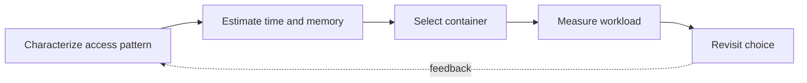

> **Level 3: Advanced** · Topic 1 of 40

[↑ Level index](../README.md) · [Algorithms in Python →](./02-algorithms-in-python.md)

# Data Structures Internals

## Overview
- **What is it?** Python containers are implemented with specialized memory layouts and algorithms: dynamic arrays for `list`, open-addressed hash tables for `dict` and `set`, and compact immutable records for `tuple`.
- **Why is it important?** Knowing those internals explains amortized complexity, ordering, memory cost, hash requirements, and surprising mutation behavior.
- **Where is it used?** Use this knowledge when selecting containers, reviewing hot paths, designing cache keys, or diagnosing memory growth.

## Learning Objectives
- Relate list growth and dictionary hashing to observed time and space complexity.
- Choose containers from workload characteristics rather than surface syntax.
- Recognize hash, equality, aliasing, and mutation hazards in production code.

## Real World Applications
- Low-latency queues, indexes, caches, deduplication sets, and graph adjacency maps.
- Capacity planning for large in-memory datasets and object-heavy services.
- Technical design reviews where asymptotic and constant-factor costs both matter.

## Core Concepts

### Dynamic Arrays and Amortization
- **Definition:** A Python list stores references in a contiguous pointer array and over-allocates when it grows, making most appends O(1) amortized while middle insertion remains O(n).
- **Visual explanation:** `logical items → spare pointer slots → occasional resize-and-copy`
- **Practical example:**

```python
import sys

values: list[int] = []
sizes = []
for number in range(20):
    before = sys.getsizeof(values)
    values.append(number)
    if sys.getsizeof(values) != before:
        sizes.append((len(values), sys.getsizeof(values)))
print(sizes)
```

### Hash Tables and Key Contracts
- **Definition:** Dictionaries locate entries from a key hash and resolve collisions by probing; keys must keep compatible, stable `__hash__` and `__eq__` behavior while stored.
- **Visual explanation:** `hash(key) → probe sequence → equality check → value slot`
- **Practical example:**

```python
from dataclasses import dataclass

@dataclass(frozen=True)
class Coordinate:
    x: int
    y: int

cache = {Coordinate(2, 5): "occupied"}
print(cache[Coordinate(2, 5)])
```

### Views, Aliasing, and Copies
- **Definition:** Assignment aliases a container, shallow copies duplicate only the outer container, and dictionary views remain connected to the source mapping.
- **Visual explanation:** `mapping → live view; shallow copy → shared nested objects`
- **Practical example:**

```python
original = {"roles": ["reader"]}
clone = original.copy()
keys = original.keys()
clone["roles"].append("editor")
original["active"] = True
print(original, list(keys))
```

## Infographic Summary

| Infographic Block | Topic-specific takeaway |
| --- | --- |
| 📌 Concept | Python containers are implemented with specialized memory layouts and algorithms: dynamic arrays for `list`, open-addressed hash tables for `dict` and `set`, and compact immutable records for `tuple`. |
| ⚡ Purpose | Knowing those internals explains amortized complexity, ordering, memory cost, hash requirements, and surprising mutation behavior. |
| 🔥 Benefits | Builds the ability to relate list growth and dictionary hashing to observed time and space complexity; it also helps practitioners choose containers from workload characteristics rather than surface syntax. |
| 🎯 Use Cases | Low-latency queues, indexes, caches, deduplication sets, and graph adjacency maps. Capacity planning for large in-memory datasets and object-heavy services. |
| 🚀 Best Practices | Prefer `deque` for frequent operations at both ends. |
| ❌ Common Mistakes | Ignoring the guardrail “Never mutate state that participates in a stored key's hash”. |

## Syntax Guide

### Basic Syntax

```python
from collections import deque

pending = deque(["a", "b"])
pending.appendleft("urgent")
next_item = pending.popleft()
```

### Standard Structure

```python
from collections import defaultdict

index: defaultdict[str, list[int]] = defaultdict(list)
for position, word in enumerate(["red", "blue", "red"]):
    index[word].append(position)
```

### Code Pattern

```python
from collections.abc import Iterable

def unique_in_order(items: Iterable[str]) -> list[str]:
    return list(dict.fromkeys(items))
```

## Examples

### Beginner Example

```python
values = [8, 3, 8, 1]
unique = set(values)
ordered_unique = list(dict.fromkeys(values))
print(unique, ordered_unique)
```

### Intermediate Example

```python
from collections import Counter

words = "hash tables reward stable hash keys".split()
frequencies = Counter(words)
most_common = frequencies.most_common(2)
print(most_common)
```

### Advanced Example

```python
from collections import deque

graph = {"api": ["cache", "db"], "cache": [], "db": ["disk"], "disk": []}
frontier = deque(["api"])
visited = {"api"}
while frontier:
    node = frontier.popleft()
    for neighbor in graph[node]:
        if neighbor not in visited:
            visited.add(neighbor)
            frontier.append(neighbor)
print(visited)
```

## Workflow Diagram



---

[↑ Level index](../README.md) · [Algorithms in Python →](./02-algorithms-in-python.md)
