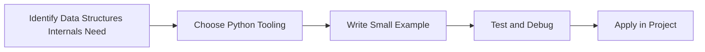

> **Level 3: Advanced** · Topic 1 of 40

[↑ Level index](../README.md) · [Algorithms in Python →](./02-algorithms-in-python.md)

# Data Structures Internals

## Overview
- **What is it?** Data Structures Internals is a Python knowledge area focused on advanced language engineering.
- **Why is it important?** Help developers apply advanced language engineering techniques safely, clearly, and consistently.
- **Where is it used?** Performance-sensitive systems, frameworks, libraries, and technical interviews.

## Learning Objectives
- Gain the practical skill to explain, write, debug, and review data structures internals code.
- Cover the vocabulary, syntax, workflow, edge cases, and professional habits behind data structures internals.
- Expected outcome: you can use data structures internals in a small project and recognize when it belongs in production code.

## Real World Applications
- **Industry use cases:** Performance-sensitive systems, frameworks, libraries, and technical interviews.
- **Business applications:** Reduce manual work, improve reliability, support reporting, automate decisions, and ship maintainable features.
- **Career relevance:** Supports Python developer, backend engineer, data engineer, AI engineer, DevOps engineer, QA automation, and cybersecurity automation roles.

## Core Concepts

### Mental Model
- **Definition:** The main idea that gives data structures internals its structure and purpose inside a Python program.
- **Visual explanation:** `problem -> Data Structures Internals model -> clear code`
- **Practical example:**

```python
apply_data_structures_internals_label = "Data Structures Internals"
print(apply_data_structures_internals_label)
```

### Execution Flow
- **Definition:** The ordered steps Python follows when data structures internals code is created, executed, or integrated.
- **Visual explanation:** `input -> Python operation -> result -> feedback`
- **Practical example:**

```python
profile = {"name": "Lin", "age": 29}
print(profile["name"])
```

### Quality Rule
- **Definition:** The reliability habit that keeps data structures internals understandable, testable, secure, and maintainable.
- **Visual explanation:** `working code -> validation -> production confidence`
- **Practical example:**

```python
inventory = {"laptop": 3, "mouse": 10}
inventory["laptop"] -= 1
print(inventory)
```

## Infographic Summary

| Infographic Block | Key Message |
| --- | --- |
| 📌 Concept | Data Structures Internals belongs to the advanced language engineering part of Python mastery. |
| ⚡ Purpose | Help developers apply advanced language engineering techniques safely, clearly, and consistently. |
| 🔥 Benefits | Stronger maintainability, better reliability, and more professional advanced language engineering decisions. |
| 🎯 Use Cases | Performance-sensitive systems, frameworks, libraries, and technical interviews. |
| 🚀 Best Practices | Prefer readable names, small examples, explicit errors, tests, documentation, and version-aware choices. |
| ❌ Common Mistakes | Copying code without understanding it, ignoring edge cases, skipping validation, and mixing unrelated responsibilities. |

## Syntax Guide

### Basic Syntax

```python
user = {"name": "Ada", "role": "admin"}
print(user["name"])
```

### Standard Structure

```python
def apply_data_structures_internals(value):
    """Apply the Data Structures Internals concept to one value."""
    return value

result = apply_data_structures_internals("practice")
print(result)
```

### Code Pattern

```python
# 1. Identify the Data Structures Internals problem
# 2. Apply the correct Python structure
# 3. Validate the result with tests or output
```

## Examples

### Beginner Example

```python
profile = {"name": "Lin", "age": 29}
print(profile["name"])
```

### Intermediate Example

```python
inventory = {"laptop": 3, "mouse": 10}
inventory["laptop"] -= 1
print(inventory)
```

### Advanced Example

```python
from collections import defaultdict

counts = defaultdict(int)
for word in ["api", "db", "api"]:
    counts[word] += 1
print(dict(counts))
```

## Workflow Diagram




---

---

[↑ Level index](../README.md) · [Algorithms in Python →](./02-algorithms-in-python.md)
