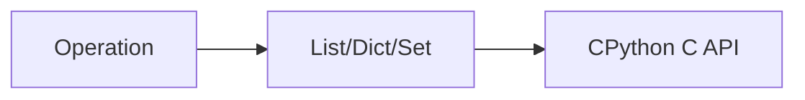

# Data Structures Internals

## Overview

- **What is it?** Data structures internals explain how Python lists, dicts, and sets are implemented.
- **Why is it important?** Understanding internals guides performance and memory decisions.
- **Where is it used?** High-scale services, competitive programming, library authors.

## Learning Objectives

- **Skills gained:** Practical command of Data Structures Internals.
- **Concepts covered:**

- Explain dynamic arrays and hash tables at high level.
- Know amortized costs of list/dict ops.
- Choose structures based on access patterns.

- **Expected outcome:** You reason about Python collection performance accurately.

## Real World Applications

- High-frequency systems
- Database engines
- Game servers
- ML infra

- **Business applications:** Automate workflows, reduce manual errors, accelerate delivery.
- **Career relevance:** Required knowledge for Python roles from junior developer to senior engineer.

## Core Concepts

### Dynamic array

- **Definition:** Lists over-allocate for append.
- **Visual explanation:** `Dynamic array` → process → result
- **Practical example:**

```python
items = []
items.append(1)
print(len(items))
```

### Hash table

- **Definition:** Dicts map keys via hashing.
- **Visual explanation:** `Hash table` → process → result
- **Practical example:**

```python
d = {'a': 1}
print('a' in d)
```

### Load factor

- **Definition:** Dicts resize when crowded.
- **Visual explanation:** `Load factor` → process → result
- **Practical example:**

```python
print(len({i: i for i in range(1000)}))
```

## Infographic Summary

| Block | Summary |
| --- | --- |
| 📌 Concept | CPython collections trade memory for speed with tuned C implementations. |
| ⚡ Purpose | Pick the right structure and avoid hidden costs. |
| 🔥 Benefits | Predictable performance, fewer production surprises. |
| 🎯 Use Cases | Caches, indexes, buffers, queues. |
| 🚀 Best Practices | Use deque for FIFO; set for membership; pre-size when known. |
| ❌ Common Mistakes | Assuming list insert is O(1), using dict as ordered log without need. |

## Syntax Guide

### Basic Syntax

```python
from collections import deque
q = deque([1, 2])
q.append(3)
```

### Standard Structure

```python
analyze access pattern -> pick structure -> benchmark
```

### Code Pattern

```python
needs_membership = True
print('set' if needs_membership else 'list')
```

## Examples

### Beginner Example

```python
from collections import deque
print(deque([1, 2, 3])[0])
```

### Intermediate Example

```python
import sys

small = {}
big = {i: i for i in range(1000)}
print(sys.getsizeof(small) < sys.getsizeof(big))
```

### Advanced Example

```python
from collections import OrderedDict

cache = OrderedDict()
cache['a'] = 1
cache['b'] = 2
cache.move_to_end('a')
print(list(cache.keys()))
```

## Workflow Diagram



---
