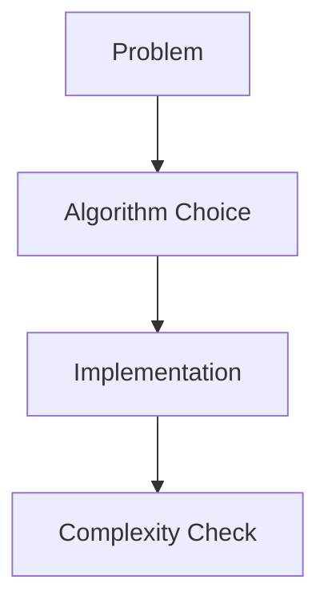

# Algorithms in Python

## Overview

- **What is it?** Algorithms in Python implement classic CS techniques for searching, sorting, and graphs.
- **Why is it important?** Correct algorithms reduce time and memory at scale.
- **Where is it used?** Interviews, data pipelines, routing, recommendation engines.

## Learning Objectives

- **Skills gained:** Practical command of Algorithms in Python.
- **Concepts covered:**

- Implement search and sort algorithms.
- Analyze Big-O complexity.
- Use heapq and bisect when appropriate.

- **Expected outcome:** You choose and implement algorithms suited to problem constraints.

## Real World Applications

- Big tech
- Logistics
- Ads ranking
- Bioinformatics

- **Business applications:** Automate workflows, reduce manual errors, accelerate delivery.
- **Career relevance:** Required knowledge for Python roles from junior developer to senior engineer.

## Core Concepts

### Binary search

- **Definition:** Divide sorted space.
- **Visual explanation:** `Binary search` → process → result
- **Practical example:**

```python
def bs(a, t):
    lo, hi = 0, len(a) - 1
    while lo <= hi:
        mid = (lo + hi) // 2
        if a[mid] == t: return mid
        if a[mid] < t: lo = mid + 1
        else: hi = mid - 1
    return -1
print(bs([1,3,5], 3))
```

### Sorting

- **Definition:** Order elements.
- **Visual explanation:** `Sorting` → process → result
- **Practical example:**

```python
print(sorted([3, 1, 2]))
```

### heapq

- **Definition:** Priority queue heap.
- **Visual explanation:** `heapq` → process → result
- **Practical example:**

```python
import heapq
h = [3, 1, 2]
heapq.heapify(h)
print(heapq.heappop(h))
```

## Infographic Summary

| Block | Summary |
| --- | --- |
| 📌 Concept | Algorithm choice depends on n, constraints, and constants. |
| ⚡ Purpose | Solve problems within time/memory budgets. |
| 🔥 Benefits | Scalability, predictable latency. |
| 🎯 Use Cases | Top-K, scheduling, shortest path, dedupe. |
| 🚀 Best Practices | Use stdlib bisect/heapq; benchmark; document complexity. |
| ❌ Common Mistakes | O(n^2) on large n, wrong assumptions about sorted input. |

## Syntax Guide

### Basic Syntax

```python
import heapq
heapq.heappush(heap, item)
```

### Standard Structure

```python
model problem -> choose algo -> implement -> test edge cases
```

### Code Pattern

```python
import heapq
h = [3, 1, 2]
heapq.heapify(h)
print(heapq.heappop(h))
```

## Examples

### Beginner Example

```python
print(sorted(['b', 'a', 'c']))
```

### Intermediate Example

```python
import bisect

nums = [1, 3, 5, 7]
print(bisect.bisect_left(nums, 5))
```

### Advanced Example

```python
from collections import deque


def bfs(graph, start):
    seen = {start}
    queue = deque([start])
    order = []
    while queue:
        node = queue.popleft()
        order.append(node)
        for nei in graph.get(node, []):
            if nei not in seen:
                seen.add(nei)
                queue.append(nei)
    return order


print(bfs({'A': ['B'], 'B': ['C']}, 'A'))
```

## Workflow Diagram



---
