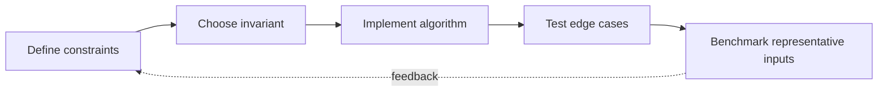

> **Level 3: Advanced** · Topic 2 of 40

[← Data Structures Internals](./01-data-structures-internals.md) · [↑ Level index](../README.md) · [Design Patterns →](./03-design-patterns.md)

# Algorithms in Python

## Overview
- **What is it?** Algorithm engineering in Python combines complexity analysis with language-aware choices such as built-in C implementations, iterators, and appropriate data structures.
- **Why is it important?** A correct algorithm can still fail operationally if its memory growth, recursion depth, or constant factors do not match the input distribution.
- **Where is it used?** It is used in search, scheduling, routing, ranking, parsing, and data-processing pipelines.

## Learning Objectives
- State time and auxiliary-space complexity for common algorithmic strategies.
- Use `bisect`, `heapq`, memoization, and graph traversal idiomatically.
- Test invariants and boundary cases instead of relying on happy-path examples.

## Real World Applications
- Shortest-route calculation, top-k ranking, interval scheduling, and dependency resolution.
- Efficient lookup and aggregation over datasets too large for naive nested loops.
- Interview problem solving that translates into maintainable production implementations.

## Core Concepts

### Complexity as a Growth Model
- **Definition:** Big-O describes how resource use scales with input size; Python implementations also account for object allocation, hashing, and optimized built-ins.
- **Visual explanation:** `input size n → operation count f(n) → feasible latency and memory`
- **Practical example:**

```python
def contains_duplicate(values: list[int]) -> bool:
    seen: set[int] = set()
    for value in values:
        if value in seen:
            return True
        seen.add(value)
    return False
```

### Greedy and Heap Invariants
- **Definition:** A heap exposes the smallest item while preserving a partial-order invariant, enabling O(log n) priority updates without fully sorting every step.
- **Visual explanation:** `candidates → heap invariant → extract best → add successors`
- **Practical example:**

```python
import heapq

jobs = [(4, "report"), (1, "alert"), (3, "backup")]
heapq.heapify(jobs)
while jobs:
    priority, name = heapq.heappop(jobs)
    print(priority, name)
```

### Dynamic Programming
- **Definition:** Dynamic programming stores overlapping subproblem results and builds a solution from a recurrence with explicit base cases.
- **Visual explanation:** `state + recurrence → memoized subproblems → optimal result`
- **Practical example:**

```python
from functools import cache

@cache
def ways(steps: int) -> int:
    if steps < 0:
        return 0
    if steps == 0:
        return 1
    return ways(steps - 1) + ways(steps - 2)
```

## Infographic Summary

| Infographic Block | Topic-specific takeaway |
| --- | --- |
| 📌 Concept | Algorithm engineering in Python combines complexity analysis with language-aware choices such as built-in C implementations, iterators, and appropriate data structures. |
| ⚡ Purpose | A correct algorithm can still fail operationally if its memory growth, recursion depth, or constant factors do not match the input distribution. |
| 🔥 Benefits | Builds the ability to state time and auxiliary-space complexity for common algorithmic strategies; it also helps practitioners use `bisect`, `heapq`, memoization, and graph traversal idiomatically. |
| 🎯 Use Cases | Shortest-route calculation, top-k ranking, interval scheduling, and dependency resolution. Efficient lookup and aggregation over datasets too large for naive nested loops. |
| 🚀 Best Practices | Validate empty, singleton, duplicate, and worst-shaped inputs. |
| ❌ Common Mistakes | Ignoring the guardrail “Prefer a simpler O(n log n) solution until constraints justify complexity”. |

## Syntax Guide

### Basic Syntax

```python
from bisect import bisect_left

values = [2, 5, 9, 14]
index = bisect_left(values, 9)
found = index < len(values) and values[index] == 9
```

### Standard Structure

```python
import heapq

def smallest_three(values: list[int]) -> list[int]:
    return heapq.nsmallest(3, values)
```

### Code Pattern

```python
def binary_search(values: list[int], target: int) -> int | None:
    low, high = 0, len(values)
    while low < high:
        middle = (low + high) // 2
        if values[middle] < target:
            low = middle + 1
        else:
            high = middle
    return low if low < len(values) and values[low] == target else None
```

## Examples

### Beginner Example

```python
from bisect import insort

scores = [10, 30, 50]
insort(scores, 40)
print(scores)
```

### Intermediate Example

```python
from collections import deque

graph = {"A": ["B", "C"], "B": ["D"], "C": ["D"], "D": []}
queue = deque([("A", 0)])
seen = {"A"}
while queue:
    node, distance = queue.popleft()
    print(node, distance)
    for neighbor in graph[node]:
        if neighbor not in seen:
            seen.add(neighbor)
            queue.append((neighbor, distance + 1))
```

### Advanced Example

```python
import heapq
import math

graph = {"A": [("B", 2), ("C", 5)], "B": [("C", 1)], "C": []}
distances = {node: math.inf for node in graph}
distances["A"] = 0
frontier = [(0, "A")]
while frontier:
    distance, node = heapq.heappop(frontier)
    if distance != distances[node]:
        continue
    for neighbor, weight in graph[node]:
        candidate = distance + weight
        if candidate < distances[neighbor]:
            distances[neighbor] = candidate
            heapq.heappush(frontier, (candidate, neighbor))
print(distances)
```

## Workflow Diagram



---

[← Data Structures Internals](./01-data-structures-internals.md) · [↑ Level index](../README.md) · [Design Patterns →](./03-design-patterns.md)
