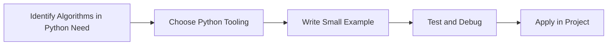

> **Level 3: Advanced** · Topic 2 of 40

[← Data Structures Internals](./01-data-structures-internals.md) · [↑ Level index](../README.md) · [Design Patterns →](./03-design-patterns.md)

# Algorithms in Python

## Overview
- **What is it?** Algorithms in Python is a Python knowledge area focused on advanced language engineering.
- **Why is it important?** Help developers apply advanced language engineering techniques safely, clearly, and consistently.
- **Where is it used?** Performance-sensitive systems, frameworks, libraries, and technical interviews.

## Learning Objectives
- Gain the practical skill to explain, write, debug, and review algorithms in python code.
- Cover the vocabulary, syntax, workflow, edge cases, and professional habits behind algorithms in python.
- Expected outcome: you can use algorithms in python in a small project and recognize when it belongs in production code.

## Real World Applications
- **Industry use cases:** Performance-sensitive systems, frameworks, libraries, and technical interviews.
- **Business applications:** Reduce manual work, improve reliability, support reporting, automate decisions, and ship maintainable features.
- **Career relevance:** Supports Python developer, backend engineer, data engineer, AI engineer, DevOps engineer, QA automation, and cybersecurity automation roles.

## Core Concepts

### Mental Model
- **Definition:** The main idea that gives algorithms in python its structure and purpose inside a Python program.
- **Visual explanation:** `problem -> Algorithms in Python model -> clear code`
- **Practical example:**

```python
apply_algorithms_in_python_label = "Algorithms in Python"
print(apply_algorithms_in_python_label)
```

### Execution Flow
- **Definition:** The ordered steps Python follows when algorithms in python code is created, executed, or integrated.
- **Visual explanation:** `input -> Python operation -> result -> feedback`
- **Practical example:**

```python
def greet(name):
    print(f"Hello, {name}")

greet("Ada")
```

### Quality Rule
- **Definition:** The reliability habit that keeps algorithms in python understandable, testable, secure, and maintainable.
- **Visual explanation:** `working code -> validation -> production confidence`
- **Practical example:**

```python
def calculate_total(subtotal: float, tax_rate: float = 0.08) -> float:
    return subtotal * (1 + tax_rate)

print(calculate_total(100))
```

## Infographic Summary

| Infographic Block | Key Message |
| --- | --- |
| 📌 Concept | Algorithms in Python belongs to the advanced language engineering part of Python mastery. |
| ⚡ Purpose | Help developers apply advanced language engineering techniques safely, clearly, and consistently. |
| 🔥 Benefits | Stronger maintainability, better reliability, and more professional advanced language engineering decisions. |
| 🎯 Use Cases | Performance-sensitive systems, frameworks, libraries, and technical interviews. |
| 🚀 Best Practices | Prefer readable names, small examples, explicit errors, tests, documentation, and version-aware choices. |
| ❌ Common Mistakes | Copying code without understanding it, ignoring edge cases, skipping validation, and mixing unrelated responsibilities. |

## Syntax Guide

### Basic Syntax

```python
def add(left, right):
    return left + right
```

### Standard Structure

```python
def apply_algorithms_in_python(value):
    """Apply the Algorithms in Python concept to one value."""
    return value

result = apply_algorithms_in_python("practice")
print(result)
```

### Code Pattern

```python
# 1. Identify the Algorithms in Python problem
# 2. Apply the correct Python structure
# 3. Validate the result with tests or output
```

## Examples

### Beginner Example

```python
def greet(name):
    print(f"Hello, {name}")

greet("Ada")
```

### Intermediate Example

```python
def calculate_total(subtotal: float, tax_rate: float = 0.08) -> float:
    return subtotal * (1 + tax_rate)

print(calculate_total(100))
```

### Advanced Example

```python
from functools import lru_cache

@lru_cache(maxsize=128)
def fibonacci(n: int) -> int:
    return n if n < 2 else fibonacci(n - 1) + fibonacci(n - 2)

print(fibonacci(10))
```

## Workflow Diagram




---

---

[← Data Structures Internals](./01-data-structures-internals.md) · [↑ Level index](../README.md) · [Design Patterns →](./03-design-patterns.md)
