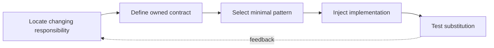

> **Level 3: Advanced** · Topic 3 of 40

[← Algorithms in Python](./02-algorithms-in-python.md) · [↑ Level index](../README.md) · [SOLID Principles →](./04-solid-principles.md)

# Design Patterns

## Overview
- **What is it?** Design patterns are named, reusable arrangements of responsibilities and object collaboration, not code templates to copy mechanically.
- **Why is it important?** In Python, functions, protocols, decorators, context managers, and modules often express patterns more directly than class-heavy translations.
- **Where is it used?** Patterns help evolve libraries, integrations, and business workflows while keeping variation behind stable boundaries.

## Learning Objectives
- Recognize Strategy, Factory, Observer, Adapter, and dependency-injection structures.
- Use Python's first-class functions and structural typing to keep patterns lightweight.
- Distinguish justified extensibility from speculative abstraction.

## Real World Applications
- Pluggable payment rules, serializers, notification channels, and storage adapters.
- Framework extension points whose callers depend on stable contracts.
- Testing systems by substituting collaborators at explicit boundaries.

## Core Concepts

### Strategy as Behavior
- **Definition:** Strategy moves a varying algorithm behind a common callable contract so clients select behavior without branching on concrete types.
- **Visual explanation:** `client → strategy contract → interchangeable algorithm`
- **Practical example:**

```python
from collections.abc import Callable

Discount = Callable[[float], float]

def checkout(total: float, discount: Discount) -> float:
    return discount(total)

print(checkout(100.0, lambda amount: amount * 0.9))
```

### Factory and Registration
- **Definition:** A factory centralizes construction while a registry lets new implementations be added without modifying every caller.
- **Visual explanation:** `configuration → registry lookup → constructed implementation`
- **Practical example:**

```python
exporters: dict[str, type] = {}

def register(name: str):
    def decorate(cls: type) -> type:
        exporters[name] = cls
        return cls
    return decorate

@register("json")
class JsonExporter:
    pass
```

### Adapter Boundaries
- **Definition:** An adapter translates a third-party or legacy interface into the application-owned protocol, containing change and simplifying tests.
- **Visual explanation:** `domain call → adapter → external API shape`
- **Practical example:**

```python
from typing import Protocol

class Sender(Protocol):
    def send(self, message: str) -> None: ...

class LegacyAdapter:
    def __init__(self, legacy_client: object) -> None:
        self.client = legacy_client

    def send(self, message: str) -> None:
        getattr(self.client, "deliver")(payload=message)
```

## Infographic Summary

| Infographic Block | Topic-specific takeaway |
| --- | --- |
| 📌 Concept | Design patterns are named, reusable arrangements of responsibilities and object collaboration, not code templates to copy mechanically. |
| ⚡ Purpose | In Python, functions, protocols, decorators, context managers, and modules often express patterns more directly than class-heavy translations. |
| 🔥 Benefits | Builds the ability to recognize Strategy, Factory, Observer, Adapter, and dependency-injection structures; it also helps practitioners use Python's first-class functions and structural typing to keep patterns lightweight. |
| 🎯 Use Cases | Pluggable payment rules, serializers, notification channels, and storage adapters. Framework extension points whose callers depend on stable contracts. |
| 🚀 Best Practices | Protocol-based contracts reduce unnecessary inheritance. |
| ❌ Common Mistakes | Ignoring the guardrail “Introduce a pattern only when it removes observed coupling”. |

## Syntax Guide

### Basic Syntax

```python
from typing import Protocol

class Formatter(Protocol):
    def format(self, value: object) -> str: ...
```

### Standard Structure

```python
class Service:
    def __init__(self, formatter: "Formatter") -> None:
        self.formatter = formatter

    def render(self, value: object) -> str:
        return self.formatter.format(value)
```

### Code Pattern

```python
from collections.abc import Callable

handlers: dict[str, Callable[[object], None]] = {}

def handler(event: str):
    def register(function: Callable[[object], None]) -> Callable[[object], None]:
        handlers[event] = function
        return function
    return register
```

## Examples

### Beginner Example

```python
def upper(value: str) -> str:
    return value.upper()

transform = upper
print(transform("pattern"))
```

### Intermediate Example

```python
class CsvFormatter:
    def format(self, value: object) -> str:
        return f'"{value}"'

service = Service(CsvFormatter())
print(service.render("Ada"))
```

### Advanced Example

```python
from collections import defaultdict
from collections.abc import Callable

class EventBus:
    def __init__(self) -> None:
        self._subscribers: defaultdict[str, list[Callable[[object], None]]] = defaultdict(list)

    def subscribe(self, event: str, callback: Callable[[object], None]) -> None:
        self._subscribers[event].append(callback)

    def publish(self, event: str, payload: object) -> None:
        for callback in tuple(self._subscribers[event]):
            callback(payload)

bus = EventBus()
bus.subscribe("created", lambda payload: print("audit", payload))
bus.publish("created", {"id": 7})
```

## Workflow Diagram



---

[← Algorithms in Python](./02-algorithms-in-python.md) · [↑ Level index](../README.md) · [SOLID Principles →](./04-solid-principles.md)
