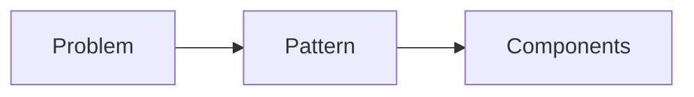

# Design Patterns

## Overview

- **What is it?** Design patterns are reusable solutions to common software design problems.
- **Why is it important?** Shared vocabulary speeds design discussions and avoids reinventing wheels.
- **Where is it used?** Enterprise apps, frameworks, large teams, maintainability-focused code.

## Learning Objectives

- **Skills gained:** Practical command of Design Patterns.
- **Concepts covered:**

- Apply factory, strategy, observer, and adapter patterns.
- Map patterns to Python idioms.
- Avoid pattern overuse.

- **Expected outcome:** You structure code with proven design patterns when they fit.

## Real World Applications

- Enterprise Java/Python shops
- SDK design
- Plugin architectures
- Games

- **Business applications:** Automate workflows, reduce manual errors, accelerate delivery.
- **Career relevance:** Required knowledge for Python roles from junior developer to senior engineer.

## Core Concepts

### Strategy

- **Definition:** Interchangeable algorithms.
- **Visual explanation:** `Strategy` → process → result
- **Practical example:**

```python
class Add:
    def apply(self, a, b):
        return a + b
print(Add().apply(2, 3))
```

### Factory

- **Definition:** Centralize object creation.
- **Visual explanation:** `Factory` → process → result
- **Practical example:**

```python
def user_factory(kind):
    return {'admin': dict(role='admin'), 'guest': dict(role='guest')}[kind]
print(user_factory('admin'))
```

### Observer

- **Definition:** Publish/subscribe.
- **Visual explanation:** `Observer` → process → result
- **Practical example:**

```python
class Bus:
    def __init__(self):
        self.listeners = []
    def subscribe(self, fn):
        self.listeners.append(fn)
    def emit(self, msg):
        for fn in self.listeners:
            fn(msg)
b = Bus()
b.subscribe(lambda m: None)
b.emit('hi')
```

## Infographic Summary

| Block | Summary |
| --- | --- |
| 📌 Concept | Patterns name recurring structure, not copy-paste code. |
| ⚡ Purpose | Improve flexibility and maintainability. |
| 🔥 Benefits | Team communication, extensibility. |
| 🎯 Use Cases | Payment strategies, notification bus, adapters for legacy APIs. |
| 🚀 Best Practices | Prefer simplicity; use patterns with clear pain point. |
| ❌ Common Mistakes | Pattern obsession, unnecessary abstraction layers. |

## Syntax Guide

### Basic Syntax

```python
class Strategy:
    def apply(self, value):
        return value


print(Strategy().apply(1))
```

### Standard Structure

```python
identify variation -> encapsulate -> compose
```

### Code Pattern

```python
context.set_strategy(concrete_strategy)
```

## Examples

### Beginner Example

```python
class Greeter:
    def greet(self, name):
        return f'Hello, {name}'


print(Greeter().greet('Ada'))
```

### Intermediate Example

```python
class Logger:
    def log(self, msg: str) -> None:
        print(msg)


class Service:
    def __init__(self, logger: Logger):
        self.logger = logger

    def run(self):
        self.logger.log('running')


Service(Logger()).run()
```

### Advanced Example

```python
from typing import Callable


class EventEmitter:
    def __init__(self):
        self._handlers: dict[str, list[Callable]] = {}

    def on(self, event: str, handler: Callable) -> None:
        self._handlers.setdefault(event, []).append(handler)

    def emit(self, event: str, payload):
        for handler in self._handlers.get(event, []):
            handler(payload)


bus = EventEmitter()
bus.on('created', lambda p: print('event', p))
bus.emit('created', {'id': 1})
```

## Workflow Diagram



---
