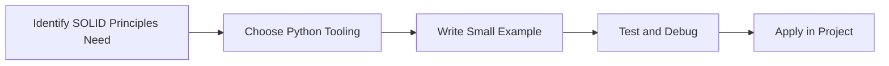

> **Level 3: Advanced** · Topic 4 of 40

[← Design Patterns](./03-design-patterns.md) · [↑ Level index](../README.md) · [Memory Management →](./05-memory-management.md)

# SOLID Principles

## Overview
- **What is it?** SOLID Principles is a Python knowledge area focused on advanced language engineering.
- **Why is it important?** Help developers apply advanced language engineering techniques safely, clearly, and consistently.
- **Where is it used?** Performance-sensitive systems, frameworks, libraries, and technical interviews.

## Learning Objectives
- Gain the practical skill to explain, write, debug, and review solid principles code.
- Cover the vocabulary, syntax, workflow, edge cases, and professional habits behind solid principles.
- Expected outcome: you can use solid principles in a small project and recognize when it belongs in production code.

## Real World Applications
- **Industry use cases:** Performance-sensitive systems, frameworks, libraries, and technical interviews.
- **Business applications:** Reduce manual work, improve reliability, support reporting, automate decisions, and ship maintainable features.
- **Career relevance:** Supports Python developer, backend engineer, data engineer, AI engineer, DevOps engineer, QA automation, and cybersecurity automation roles.

## Core Concepts

### Model
- **Definition:** The main idea that gives solid principles its structure and purpose inside a Python program.
- **Visual explanation:** `problem -> SOLID Principles model -> clear code`
- **Practical example:**

```python
apply_solid_principles_label = "SOLID Principles"
print(apply_solid_principles_label)
```

### Interface
- **Definition:** The ordered steps Python follows when solid principles code is created, executed, or integrated.
- **Visual explanation:** `input -> Python operation -> result -> feedback`
- **Practical example:**

```python
class Dog:
    def speak(self):
        return "woof"

print(Dog().speak())
```

### Behavior Rule
- **Definition:** The reliability habit that keeps solid principles understandable, testable, secure, and maintainable.
- **Visual explanation:** `working code -> validation -> production confidence`
- **Practical example:**

```python
class Account:
    def __init__(self, balance: float = 0):
        self.balance = balance

    def deposit(self, amount: float) -> None:
        self.balance += amount

account = Account()
account.deposit(50)
print(account.balance)
```

## Infographic Summary

| Infographic Block | Key Message |
| --- | --- |
| 📌 Concept | SOLID Principles belongs to the advanced language engineering part of Python mastery. |
| ⚡ Purpose | Help developers apply advanced language engineering techniques safely, clearly, and consistently. |
| 🔥 Benefits | Stronger maintainability, better reliability, and more professional advanced language engineering decisions. |
| 🎯 Use Cases | Performance-sensitive systems, frameworks, libraries, and technical interviews. |
| 🚀 Best Practices | Prefer readable names, small examples, explicit errors, tests, documentation, and version-aware choices. |
| ❌ Common Mistakes | Copying code without understanding it, ignoring edge cases, skipping validation, and mixing unrelated responsibilities. |

## Syntax Guide

### Basic Syntax

```python
class Customer:
    def __init__(self, name):
        self.name = name
```

### Standard Structure

```python
def apply_solid_principles(value):
    """Apply the SOLID Principles concept to one value."""
    return value

result = apply_solid_principles("practice")
print(result)
```

### Code Pattern

```python
# 1. Identify the SOLID Principles problem
# 2. Apply the correct Python structure
# 3. Validate the result with tests or output
```

## Examples

### Beginner Example

```python
class Dog:
    def speak(self):
        return "woof"

print(Dog().speak())
```

### Intermediate Example

```python
class Account:
    def __init__(self, balance: float = 0):
        self.balance = balance

    def deposit(self, amount: float) -> None:
        self.balance += amount

account = Account()
account.deposit(50)
print(account.balance)
```

### Advanced Example

```python
from dataclasses import dataclass

@dataclass
class Order:
    id: int
    total: float

    def is_large(self) -> bool:
        return self.total >= 1000

print(Order(1, 1200).is_large())
```

## Workflow Diagram




---

---

[← Design Patterns](./03-design-patterns.md) · [↑ Level index](../README.md) · [Memory Management →](./05-memory-management.md)
