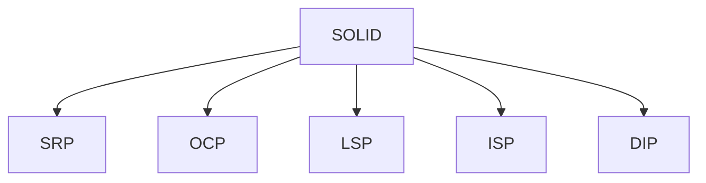

# SOLID Principles

## Overview

- **What is it?** SOLID principles guide object-oriented design for maintainable systems.
- **Why is it important?** They reduce coupling and make change safer in large codebases.
- **Where is it used?** Enterprise services, domain-driven design, long-lived products.

## Learning Objectives

- **Skills gained:** Practical command of SOLID Principles.
- **Concepts covered:**

- Explain SRP, OCP, LSP, ISP, DIP.
- Recognize violations in Python code.
- Refactor toward SOLID incrementally.

- **Expected outcome:** You evaluate designs using SOLID as a checklist.

## Real World Applications

- Enterprise software
- Banking platforms
- Healthcare systems
- B2B SaaS

- **Business applications:** Automate workflows, reduce manual errors, accelerate delivery.
- **Career relevance:** Required knowledge for Python roles from junior developer to senior engineer.

## Core Concepts

### SRP

- **Definition:** One reason to change per class.
- **Visual explanation:** `SRP` → process → result
- **Practical example:**

```python
class ReportWriter:
    def write(self, text):
        return text.upper()
print(ReportWriter().write('a'))
```

### OCP

- **Definition:** Open for extension, closed for modification.
- **Visual explanation:** `OCP` → process → result
- **Practical example:**

```python
class Tax:
    def rate(self):
        return 0.1
class ReducedTax(Tax):
    def rate(self):
        return 0.05
print(ReducedTax().rate())
```

### DIP

- **Definition:** Depend on abstractions.
- **Visual explanation:** `DIP` → process → result
- **Practical example:**

```python
class Repo:
    def save(self, data):
        return data
class Service:
    def __init__(self, repo: Repo):
        self.repo = repo
print(Service(Repo()).repo.save(1))
```

## Infographic Summary

| Block | Summary |
| --- | --- |
| 📌 Concept | SOLID favors composable, testable modules. |
| ⚡ Purpose | Manage complexity as systems grow. |
| 🔥 Benefits | Easier testing, safer refactors, clearer boundaries. |
| 🎯 Use Cases | Plugin systems, policy engines, multi-tenant apps. |
| 🚀 Best Practices | Small classes; inject dependencies; program to interfaces. |
| ❌ Common Mistakes | God objects, concrete imports everywhere, inheritance abuse. |

## Syntax Guide

### Basic Syntax

```python
# depend on Protocol/ABC interfaces, not concrete classes
```

### Standard Structure

```python
define abstraction -> implement -> inject
```

### Code Pattern

```python
class Service:
    def __init__(self, repo):
        self.repo = repo


print(Service(repo=object()))
```

## Examples

### Beginner Example

```python
class Formatter:
    def fmt(self, x):
        return str(x)
print(Formatter().fmt(1))
```

### Intermediate Example

```python
from typing import Protocol


class Notifier(Protocol):
    def send(self, message: str) -> None: ...


class EmailNotifier:
    def send(self, message: str) -> None:
        print(message)


def notify(user: str, notifier: Notifier) -> None:
    notifier.send(f'hello {user}')


notify('Ada', EmailNotifier())
```

### Advanced Example

```python
class DiscountPolicy:
    def discount(self, total: float) -> float:
        return total


class VIPDiscount(DiscountPolicy):
    def discount(self, total: float) -> float:
        return total * 0.9


class Checkout:
    def __init__(self, policy: DiscountPolicy):
        self.policy = policy

    def total(self, amount: float) -> float:
        return self.policy.discount(amount)


print(Checkout(VIPDiscount()).total(100))
```

## Workflow Diagram



---
