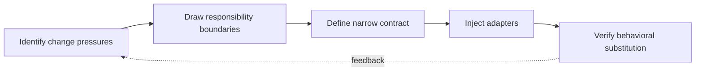

> **Level 3: Advanced** · Topic 4 of 40

[← Design Patterns](./03-design-patterns.md) · [↑ Level index](../README.md) · [Memory Management →](./05-memory-management.md)

# SOLID Principles

## Overview
- **What is it?** SOLID is a set of design heuristics for managing reasons to change, extension, substitutability, interface size, and dependency direction.
- **Why is it important?** The principles guide trade-offs rather than requiring one class per action; Python protocols and composition keep boundaries small.
- **Where is it used?** They are useful in long-lived services, libraries, and integrations where policy changes independently from infrastructure.

## Learning Objectives
- Apply each SOLID principle to concrete Python module and object boundaries.
- Use protocols and dependency injection to reverse dependencies.
- Detect violations through change friction, broad interfaces, and unsafe substitution.

## Real World Applications
- Separating invoice policy from persistence and delivery infrastructure.
- Adding integrations without editing stable domain decision code.
- Constructing testable services with small, substitutable collaborators.

## Core Concepts

### Single Responsibility and Cohesion
- **Definition:** A component should have one coherent reason to change; calculation, persistence, and presentation usually evolve under different pressures.
- **Visual explanation:** `domain policy | storage policy | presentation policy`
- **Practical example:**

```python
def invoice_total(lines: list[tuple[int, float]]) -> float:
    return sum(quantity * price for quantity, price in lines)

def render_total(total: float) -> str:
    return f"${total:,.2f}"
```

### Open/Closed and Substitution
- **Definition:** Stable callers should accept new behavior through a contract, and every implementation must preserve that contract's inputs, outputs, and failure semantics.
- **Visual explanation:** `caller → stable protocol → old or new implementation`
- **Practical example:**

```python
from typing import Protocol

class TaxPolicy(Protocol):
    def tax(self, subtotal: float) -> float: ...

class FlatTax:
    def tax(self, subtotal: float) -> float:
        return subtotal * 0.2
```

### Dependency Inversion
- **Definition:** High-level policy owns an abstraction and receives infrastructure implementations rather than importing concrete databases or gateways directly.
- **Visual explanation:** `high-level use case → owned port ← infrastructure adapter`
- **Practical example:**

```python
from typing import Protocol

class AuditLog(Protocol):
    def record(self, message: str) -> None: ...

def approve(order_id: str, audit: AuditLog) -> None:
    audit.record(f"approved:{order_id}")
```

## Infographic Summary

| Infographic Block | Topic-specific takeaway |
| --- | --- |
| 📌 Concept | SOLID is a set of design heuristics for managing reasons to change, extension, substitutability, interface size, and dependency direction. |
| ⚡ Purpose | The principles guide trade-offs rather than requiring one class per action; Python protocols and composition keep boundaries small. |
| 🔥 Benefits | Builds the ability to apply each SOLID principle to concrete Python module and object boundaries; it also helps practitioners use protocols and dependency injection to reverse dependencies. |
| 🎯 Use Cases | Separating invoice policy from persistence and delivery infrastructure. Adding integrations without editing stable domain decision code. |
| 🚀 Best Practices | D: policy owns abstractions; infrastructure plugs in. |
| ❌ Common Mistakes | Ignoring the guardrail “Watch for pass-through classes that add ceremony without isolation”. |

## Syntax Guide

### Basic Syntax

```python
from typing import Protocol

class Reader(Protocol):
    def read(self, key: str) -> bytes: ...
```

### Standard Structure

```python
class ReportService:
    def __init__(self, reader: "Reader") -> None:
        self._reader = reader

    def load(self, key: str) -> bytes:
        return self._reader.read(key)
```

### Code Pattern

```python
class MemoryReader:
    def __init__(self, values: dict[str, bytes]) -> None:
        self._values = values

    def read(self, key: str) -> bytes:
        return self._values[key]
```

## Examples

### Beginner Example

```python
def shipping(weight: float, rate: float) -> float:
    if weight < 0:
        raise ValueError("weight must be nonnegative")
    return weight * rate
```

### Intermediate Example

```python
from typing import Protocol

class TaxPolicy(Protocol):
    def tax(self, subtotal: float) -> float: ...

class PercentageTax:
    def __init__(self, rate: float) -> None:
        self.rate = rate

    def tax(self, subtotal: float) -> float:
        return subtotal * self.rate

policy: TaxPolicy = PercentageTax(0.075)
print(policy.tax(200.0))
```

### Advanced Example

```python
from typing import Protocol

class AuditLog(Protocol):
    def record(self, message: str) -> None: ...

def approve(order_id: str, audit: AuditLog) -> None:
    audit.record(f"approved:{order_id}")

class MemoryAudit:
    def __init__(self) -> None:
        self.events: list[str] = []

    def record(self, message: str) -> None:
        self.events.append(message)

audit = MemoryAudit()
approve("A-42", audit)
assert audit.events == ["approved:A-42"]
```

## Workflow Diagram



---

[← Design Patterns](./03-design-patterns.md) · [↑ Level index](../README.md) · [Memory Management →](./05-memory-management.md)
