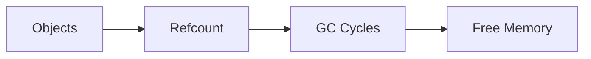

# Memory Management

## Overview

- **What is it?** Memory management covers how Python allocates, uses, and releases object memory.
- **Why is it important?** Memory leaks and bloat cause crashes and cost in production.
- **Where is it used?** Long-running services, data processing, ML training, embedded Python.

## Learning Objectives

- **Skills gained:** Practical command of Memory Management.
- **Concepts covered:**

- Understand object sizes and references.
- Use sys.getsizeof and tracemalloc.
- Break reference cycles thoughtfully.

- **Expected outcome:** You diagnose and reduce memory usage in Python programs.

## Real World Applications

- Streaming ETL
- Web workers
- Scientific computing
- Ad tech

- **Business applications:** Automate workflows, reduce manual errors, accelerate delivery.
- **Career relevance:** Required knowledge for Python roles from junior developer to senior engineer.

## Core Concepts

### References

- **Definition:** Names point to objects.
- **Visual explanation:** `References` → process → result
- **Practical example:**

```python
import sys
a = []
b = a
print(sys.getrefcount(a) > 1)
```

### getsizeof

- **Definition:** Shallow object size.
- **Visual explanation:** `getsizeof` → process → result
- **Practical example:**

```python
import sys
print(sys.getsizeof([]))
```

### tracemalloc

- **Definition:** Track allocations.
- **Visual explanation:** `tracemalloc` → process → result
- **Practical example:**

```python
import tracemalloc
tracemalloc.start()
x = [0] * 1000
print(tracemalloc.get_traced_memory()[0] > 0)
```

## Infographic Summary

| Block | Summary |
| --- | --- |
| 📌 Concept | CPython uses reference counting plus cyclic GC. |
| ⚡ Purpose | Use memory efficiently and avoid leaks. |
| 🔥 Benefits | Stability, lower cloud bills, faster caches. |
| 🎯 Use Cases | Batch jobs, caches, image/audio buffers. |
| 🚀 Best Practices | Profile before optimizing; use generators; weakref caches. |
| ❌ Common Mistakes | Global caches without bounds, circular refs with __del__, huge lists. |

## Syntax Guide

### Basic Syntax

```python
import sys
sys.getsizeof(obj)
```

### Standard Structure

```python
measure -> identify hotspots -> reduce retention
```

### Code Pattern

```python
for chunk in read_chunks(): process(chunk)
```

## Examples

### Beginner Example

```python
import sys
print(sys.getsizeof('hello'))
```

### Intermediate Example

```python
import tracemalloc

tracemalloc.start()
data = bytearray(10_000)
current, peak = tracemalloc.get_traced_memory()
tracemalloc.stop()
print(peak > current)
```

### Advanced Example

```python
import gc

gc.set_threshold(700, 10, 10)
objects = [{} for _ in range(100)]
del objects
print(gc.collect() >= 0)
```

## Workflow Diagram



---
