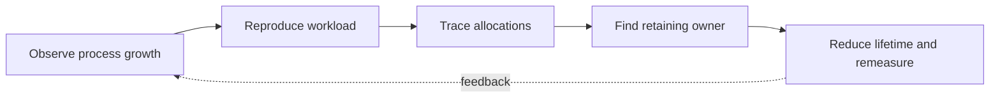

> **Level 3: Advanced** · Topic 5 of 40

[← SOLID Principles](./04-solid-principles.md) · [↑ Level index](../README.md) · [Garbage Collection →](./06-garbage-collection.md)

# Memory Management

## Overview
- **What is it?** CPython manages object lifetimes primarily with reference counting, supplements it with cyclic garbage collection, and allocates small objects through private arenas.
- **Why is it important?** Memory behavior matters because retaining one reference can keep an entire object graph alive even when CPU work appears complete.
- **Where is it used?** Use memory diagnostics in long-running services, data pipelines, caches, and extension-heavy applications.

## Learning Objectives
- Explain references, identity, shallow size, and object lifetime in CPython.
- Use weak references and bounded ownership where retention is undesirable.
- Measure allocation traces before changing representations or pooling objects.

## Real World Applications
- Finding request objects retained by global caches or callbacks.
- Reducing peak memory in batch pipelines through streaming and compact records.
- Designing caches that do not accidentally become permanent ownership graphs.

## Core Concepts

### Reference Ownership
- **Definition:** Names and containers hold references, not embedded objects; an object remains reachable while any strong reference path leads to it.
- **Visual explanation:** `roots → strong references → reachable object graph`
- **Practical example:**

```python
import sys

payload = {"items": [1, 2, 3]}
alias = payload
print(payload is alias)
print(sys.getrefcount(payload))
```

### Weak References
- **Definition:** A weak reference observes an object without extending its lifetime and is useful for caches, registries, and back-references.
- **Visual explanation:** `owner → object ← weak observer; remove owner → observer returns None`
- **Practical example:**

```python
import weakref

class Session:
    pass

session = Session()
observed = weakref.ref(session)
assert observed() is session
del session
assert observed() is None
```

### Allocation Tracing
- **Definition:** `tracemalloc` records Python allocation stacks and compares snapshots, revealing where retained Python-managed memory was created.
- **Visual explanation:** `start tracing → exercise workload → snapshot diff → owning line`
- **Practical example:**

```python
import tracemalloc

tracemalloc.start()
before = tracemalloc.take_snapshot()
data = [bytearray(1024) for _ in range(50)]
after = tracemalloc.take_snapshot()
print(after.compare_to(before, "lineno")[:1])
```

## Infographic Summary

| Infographic Block | Topic-specific takeaway |
| --- | --- |
| 📌 Concept | CPython manages object lifetimes primarily with reference counting, supplements it with cyclic garbage collection, and allocates small objects through private arenas. |
| ⚡ Purpose | Memory behavior matters because retaining one reference can keep an entire object graph alive even when CPU work appears complete. |
| 🔥 Benefits | Builds the ability to explain references, identity, shallow size, and object lifetime in CPython; it also helps practitioners use weak references and bounded ownership where retention is undesirable. |
| 🎯 Use Cases | Finding request objects retained by global caches or callbacks. Reducing peak memory in batch pipelines through streaming and compact records. |
| 🚀 Best Practices | `tracemalloc` attributes Python allocations to source lines. |
| ❌ Common Mistakes | Ignoring the guardrail “Bound caches and stream data before micro-optimizing object size”. |

## Syntax Guide

### Basic Syntax

```python
import sys

value = [1, 2, 3]
shallow_bytes = sys.getsizeof(value)
```

### Standard Structure

```python
import weakref

class Item:
    pass

cache: weakref.WeakValueDictionary[str, Item] = weakref.WeakValueDictionary()
```

### Code Pattern

```python
import tracemalloc

tracemalloc.start(10)
current, peak = tracemalloc.get_traced_memory()
tracemalloc.stop()
```

## Examples

### Beginner Example

```python
first = [1, 2]
second = first
copied = first.copy()
assert first is second
assert first == copied and first is not copied
```

### Intermediate Example

```python
from dataclasses import dataclass

@dataclass(slots=True)
class Point:
    x: float
    y: float

points = [Point(1.0, 2.0) for _ in range(100)]
print(points[0])
```

### Advanced Example

```python
import tracemalloc

def allocate_batch(size: int) -> list[bytes]:
    return [b"x" * 256 for _ in range(size)]

tracemalloc.start()
baseline = tracemalloc.take_snapshot()
retained = allocate_batch(1_000)
delta = tracemalloc.take_snapshot().compare_to(baseline, "traceback")
print(len(retained), delta[0])
tracemalloc.stop()
```

## Workflow Diagram



---

[← SOLID Principles](./04-solid-principles.md) · [↑ Level index](../README.md) · [Garbage Collection →](./06-garbage-collection.md)
