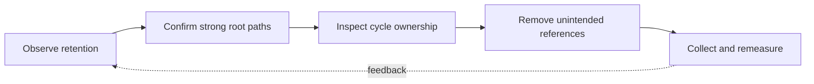

> **Level 3: Advanced** · Topic 6 of 40

[← Memory Management](./05-memory-management.md) · [↑ Level index](../README.md) · [Python Internals →](./07-python-internals.md)

# Garbage Collection

## Overview
- **What is it?** CPython's cyclic garbage collector complements reference counting by detecting unreachable container cycles across three generations.
- **Why is it important?** Understanding collection prevents myths about manual `gc.collect()`, clarifies finalization, and helps diagnose retained object graphs.
- **Where is it used?** It matters in long-lived workers, graph-heavy applications, ORM sessions, callback systems, and objects with finalizers.

## Learning Objectives
- Separate immediate reference-count cleanup from cyclic collection.
- Inspect collection thresholds, statistics, callbacks, and unreachable cycles.
- Break unintended ownership paths instead of forcing collection on every request.

## Real World Applications
- Diagnosing cycles formed by parents, children, closures, and event listeners.
- Observing pause and collection behavior in latency-sensitive processes.
- Designing safe cleanup with context managers and `weakref.finalize`.

## Core Concepts

### Generational Cycle Detection
- **Definition:** The collector tracks cycle-capable objects and scans younger generations more often because most newly allocated objects die quickly.
- **Visual explanation:** `tracked objects → generation threshold → reachability scan → reclaim cycle`
- **Practical example:**

```python
import gc

before = gc.get_count()
cycle: list[object] = []
cycle.append(cycle)
del cycle
reclaimed = gc.collect()
print(before, reclaimed)
```

### Reachability and Retention
- **Definition:** A cycle is collectible only when unreachable from roots; caches, module globals, tracebacks, and callbacks can legitimately keep it alive.
- **Visual explanation:** `root path present → retained; no root path → cycle collectible`
- **Practical example:**

```python
import gc

class Node:
    pass

node = Node()
referrers = gc.get_referrers(node)
print(any(isinstance(item, dict) for item in referrers))
```

### Deterministic Resource Cleanup
- **Definition:** Garbage collection timing is not a resource-management contract; files, locks, and transactions should use context managers.
- **Visual explanation:** `acquire → `with` body → guaranteed release`
- **Practical example:**

```python
from pathlib import Path

path = Path("events.txt")
with path.open("w", encoding="utf-8") as stream:
    stream.write("complete\n")
```

## Infographic Summary

| Infographic Block | Topic-specific takeaway |
| --- | --- |
| 📌 Concept | CPython's cyclic garbage collector complements reference counting by detecting unreachable container cycles across three generations. |
| ⚡ Purpose | Understanding collection prevents myths about manual `gc.collect()`, clarifies finalization, and helps diagnose retained object graphs. |
| 🔥 Benefits | Builds the ability to separate immediate reference-count cleanup from cyclic collection; it also helps practitioners inspect collection thresholds, statistics, callbacks, and unreachable cycles. |
| 🎯 Use Cases | Diagnosing cycles formed by parents, children, closures, and event listeners. Observing pause and collection behavior in latency-sensitive processes. |
| 🚀 Best Practices | Use context managers for scarce external resources. |
| ❌ Common Mistakes | Ignoring the guardrail “Avoid unconditional `gc.collect()` in hot request paths”. |

## Syntax Guide

### Basic Syntax

```python
import gc

counts = gc.get_count()
thresholds = gc.get_threshold()
```

### Standard Structure

```python
import gc

def observe(phase: str, info: dict[str, int]) -> None:
    if phase == "stop":
        print(info["generation"], info["collected"])

gc.callbacks.append(observe)
```

### Code Pattern

```python
import gc
from contextlib import contextmanager

@contextmanager
def gc_disabled():
    was_enabled = gc.isenabled()
    gc.disable()
    try:
        yield
    finally:
        if was_enabled:
            gc.enable()
```

## Examples

### Beginner Example

```python
import gc

print(gc.isenabled())
print(gc.get_threshold())
```

### Intermediate Example

```python
import weakref

class Parent:
    pass

class Child:
    def __init__(self, parent: Parent) -> None:
        self.parent = weakref.ref(parent)

parent = Parent()
child = Child(parent)
assert child.parent() is parent
```

### Advanced Example

```python
import gc

gc.collect()
baseline = [row.copy() for row in gc.get_stats()]
cycles = []
for _ in range(100):
    item: list[object] = []
    item.append(item)
    cycles.append(item)
del cycles
gc.collect()
after = gc.get_stats()
print([(a["collected"] - b["collected"]) for a, b in zip(after, baseline)])
```

## Workflow Diagram



---

[← Memory Management](./05-memory-management.md) · [↑ Level index](../README.md) · [Python Internals →](./07-python-internals.md)
