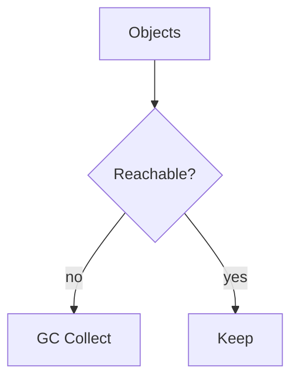

# Garbage Collection

## Overview

- **What is it?** Garbage collection reclaims memory from unreachable objects, especially cycles.
- **Why is it important?** Reference cycles alone would leak memory without cyclic GC.
- **Where is it used?** Graphs, linked structures, long-lived caches, ORM identity maps.

## Learning Objectives

- **Skills gained:** Practical command of Garbage Collection.
- **Concepts covered:**

- Explain refcount vs generational GC.
- Use gc module for debugging.
- Design to minimize cycles.

- **Expected outcome:** You understand when Python frees objects and how to debug retention.

## Real World Applications

- Game servers
- Graph analytics
- Desktop apps
- ORM-heavy web apps

- **Business applications:** Automate workflows, reduce manual errors, accelerate delivery.
- **Career relevance:** Required knowledge for Python roles from junior developer to senior engineer.

## Core Concepts

### refcount

- **Definition:** Immediate reclaim when zero.
- **Visual explanation:** `refcount` → process → result
- **Practical example:**

```python
import sys
obj = object()
print(sys.getrefcount(obj) >= 2)
```

### gc.collect

- **Definition:** Force collection.
- **Visual explanation:** `gc.collect` → process → result
- **Practical example:**

```python
import gc
print(isinstance(gc.collect(), int))
```

### generations

- **Definition:** GC generations 0/1/2.
- **Visual explanation:** `generations` → process → result
- **Practical example:**

```python
import gc
print(len(gc.get_threshold()) == 3)
```

## Infographic Summary

| Block | Summary |
| --- | --- |
| 📌 Concept | Generational GC tracks container objects in cycles. |
| ⚡ Purpose | Reclaim cyclic garbage automatically. |
| 🔥 Benefits | Less manual memory management than C. |
| 🎯 Use Cases | Linked lists, parent/child trees, observer graphs. |
| 🚀 Best Practices | Use weakref for caches; avoid __del__ complexity. |
| ❌ Common Mistakes | Creating unbounded cycles, disabling GC without reason. |

## Syntax Guide

### Basic Syntax

```python
import gc
gc.collect()
```

### Standard Structure

```python
allocate -> use -> dereference -> GC runs
```

### Code Pattern

```python
import weakref
weakref.ref(obj)
```

## Examples

### Beginner Example

```python
import gc
print(gc.isenabled())
```

### Intermediate Example

```python
import gc

class Node:
    def __init__(self):
        self.ref = None

a = Node()
b = Node()
a.ref = b
b.ref = a
del a, b
print(gc.collect() >= 0)
```

### Advanced Example

```python
import weakref


class Cache:
    def __init__(self):
        self._items = {}

    def set(self, key, value):
        self._items[key] = weakref.ref(value)

    def get(self, key):
        ref = self._items.get(key)
        return ref() if ref else None


c = Cache()
obj = {'a': 1}
c.set('k', obj)
print(c.get('k'))
```

## Workflow Diagram



---
