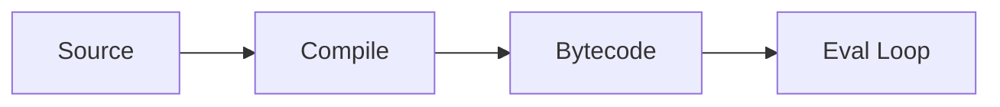

# Python Internals

## Overview

- **What is it?** Python internals cover bytecode, the evaluation loop, and CPython implementation details.
- **Why is it important?** Internals explain performance characteristics and debugging mysteries.
- **Where is it used?** Performance tuning, compiler tooling, advanced debugging, C extensions.

## Learning Objectives

- **Skills gained:** Practical command of Python Internals.
- **Concepts covered:**

- Inspect bytecode with dis.
- Explain frame objects and namespaces.
- Understand GIL at high level.

- **Expected outcome:** You read dis output and understand how CPython executes code.

## Real World Applications

- Language tooling
- High-performance Python
- Security research
- Compiler dev

- **Business applications:** Automate workflows, reduce manual errors, accelerate delivery.
- **Career relevance:** Required knowledge for Python roles from junior developer to senior engineer.

## Core Concepts

### bytecode

- **Definition:** Stack machine instructions.
- **Visual explanation:** `bytecode` → process → result
- **Practical example:**

```python
import dis
dis.dis('a=1')
```

### frame

- **Definition:** Execution frame with locals.
- **Visual explanation:** `frame` → process → result
- **Practical example:**

```python
def f():
    x = 1
    return x
print(f())
```

### GIL

- **Definition:** Global interpreter lock.
- **Visual explanation:** `GIL` → process → result
- **Practical example:**

```python
import sys
print(hasattr(sys, 'version'))
```

## Infographic Summary

| Block | Summary |
| --- | --- |
| 📌 Concept | CPython compiles to bytecode interpreted by the eval loop. |
| ⚡ Purpose | Deepen mental model of Python execution. |
| 🔥 Benefits | Better optimization instincts, clearer profiling. |
| 🎯 Use Cases | Hot path optimization, custom profilers, REPL tools. |
| 🚀 Best Practices | Profile first; consider PyPy/C extensions for hot loops. |
| ❌ Common Mistakes | Micro-optimizing without measurement, fighting the GIL blindly. |

## Syntax Guide

### Basic Syntax

```python
import dis
dis.dis(func)
```

### Standard Structure

```python
source -> compile -> bytecode -> eval loop
```

### Code Pattern

```python
dis.dis(compile('x=1', '<s>', 'exec'))
```

## Examples

### Beginner Example

```python
import dis
dis.dis(lambda x: x + 1)
```

### Intermediate Example

```python
import dis


def add(a, b):
    return a + b


dis.dis(add)
```

### Advanced Example

```python
import types

code = compile('result = 40 + 2', '<string>', 'exec')
namespace = {}
exec(code, namespace)
print(namespace['result'])
```

## Workflow Diagram



---
