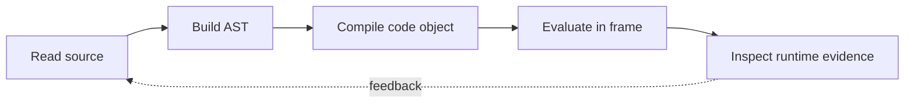

> **Level 3: Advanced** · Topic 7 of 40

[← Garbage Collection](./06-garbage-collection.md) · [↑ Level index](../README.md) · [Metaclasses →](./08-metaclasses.md)

# Python Internals

## Overview
- **What is it?** Python internals connect source text to tokens, abstract syntax trees, code objects, bytecode, frames, and the CPython evaluation loop.
- **Why is it important?** This model makes disassembly, import behavior, scope resolution, and interpreter-specific performance observations understandable.
- **Where is it used?** It is useful for debuggers, profilers, framework authors, static-analysis tools, and advanced incident diagnosis.

## Learning Objectives
- Trace source through parsing, compilation, bytecode, frames, and execution.
- Inspect code objects and disassembly without relying on unstable opcode details.
- Explain name resolution, imports, and interpreter-specific implementation boundaries.

## Real World Applications
- Building decorators, tracers, debuggers, linters, and code-generation tools.
- Understanding closure state, exception tracebacks, and import cache behavior.
- Reading performance profiles with awareness of interpreter specialization.

## Core Concepts

### Compilation Pipeline
- **Definition:** `compile` transforms parsed source into an immutable code object containing bytecode, constants, names, and source-location metadata.
- **Visual explanation:** `source → tokenizer/parser → AST → code object → evaluation`
- **Practical example:**

```python
import ast

tree = ast.parse("result = left + right")
code_object = compile(tree, "<lesson>", "exec")
print(code_object.co_names)
```

### Frames and Name Resolution
- **Definition:** Each executing scope has a frame linking code, local/global mappings, and the previous frame; lexical names follow local, enclosing, global, builtins lookup.
- **Visual explanation:** `bytecode instruction → frame locals/globals → resolved object`
- **Practical example:**

```python
import inspect

def describe_frame() -> tuple[str, tuple[str, ...]]:
    frame = inspect.currentframe()
    assert frame is not None
    return frame.f_code.co_name, frame.f_code.co_varnames

print(describe_frame())
```

### Imports and Module Caching
- **Definition:** Import finders locate a module specification, loaders execute module code, and `sys.modules` caches the resulting module object.
- **Visual explanation:** `import statement → finder/spec → loader → `sys.modules``
- **Practical example:**

```python
import importlib.util
import sys

specification = importlib.util.find_spec("json")
assert specification is not None
print(specification.origin)
print("json" in sys.modules)
```

## Infographic Summary

| Infographic Block | Topic-specific takeaway |
| --- | --- |
| 📌 Concept | Python internals connect source text to tokens, abstract syntax trees, code objects, bytecode, frames, and the CPython evaluation loop. |
| ⚡ Purpose | This model makes disassembly, import behavior, scope resolution, and interpreter-specific performance observations understandable. |
| 🔥 Benefits | Builds the ability to trace source through parsing, compilation, bytecode, frames, and execution; it also helps practitioners inspect code objects and disassembly without relying on unstable opcode details. |
| 🎯 Use Cases | Building decorators, tracers, debuggers, linters, and code-generation tools. Understanding closure state, exception tracebacks, and import cache behavior. |
| 🚀 Best Practices | Use documented introspection APIs before private interpreter fields. |
| ❌ Common Mistakes | Ignoring the guardrail “Do not infer source-level cost from bytecode count alone”. |

## Syntax Guide

### Basic Syntax

```python
import ast

expression = ast.parse("price * quantity", mode="eval")
print(ast.dump(expression, indent=2))
```

### Standard Structure

```python
import dis

def squared(value: int) -> int:
    return value * value

dis.dis(squared)
```

### Code Pattern

```python
def make_counter():
    count = 0

    def increment() -> int:
        nonlocal count
        count += 1
        return count

    return increment
```

## Examples

### Beginner Example

```python
source = "answer = 6 * 7"
namespace: dict[str, object] = {}
exec(compile(source, "<dynamic>", "exec"), namespace)
assert namespace["answer"] == 42
```

### Intermediate Example

```python
def outer(prefix: str):
    def inner(value: str) -> str:
        return f"{prefix}:{value}"
    return inner

formatter = outer("id")
print(formatter.__code__.co_freevars)
print(formatter.__closure__[0].cell_contents)
```

### Advanced Example

```python
import ast

class NameCollector(ast.NodeVisitor):
    def __init__(self) -> None:
        self.names: set[str] = set()

    def visit_Name(self, node: ast.Name) -> None:
        self.names.add(node.id)
        self.generic_visit(node)

collector = NameCollector()
collector.visit(ast.parse("total = price * quantity"))
print(collector.names)
```

## Workflow Diagram



---

[← Garbage Collection](./06-garbage-collection.md) · [↑ Level index](../README.md) · [Metaclasses →](./08-metaclasses.md)
