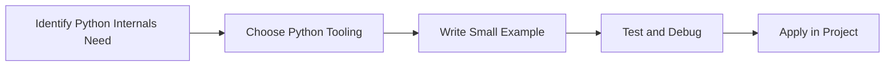

> **Level 3: Advanced** · Topic 7 of 40

[← Garbage Collection](./06-garbage-collection.md) · [↑ Level index](../README.md) · [Metaclasses →](./08-metaclasses.md)

# Python Internals

## Overview
- **What is it?** Python Internals is a Python knowledge area focused on advanced language engineering.
- **Why is it important?** Help developers apply advanced language engineering techniques safely, clearly, and consistently.
- **Where is it used?** Performance-sensitive systems, frameworks, libraries, and technical interviews.

## Learning Objectives
- Gain the practical skill to explain, write, debug, and review python internals code.
- Cover the vocabulary, syntax, workflow, edge cases, and professional habits behind python internals.
- Expected outcome: you can use python internals in a small project and recognize when it belongs in production code.

## Real World Applications
- **Industry use cases:** Performance-sensitive systems, frameworks, libraries, and technical interviews.
- **Business applications:** Reduce manual work, improve reliability, support reporting, automate decisions, and ship maintainable features.
- **Career relevance:** Supports Python developer, backend engineer, data engineer, AI engineer, DevOps engineer, QA automation, and cybersecurity automation roles.

## Core Concepts

### Mental Model
- **Definition:** The main idea that gives python internals its structure and purpose inside a Python program.
- **Visual explanation:** `problem -> Python Internals model -> clear code`
- **Practical example:**

```python
apply_python_internals_label = "Python Internals"
print(apply_python_internals_label)
```

### Execution Flow
- **Definition:** The ordered steps Python follows when python internals code is created, executed, or integrated.
- **Visual explanation:** `input -> Python operation -> result -> feedback`
- **Practical example:**

```python
value = 42
print(type(value).__name__)
```

### Quality Rule
- **Definition:** The reliability habit that keeps python internals understandable, testable, secure, and maintainable.
- **Visual explanation:** `working code -> validation -> production confidence`
- **Practical example:**

```python
profile = {"name": "Noor", "skills": ["Python", "SQL"], "active": True}
print(profile["skills"][0])
```

## Infographic Summary

| Infographic Block | Key Message |
| --- | --- |
| 📌 Concept | Python Internals belongs to the advanced language engineering part of Python mastery. |
| ⚡ Purpose | Help developers apply advanced language engineering techniques safely, clearly, and consistently. |
| 🔥 Benefits | Stronger maintainability, better reliability, and more professional advanced language engineering decisions. |
| 🎯 Use Cases | Performance-sensitive systems, frameworks, libraries, and technical interviews. |
| 🚀 Best Practices | Prefer readable names, small examples, explicit errors, tests, documentation, and version-aware choices. |
| ❌ Common Mistakes | Copying code without understanding it, ignoring edge cases, skipping validation, and mixing unrelated responsibilities. |

## Syntax Guide

### Basic Syntax

```python
age = 31
price = 19.99
name = "Python"
is_active = True
missing = None
```

### Standard Structure

```python
def apply_python_internals(value):
    """Apply the Python Internals concept to one value."""
    return value

result = apply_python_internals("practice")
print(result)
```

### Code Pattern

```python
# 1. Identify the Python Internals problem
# 2. Apply the correct Python structure
# 3. Validate the result with tests or output
```

## Examples

### Beginner Example

```python
value = 42
print(type(value).__name__)
```

### Intermediate Example

```python
profile = {"name": "Noor", "skills": ["Python", "SQL"], "active": True}
print(profile["skills"][0])
```

### Advanced Example

```python
from typing import TypedDict

class User(TypedDict):
    id: int
    email: str

user: User = {"id": 1, "email": "dev@example.com"}
print(user)
```

## Workflow Diagram




---

---

[← Garbage Collection](./06-garbage-collection.md) · [↑ Level index](../README.md) · [Metaclasses →](./08-metaclasses.md)
