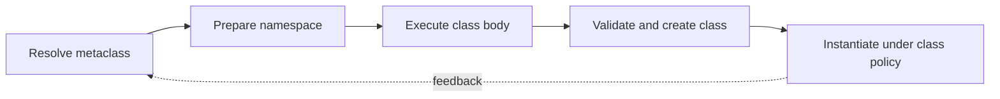

> **Level 3: Advanced** · Topic 8 of 40

[← Python Internals](./07-python-internals.md) · [↑ Level index](../README.md) · [Descriptors →](./09-descriptors.md)

# Metaclasses

## Overview
- **What is it?** A metaclass is the callable responsible for creating a class object; ordinary classes are instances of `type`.
- **Why is it important?** Metaclasses can validate namespaces, register subclasses, or synthesize class-level behavior when `__init_subclass__` and decorators are insufficient.
- **Where is it used?** They appear in ORMs, schema frameworks, abstract interfaces, plugin systems, and declarative APIs.

## Learning Objectives
- Explain class creation from namespace preparation through metaclass construction.
- Implement registration and declaration validation with `type` hooks.
- Choose simpler class decorators or `__init_subclass__` when full metaclass control is unnecessary.

## Real World Applications
- Collecting declarative fields into ORM or validation schemas.
- Registering concrete plugins at class-definition time.
- Enforcing class-level contracts before instances can be created.

## Core Concepts

### Classes Are Runtime Objects
- **Definition:** `type(name, bases, namespace)` creates a class dynamically; the class then creates instances through its own call protocol.
- **Visual explanation:** `namespace + bases → metaclass → class object → instances`
- **Practical example:**

```python
def speak(self) -> str:
    return "ready"

Worker = type("Worker", (), {"speak": speak})
worker = Worker()
print(type(Worker), worker.speak())
```

### Class Creation Hooks
- **Definition:** Python resolves the metaclass, calls `__prepare__`, executes the class body into that namespace, and invokes metaclass `__new__` then `__init__`.
- **Visual explanation:** `resolve metaclass → prepare namespace → execute body → construct class`
- **Practical example:**

```python
class RequiredName(type):
    def __new__(mcls, name, bases, namespace):
        if bases and "plugin_name" not in namespace:
            raise TypeError("plugin_name is required")
        return super().__new__(mcls, name, bases, namespace)

class Plugin(metaclass=RequiredName):
    pass
```

### Metaclass Registries
- **Definition:** A registry metaclass records concrete classes at definition time, enabling configured lookup while keeping construction centralized.
- **Visual explanation:** `class statement → metaclass validation → registry entry`
- **Practical example:**

```python
class Registered(type):
    plugins: dict[str, type] = {}

    def __new__(mcls, name, bases, namespace):
        cls = super().__new__(mcls, name, bases, namespace)
        if key := namespace.get("plugin_name"):
            mcls.plugins[key] = cls
        return cls
```

## Infographic Summary

| Infographic Block | Topic-specific takeaway |
| --- | --- |
| 📌 Concept | A metaclass is the callable responsible for creating a class object; ordinary classes are instances of `type`. |
| ⚡ Purpose | Metaclasses can validate namespaces, register subclasses, or synthesize class-level behavior when `__init_subclass__` and decorators are insufficient. |
| 🔥 Benefits | Builds the ability to explain class creation from namespace preparation through metaclass construction; it also helps practitioners implement registration and declaration validation with `type` hooks. |
| 🎯 Use Cases | Collecting declarative fields into ORM or validation schemas. Registering concrete plugins at class-definition time. |
| 🚀 Best Practices | Prefer `__init_subclass__` for local subclass registration. |
| ❌ Common Mistakes | Ignoring the guardrail “Reserve metaclasses for class-creation policies shared across hierarchies”. |

## Syntax Guide

### Basic Syntax

```python
class Traced(type):
    def __new__(mcls, name, bases, namespace):
        namespace["created_by"] = mcls.__name__
        return super().__new__(mcls, name, bases, namespace)
```

### Standard Structure

```python
class Service(metaclass=Traced):
    pass

assert Service.created_by == "Traced"
```

### Code Pattern

```python
class OrderedMeta(type):
    @classmethod
    def __prepare__(mcls, name, bases):
        return {}

    def __new__(mcls, name, bases, namespace):
        cls = super().__new__(mcls, name, bases, namespace)
        cls.declared_names = tuple(namespace)
        return cls
```

## Examples

### Beginner Example

```python
DynamicRecord = type("DynamicRecord", (), {"kind": "event"})
record = DynamicRecord()
print(record.kind)
```

### Intermediate Example

```python
class Command:
    registry: dict[str, type["Command"]] = {}

    def __init_subclass__(cls, *, name: str, **kwargs) -> None:
        super().__init_subclass__(**kwargs)
        cls.registry[name] = cls

class Start(Command, name="start"):
    pass

assert Command.registry["start"] is Start
```

### Advanced Example

```python
class SchemaMeta(type):
    def __new__(mcls, name, bases, namespace):
        annotations = namespace.get("__annotations__", {})
        cls = super().__new__(mcls, name, bases, namespace)
        cls.fields = tuple(annotations)
        return cls

class UserSchema(metaclass=SchemaMeta):
    name: str
    active: bool

assert UserSchema.fields == ("name", "active")
```

## Workflow Diagram



---

[← Python Internals](./07-python-internals.md) · [↑ Level index](../README.md) · [Descriptors →](./09-descriptors.md)
