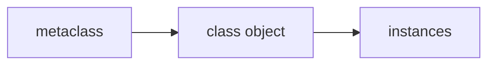

# Metaclasses

## Overview

- **What is it?** Metaclasses are classes that create classes, hooking into class construction.
- **Why is it important?** Frameworks use metaclasses for ORMs, validation, and API registries.
- **Where is it used?** Django models, dataclass-like codegen, plugin registration, singletons.

## Learning Objectives

- **Skills gained:** Practical command of Metaclasses.
- **Concepts covered:**

- Explain type and class creation.
- Write a simple metaclass.
- Know when class decorators suffice.

- **Expected outcome:** You understand metaclass use cases and implement simple ones.

## Real World Applications

- Web frameworks
- Code generators
- Enterprise DSLs
- Testing frameworks

- **Business applications:** Automate workflows, reduce manual errors, accelerate delivery.
- **Career relevance:** Required knowledge for Python roles from junior developer to senior engineer.

## Core Concepts

### type

- **Definition:** Default metaclass.
- **Visual explanation:** `type` → process → result
- **Practical example:**

```python
class A: pass
print(type(A))
```

### __new__

- **Definition:** Metaclass creates class.
- **Visual explanation:** `__new__` → process → result
- **Practical example:**

```python
class Meta(type):
    def __new__(mcls, name, bases, ns):
        ns['tag'] = name.lower()
        return super().__new__(mcls, name, bases, ns)
class A(metaclass=Meta): pass
print(A.tag)
```

### __init__

- **Definition:** Initialize created class.
- **Visual explanation:** `__init__` → process → result
- **Practical example:**

```python
class Meta(type):
    def __init__(cls, name, bases, ns):
        super().__init__(name, bases, ns)
        cls.created = True
class B(metaclass=Meta): pass
print(B.created)
```

## Infographic Summary

| Block | Summary |
| --- | --- |
| 📌 Concept | Metaclasses customize class object creation. |
| ⚡ Purpose | Framework-level automation and enforcement. |
| 🔥 Benefits | Centralized registration, enforced conventions. |
| 🎯 Use Cases | ORM field collection, API route tables, interface enforcement. |
| 🚀 Best Practices | Prefer simpler hooks first; document heavily. |
| ❌ Common Mistakes | Metaclass for everything, incomprehensible MRO interactions. |

## Syntax Guide

### Basic Syntax

```python
class Meta(type):
    pass


class MyClass(metaclass=Meta):
    pass


print(MyClass.__name__)
```

### Standard Structure

```python
metaclass __new__/__init__ -> class object
```

### Code Pattern

```python
class Registry(type):
    registry = {}

    def __new__(mcls, name, bases, namespace):
        cls = super().__new__(mcls, name, bases, namespace)
        registry = mcls.registry
        registry[name] = cls
        return cls


print(callable(Registry))
```

## Examples

### Beginner Example

```python
print(type(int))
```

### Intermediate Example

```python
class PluginMeta(type):
    plugins = {}

    def __new__(mcls, name, bases, namespace):
        cls = super().__new__(mcls, name, bases, namespace)
        if name != 'PluginBase':
            mcls.plugins[name] = cls
        return cls


class PluginBase(metaclass=PluginMeta):
    pass


class EmailPlugin(PluginBase):
    pass


print('EmailPlugin' in PluginMeta.plugins)
```

### Advanced Example

```python
class SingletonMeta(type):
    _instances = {}

    def __call__(cls, *args, **kwargs):
        if cls not in cls._instances:
            cls._instances[cls] = super().__call__(*args, **kwargs)
        return cls._instances[cls]


class Config(metaclass=SingletonMeta):
    def __init__(self):
        self.env = 'prod'


print(Config() is Config())
```

## Workflow Diagram



---
