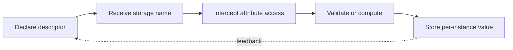

> **Level 3: Advanced** · Topic 9 of 40

[← Metaclasses](./08-metaclasses.md) · [↑ Level index](../README.md) · [Concurrency →](./10-concurrency.md)

# Descriptors

## Overview
- **What is it?** Descriptors are objects defining `__get__`, `__set__`, or `__delete__` to customize attribute access from another class.
- **Why is it important?** They are the mechanism beneath methods, properties, `classmethod`, `staticmethod`, slots, and many ORM fields.
- **Where is it used?** Descriptors centralize validation, lazy computation, binding, and storage across many managed attributes.

## Learning Objectives
- Apply descriptor lookup precedence for class and instance access.
- Implement reusable validated fields with `__set_name__`.
- Distinguish data descriptors, non-data descriptors, and ordinary instance attributes.

## Real World Applications
- Validated model fields, lazy properties, ORM columns, and dependency injection.
- Understanding why functions bind into methods when read from instances.
- Building declarative APIs without repetitive property definitions.

## Core Concepts

### Descriptor Protocol
- **Definition:** Attribute lookup invokes a descriptor's methods with the managed instance and owner; class access conventionally returns the descriptor itself.
- **Visual explanation:** `instance.attr → owner namespace descriptor → `__get__``
- **Practical example:**

```python
class Constant:
    def __get__(self, instance, owner):
        return 42

class Answer:
    value = Constant()

print(Answer().value)
```

### Lookup Precedence
- **Definition:** A data descriptor with `__set__` outranks the instance dictionary, while a non-data descriptor can be shadowed by an instance attribute.
- **Visual explanation:** `data descriptor → instance dictionary → non-data descriptor → class value`
- **Practical example:**

```python
class NonData:
    def __get__(self, instance, owner):
        return "descriptor"

class Example:
    value = NonData()

item = Example()
item.value = "instance"
print(item.value)
```

### Managed Storage
- **Definition:** `__set_name__` tells a descriptor its assigned attribute name so one descriptor class can store and validate many fields safely.
- **Visual explanation:** `class creation → storage name → validated set/get`
- **Practical example:**

```python
class Positive:
    def __set_name__(self, owner, name):
        self.storage_name = f"_{name}"

    def __get__(self, instance, owner):
        if instance is None:
            return self
        return getattr(instance, self.storage_name)

    def __set__(self, instance, value):
        if value <= 0:
            raise ValueError("must be positive")
        setattr(instance, self.storage_name, value)
```

## Infographic Summary

| Infographic Block | Topic-specific takeaway |
| --- | --- |
| 📌 Concept | Descriptors are objects defining `__get__`, `__set__`, or `__delete__` to customize attribute access from another class. |
| ⚡ Purpose | They are the mechanism beneath methods, properties, `classmethod`, `staticmethod`, slots, and many ORM fields. |
| 🔥 Benefits | Builds the ability to apply descriptor lookup precedence for class and instance access; it also helps practitioners implement reusable validated fields with `__set_name__`. |
| 🎯 Use Cases | Validated model fields, lazy properties, ORM columns, and dependency injection. Understanding why functions bind into methods when read from instances. |
| 🚀 Best Practices | Store per-instance data on the instance, not the descriptor. |
| ❌ Common Mistakes | Ignoring the guardrail “Return `self` for class-level descriptor inspection”. |

## Syntax Guide

### Basic Syntax

```python
class Descriptor:
    def __get__(self, instance, owner):
        if instance is None:
            return self
        return instance.__dict__["value"]
```

### Standard Structure

```python
class NamedField:
    def __set_name__(self, owner, name):
        self.name = name

    def __set__(self, instance, value):
        instance.__dict__[self.name] = value
```

### Code Pattern

```python
class Lazy:
    def __init__(self, function):
        self.function = function
        self.name = function.__name__

    def __get__(self, instance, owner):
        if instance is None:
            return self
        value = self.function(instance)
        instance.__dict__[self.name] = value
        return value
```

## Examples

### Beginner Example

```python
class Celsius:
    def __init__(self, value: float) -> None:
        self._value = value

    @property
    def value(self) -> float:
        return self._value
```

### Intermediate Example

```python
class Positive:
    def __set_name__(self, owner, name):
        self.storage_name = f"_{name}"

    def __get__(self, instance, owner):
        if instance is None:
            return self
        return getattr(instance, self.storage_name)

    def __set__(self, instance, value):
        if value <= 0:
            raise ValueError("must be positive")
        setattr(instance, self.storage_name, value)

class Product:
    price = Positive()

    def __init__(self, price: float) -> None:
        self.price = price

product = Product(19.5)
assert product.price == 19.5
```

### Advanced Example

```python
class Typed:
    def __init__(self, expected_type: type) -> None:
        self.expected_type = expected_type

    def __set_name__(self, owner, name):
        self.name = name

    def __get__(self, instance, owner):
        return self if instance is None else instance.__dict__[self.name]

    def __set__(self, instance, value):
        if not isinstance(value, self.expected_type):
            raise TypeError(f"{self.name} requires {self.expected_type.__name__}")
        instance.__dict__[self.name] = value

class Event:
    name = Typed(str)

event = Event()
event.name = "deployed"
```

## Workflow Diagram



---

[← Metaclasses](./08-metaclasses.md) · [↑ Level index](../README.md) · [Concurrency →](./10-concurrency.md)
