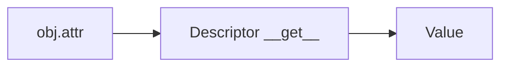

# Descriptors

## Overview

- **What is it?** Descriptors implement __get__, __set__, or __delete__ to customize attribute access.
- **Why is it important?** They power properties, ORM fields, and validated attributes.
- **Where is it used?** Frameworks, data models, lazy computed fields, cached attributes.

## Learning Objectives

- **Skills gained:** Practical command of Descriptors.
- **Concepts covered:**

- Implement descriptor protocol.
- Understand data vs non-data descriptors.
- Use property as descriptor shortcut.

- **Expected outcome:** You control attribute access with descriptors and properties.

## Real World Applications

- ORMs
- Validation libraries
- Game engines
- Financial models

- **Business applications:** Automate workflows, reduce manual errors, accelerate delivery.
- **Career relevance:** Required knowledge for Python roles from junior developer to senior engineer.

## Core Concepts

### __get__

- **Definition:** Customize read.
- **Visual explanation:** `__get__` → process → result
- **Practical example:**

```python
class D:
    def __get__(self, obj, owner):
        return 42
class A:
    x = D()
print(A().x)
```

### __set__

- **Definition:** Customize write.
- **Visual explanation:** `__set__` → process → result
- **Practical example:**

```python
class Positive:
    def __set__(self, obj, value):
        if value < 0: raise ValueError
        obj._v = value
    def __get__(self, obj, owner):
        return obj._v
class Account:
    balance = Positive()
a = Account()
a.balance = 10
print(a.balance)
```

### property

- **Definition:** Built-in descriptor.
- **Visual explanation:** `property` → process → result
- **Practical example:**

```python
class C:
    def __init__(self):
        self._n = 0
    @property
    def n(self):
        return self._n
print(C().n)
```

## Infographic Summary

| Block | Summary |
| --- | --- |
| 📌 Concept | Descriptors intercept dot access on classes. |
| ⚡ Purpose | Reuse attribute logic across classes. |
| 🔥 Benefits | DRY validation, lazy loading, typed fields. |
| 🎯 Use Cases | Validated setters, cached properties, ORM columns. |
| 🚀 Best Practices | Use property first; descriptor for reuse across classes. |
| ❌ Common Mistakes | Infinite recursion in __get__, confusing data descriptor priority. |

## Syntax Guide

### Basic Syntax

```python
class Desc:
    def __get__(self, obj, owner=None):
        return 42


class Host:
    value = Desc()


print(Host().value)
```

### Standard Structure

```python
define descriptor -> assign to class -> access via instance
```

### Code Pattern

```python
class Model:
    @property
    def field(self):
        return self._field


m = Model()
m._field = 1
print(m.field)
```

## Examples

### Beginner Example

```python
class Echo:
    def __get__(self, obj, owner):
        return 'echo'


class Host:
    msg = Echo()


print(Host().msg)
```

### Intermediate Example

```python
class Typed:
    def __init__(self, name, expected_type):
        self.name = name
        self.expected_type = expected_type

    def __set_name__(self, owner, name):
        self.name = name

    def __get__(self, obj, owner):
        return obj.__dict__.get(self.name)

    def __set__(self, obj, value):
        if not isinstance(value, self.expected_type):
            raise TypeError('wrong type')
        obj.__dict__[self.name] = value


class User:
    age = Typed('age', int)


u = User()
u.age = 30
print(u.age)
```

### Advanced Example

```python
class LazyProperty:
    def __init__(self, func):
        self.func = func
        self.name = func.__name__

    def __get__(self, obj, owner):
        if obj is None:
            return self
        value = self.func(obj)
        setattr(obj, self.name, value)
        return value


class Data:
    @LazyProperty
    def expensive(self):
        return sum(range(1000))


d = Data()
print(d.expensive == d.expensive)
```

## Workflow Diagram



---
