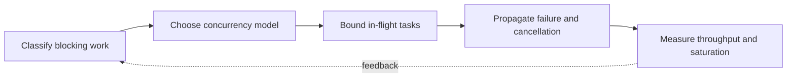

> **Level 3: Advanced** · Topic 10 of 40

[← Descriptors](./09-descriptors.md) · [↑ Level index](../README.md) · [Parallel Computing →](./11-parallel-computing.md)

# Concurrency

## Overview
- **What is it?** Concurrency lets multiple tasks make progress during overlapping time through threads, event loops, or structured task orchestration.
- **Why is it important?** It improves I/O throughput but introduces cancellation, synchronization, backpressure, and shared-state correctness concerns.
- **Where is it used?** Use it for network clients, request fan-out, background I/O, and pipelines with independently waiting stages.

## Learning Objectives
- Choose threads or `asyncio` from blocking behavior and library compatibility.
- Coordinate task lifetime, cancellation, synchronization, and bounded work.
- Build producer-consumer flows with task accounting or sentinels instead of racy state inspection.

## Real World Applications
- Fetching many independent endpoints while bounding in-flight requests.
- Serving concurrent connections and overlapping database or filesystem waits.
- Separating ingestion from processing with explicit capacity and shutdown.

## Core Concepts

### Threads and Shared State
- **Definition:** Threads share process memory and are effective for blocking I/O, but compound operations require locks or message passing to preserve invariants.
- **Visual explanation:** `threads → shared object → lock-protected critical section`
- **Practical example:**

```python
from concurrent.futures import ThreadPoolExecutor
from urllib.request import urlopen

def status(url: str) -> int:
    with urlopen(url, timeout=5) as response:
        return response.status

with ThreadPoolExecutor(max_workers=4) as pool:
    results = list(pool.map(status, ["https://example.com"] * 2))
```

### Structured Async Tasks
- **Definition:** `asyncio.TaskGroup` binds child task lifetime to a lexical scope and propagates failures as an exception group after cancelling siblings.
- **Visual explanation:** `enter task group → create children → await all or cancel on failure`
- **Practical example:**

```python
import asyncio

async def fetch(identifier: int) -> int:
    await asyncio.sleep(0.01)
    return identifier

async def main() -> None:
    async with asyncio.TaskGroup() as group:
        tasks = [group.create_task(fetch(i)) for i in range(3)]
    print([task.result() for task in tasks])
```

### Backpressure and Shutdown
- **Definition:** A bounded queue makes producers wait when consumers fall behind, and sentinels or task accounting provide race-free completion.
- **Visual explanation:** `producer → bounded queue → consumer → `task_done`/sentinel`
- **Practical example:**

```python
from queue import Queue
from threading import Thread

STOP = object()
work: Queue[object] = Queue(maxsize=8)

def consume() -> None:
    while (item := work.get()) is not STOP:
        print(item)
        work.task_done()
    work.task_done()

Thread(target=consume).start()
work.put("job")
work.put(STOP)
work.join()
```

## Infographic Summary

| Infographic Block | Topic-specific takeaway |
| --- | --- |
| 📌 Concept | Concurrency lets multiple tasks make progress during overlapping time through threads, event loops, or structured task orchestration. |
| ⚡ Purpose | It improves I/O throughput but introduces cancellation, synchronization, backpressure, and shared-state correctness concerns. |
| 🔥 Benefits | Builds the ability to choose threads or `asyncio` from blocking behavior and library compatibility; it also helps practitioners coordinate task lifetime, cancellation, synchronization, and bounded work. |
| 🎯 Use Cases | Fetching many independent endpoints while bounding in-flight requests. Serving concurrent connections and overlapping database or filesystem waits. |
| 🚀 Best Practices | Use `join`/sentinels, not `empty()`, to determine completion. |
| ❌ Common Mistakes | Ignoring the guardrail “Always set deadlines around remote and blocking operations”. |

## Syntax Guide

### Basic Syntax

```python
from concurrent.futures import ThreadPoolExecutor

with ThreadPoolExecutor(max_workers=8) as executor:
    future = executor.submit(str.upper, "ready")
    result = future.result(timeout=1)
```

### Standard Structure

```python
import asyncio

async def operation() -> str:
    await asyncio.sleep(0)
    return "done"

result = asyncio.run(operation())
```

### Code Pattern

```python
import asyncio

async def limited_call(semaphore: asyncio.Semaphore, value: int) -> int:
    async with semaphore:
        await asyncio.sleep(0.01)
        return value * 2
```

## Examples

### Beginner Example

```python
from concurrent.futures import ThreadPoolExecutor

with ThreadPoolExecutor() as pool:
    lengths = list(pool.map(len, ["alpha", "beta", "gamma"]))
print(lengths)
```

### Intermediate Example

```python
import asyncio

async def timed_work() -> str:
    async with asyncio.timeout(1.0):
        await asyncio.sleep(0.01)
        return "complete"

print(asyncio.run(timed_work()))
```

### Advanced Example

```python
import asyncio

async def worker(queue: asyncio.Queue[int | None]) -> None:
    while True:
        item = await queue.get()
        try:
            if item is None:
                return
            print(item * item)
        finally:
            queue.task_done()

async def pipeline() -> None:
    queue: asyncio.Queue[int | None] = asyncio.Queue(maxsize=4)
    consumer = asyncio.create_task(worker(queue))
    for item in range(5):
        await queue.put(item)
    await queue.put(None)
    await queue.join()
    await consumer

asyncio.run(pipeline())
```

## Workflow Diagram



---

[← Descriptors](./09-descriptors.md) · [↑ Level index](../README.md) · [Parallel Computing →](./11-parallel-computing.md)
