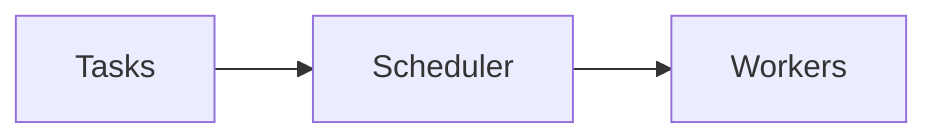

# Concurrency

## Overview

- **What is it?** Concurrency coordinates multiple tasks making progress without necessarily running in parallel.
- **Why is it important?** Users expect responsive systems during I/O and background work.
- **Where is it used?** Web servers, UI backends, job orchestration, streaming.

## Learning Objectives

- **Skills gained:** Practical command of Concurrency.
- **Concepts covered:**

- Contrast concurrency vs parallelism.
- Combine threads and async appropriately.
- Use queues for producer/consumer.

- **Expected outcome:** You design systems where tasks overlap safely.

## Real World Applications

- Realtime dashboards
- Chat
- Trading feeds
- IoT hubs

- **Business applications:** Automate workflows, reduce manual errors, accelerate delivery.
- **Career relevance:** Required knowledge for Python roles from junior developer to senior engineer.

## Core Concepts

### Concurrency

- **Definition:** Tasks interleave progress.
- **Visual explanation:** `Concurrency` → process → result
- **Practical example:**

```python
import asyncio
async def task():
    return 1
print(asyncio.run(task()))
```

### Parallelism

- **Definition:** Simultaneous CPU execution.
- **Visual explanation:** `Parallelism` → process → result
- **Practical example:**

```python
print('use multiprocessing for CPU parallel')
```

### Queue

- **Definition:** Coordinate workers.
- **Visual explanation:** `Queue` → process → result
- **Practical example:**

```python
from queue import Queue
q = Queue()
q.put(1)
print(q.get())
```

## Infographic Summary

| Block | Summary |
| --- | --- |
| 📌 Concept | Concurrency manages many tasks; parallelism uses multiple cores. |
| ⚡ Purpose | Improve throughput and responsiveness. |
| 🔥 Benefits | Better resource utilization, smoother UX. |
| 🎯 Use Cases | Download managers, job workers, server request handling. |
| 🚀 Best Practices | Match tool to workload; bound queues; monitor backlog. |
| ❌ Common Mistakes | Threads for CPU-bound, unbounded task spawning, no backpressure. |

## Syntax Guide

### Basic Syntax

```python
queue.put(item)
item = queue.get()
```

### Standard Structure

```python
producers -> queue -> consumers
```

### Code Pattern

```python
asyncio.create_task(coro)
```

## Examples

### Beginner Example

```python
from queue import Queue
q = Queue()
q.put('job')
print(q.get())
```

### Intermediate Example

```python
import asyncio

async def worker(name, delay):
    await asyncio.sleep(delay)
    return name

async def main():
    results = await asyncio.gather(worker('a', 0.01), worker('b', 0.01))
    print(sorted(results))

asyncio.run(main())
```

### Advanced Example

```python
import threading
from queue import Queue


def consumer(q: Queue, out: list):
    while True:
        item = q.get()
        if item is None:
            break
        out.append(item * 2)
        q.task_done()


q = Queue()
out = []
t = threading.Thread(target=consumer, args=(q, out))
t.start()
q.put(21)
q.put(None)
t.join()
print(out)
```

## Workflow Diagram



---
