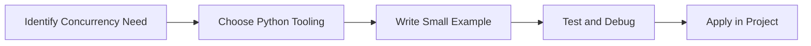

> **Level 3: Advanced** · Topic 10 of 40

[← Descriptors](./09-descriptors.md) · [↑ Level index](../README.md) · [Parallel Computing →](./11-parallel-computing.md)

# Concurrency

## Overview
- **What is it?** Concurrency is a Python knowledge area focused on execution model.
- **Why is it important?** Help developers apply execution model techniques safely, clearly, and consistently.
- **Where is it used?** High-throughput services, background jobs, io workloads, and cpu-bound processing.

## Learning Objectives
- Gain the practical skill to explain, write, debug, and review concurrency code.
- Cover the vocabulary, syntax, workflow, edge cases, and professional habits behind concurrency.
- Expected outcome: you can use concurrency in a small project and recognize when it belongs in production code.

## Real World Applications
- **Industry use cases:** High-throughput services, background jobs, io workloads, and cpu-bound processing.
- **Business applications:** Reduce manual work, improve reliability, support reporting, automate decisions, and ship maintainable features.
- **Career relevance:** Supports Python developer, backend engineer, data engineer, AI engineer, DevOps engineer, QA automation, and cybersecurity automation roles.

## Core Concepts

### Task Unit
- **Definition:** The main idea that gives concurrency its structure and purpose inside a Python program.
- **Visual explanation:** `problem -> Concurrency model -> clear code`
- **Practical example:**

```python
apply_concurrency_label = "Concurrency"
print(apply_concurrency_label)
```

### Scheduler or Worker
- **Definition:** The ordered steps Python follows when concurrency code is created, executed, or integrated.
- **Visual explanation:** `input -> Python operation -> result -> feedback`
- **Practical example:**

```python
import asyncio

async def greet():
    return "hello"

print(asyncio.run(greet()))
```

### Coordination Rule
- **Definition:** The reliability habit that keeps concurrency understandable, testable, secure, and maintainable.
- **Visual explanation:** `working code -> validation -> production confidence`
- **Practical example:**

```python
import asyncio

async def fetch(number):
    await asyncio.sleep(0)
    return number * 2

async def main():
    print(await asyncio.gather(fetch(1), fetch(2)))

asyncio.run(main())
```

## Infographic Summary

| Infographic Block | Key Message |
| --- | --- |
| 📌 Concept | Concurrency belongs to the execution model part of Python mastery. |
| ⚡ Purpose | Help developers apply execution model techniques safely, clearly, and consistently. |
| 🔥 Benefits | Stronger maintainability, better reliability, and more professional execution model decisions. |
| 🎯 Use Cases | High-throughput services, background jobs, io workloads, and cpu-bound processing. |
| 🚀 Best Practices | Prefer readable names, small examples, explicit errors, tests, documentation, and version-aware choices. |
| ❌ Common Mistakes | Copying code without understanding it, ignoring edge cases, skipping validation, and mixing unrelated responsibilities. |

## Syntax Guide

### Basic Syntax

```python
import asyncio

async def main():
    await asyncio.sleep(0)

asyncio.run(main())
```

### Standard Structure

```python
def apply_concurrency(value):
    """Apply the Concurrency concept to one value."""
    return value

result = apply_concurrency("practice")
print(result)
```

### Code Pattern

```python
# 1. Identify the Concurrency problem
# 2. Apply the correct Python structure
# 3. Validate the result with tests or output
```

## Examples

### Beginner Example

```python
import asyncio

async def greet():
    return "hello"

print(asyncio.run(greet()))
```

### Intermediate Example

```python
import asyncio

async def fetch(number):
    await asyncio.sleep(0)
    return number * 2

async def main():
    print(await asyncio.gather(fetch(1), fetch(2)))

asyncio.run(main())
```

### Advanced Example

```python
import asyncio

async def worker(name, queue):
    while not queue.empty():
        item = await queue.get()
        print(name, item)
        queue.task_done()

async def main():
    queue = asyncio.Queue()
    for item in range(3):
        await queue.put(item)
    await asyncio.gather(worker("w1", queue), worker("w2", queue))

asyncio.run(main())
```

## Workflow Diagram




---

---

[← Descriptors](./09-descriptors.md) · [↑ Level index](../README.md) · [Parallel Computing →](./11-parallel-computing.md)
