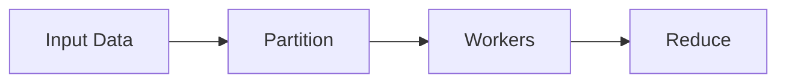

# Parallel Computing

## Overview

- **What is it?** Parallel computing executes computations simultaneously across cores or machines.
- **Why is it important?** CPU-heavy workloads need parallelism to meet latency SLAs.
- **Where is it used?** NumPy, multiprocessing, Spark, GPU offload, simulation.

## Learning Objectives

- **Skills gained:** Practical command of Parallel Computing.
- **Concepts covered:**

- Use process pools for CPU parallelism.
- Partition data for workers.
- Understand Amdahl's law limits.

- **Expected outcome:** You scale CPU-bound Python workloads across cores.

## Real World Applications

- Quant
- Rendering
- Scientific HPC
- ML feature gen

- **Business applications:** Automate workflows, reduce manual errors, accelerate delivery.
- **Career relevance:** Required knowledge for Python roles from junior developer to senior engineer.

## Core Concepts

### Process pool

- **Definition:** Multiple interpreters.
- **Visual explanation:** `Process pool` → process → result
- **Practical example:**

```python
from concurrent.futures import ProcessPoolExecutor
print(ProcessPoolExecutor)
```

### map

- **Definition:** Apply func across inputs.
- **Visual explanation:** `map` → process → result
- **Practical example:**

```python
print(list(map(lambda x: x * 2, [1, 2, 3])))
```

### chunking

- **Definition:** Split data for workers.
- **Visual explanation:** `chunking` → process → result
- **Practical example:**

```python
data = list(range(10))
chunks = [data[i:i+3] for i in range(0, len(data), 3)]
print(len(chunks))
```

## Infographic Summary

| Block | Summary |
| --- | --- |
| 📌 Concept | Parallelism requires independent work units and merges results. |
| ⚡ Purpose | Reduce wall-clock time for heavy compute. |
| 🔥 Benefits | Faster batch jobs, higher hardware utilization. |
| 🎯 Use Cases | Monte Carlo, image filters, large transforms. |
| 🚀 Best Practices | Minimize IPC; profile serial vs parallel; pick chunk sizes. |
| ❌ Common Mistakes | Tiny tasks overhead, pickle overhead, no speedup due to serial sections. |

## Syntax Guide

### Basic Syntax

```python
with ProcessPoolExecutor() as pool:
    pool.map(func, items)
```

### Standard Structure

```python
partition -> map workers -> reduce results
```

### Code Pattern

```python
pool.map(process_chunk, chunks)
```

## Examples

### Beginner Example

```python
print(sum(map(lambda x: x * x, range(5))))
```

### Intermediate Example

```python
from concurrent.futures import ProcessPoolExecutor


def square(n: int) -> int:
    return n * n


if __name__ == '__main__':
    with ProcessPoolExecutor(max_workers=2) as pool:
        print(list(pool.map(square, range(4))))
```

### Advanced Example

```python
def parallel_sum(numbers, workers=2):
    size = len(numbers) // workers or 1
    chunks = [numbers[i:i + size] for i in range(0, len(numbers), size)]
    partials = [sum(chunk) for chunk in chunks]
    return sum(partials)


print(parallel_sum(list(range(10)), workers=2))
```

## Workflow Diagram



---
