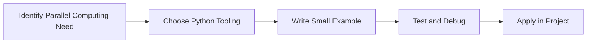

> **Level 3: Advanced** · Topic 11 of 40

[← Concurrency](./10-concurrency.md) · [↑ Level index](../README.md) · [Distributed Systems →](./12-distributed-systems.md)

# Parallel Computing

## Overview
- **What is it?** Parallel Computing is a Python knowledge area focused on execution model.
- **Why is it important?** Help developers apply execution model techniques safely, clearly, and consistently.
- **Where is it used?** High-throughput services, background jobs, io workloads, and cpu-bound processing.

## Learning Objectives
- Gain the practical skill to explain, write, debug, and review parallel computing code.
- Cover the vocabulary, syntax, workflow, edge cases, and professional habits behind parallel computing.
- Expected outcome: you can use parallel computing in a small project and recognize when it belongs in production code.

## Real World Applications
- **Industry use cases:** High-throughput services, background jobs, io workloads, and cpu-bound processing.
- **Business applications:** Reduce manual work, improve reliability, support reporting, automate decisions, and ship maintainable features.
- **Career relevance:** Supports Python developer, backend engineer, data engineer, AI engineer, DevOps engineer, QA automation, and cybersecurity automation roles.

## Core Concepts

### Task Unit
- **Definition:** The main idea that gives parallel computing its structure and purpose inside a Python program.
- **Visual explanation:** `problem -> Parallel Computing model -> clear code`
- **Practical example:**

```python
apply_parallel_computing_label = "Parallel Computing"
print(apply_parallel_computing_label)
```

### Scheduler or Worker
- **Definition:** The ordered steps Python follows when parallel computing code is created, executed, or integrated.
- **Visual explanation:** `input -> Python operation -> result -> feedback`
- **Practical example:**

```python
from multiprocessing import cpu_count
print(cpu_count())
```

### Coordination Rule
- **Definition:** The reliability habit that keeps parallel computing understandable, testable, secure, and maintainable.
- **Visual explanation:** `working code -> validation -> production confidence`
- **Practical example:**

```python
from multiprocessing import Pool

def square(value):
    return value * value

if __name__ == "__main__":
    with Pool(2) as pool:
        print(pool.map(square, [1, 2, 3]))
```

## Infographic Summary

| Infographic Block | Key Message |
| --- | --- |
| 📌 Concept | Parallel Computing belongs to the execution model part of Python mastery. |
| ⚡ Purpose | Help developers apply execution model techniques safely, clearly, and consistently. |
| 🔥 Benefits | Stronger maintainability, better reliability, and more professional execution model decisions. |
| 🎯 Use Cases | High-throughput services, background jobs, io workloads, and cpu-bound processing. |
| 🚀 Best Practices | Prefer readable names, small examples, explicit errors, tests, documentation, and version-aware choices. |
| ❌ Common Mistakes | Copying code without understanding it, ignoring edge cases, skipping validation, and mixing unrelated responsibilities. |

## Syntax Guide

### Basic Syntax

```python
from multiprocessing import Process
process = Process(target=print, args=("hi",))
```

### Standard Structure

```python
def apply_parallel_computing(value):
    """Apply the Parallel Computing concept to one value."""
    return value

result = apply_parallel_computing("practice")
print(result)
```

### Code Pattern

```python
# 1. Identify the Parallel Computing problem
# 2. Apply the correct Python structure
# 3. Validate the result with tests or output
```

## Examples

### Beginner Example

```python
from multiprocessing import cpu_count
print(cpu_count())
```

### Intermediate Example

```python
from multiprocessing import Pool

def square(value):
    return value * value

if __name__ == "__main__":
    with Pool(2) as pool:
        print(pool.map(square, [1, 2, 3]))
```

### Advanced Example

```python
from concurrent.futures import ProcessPoolExecutor

def score(value):
    return sum(i * i for i in range(value))

if __name__ == "__main__":
    with ProcessPoolExecutor() as pool:
        print(list(pool.map(score, [1000, 2000])))
```

## Workflow Diagram




---

---

[← Concurrency](./10-concurrency.md) · [↑ Level index](../README.md) · [Distributed Systems →](./12-distributed-systems.md)
