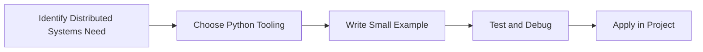

> **Level 3: Advanced** · Topic 12 of 40

[← Parallel Computing](./11-parallel-computing.md) · [↑ Level index](../README.md) · [Network Programming →](./13-network-programming.md)

# Distributed Systems

## Overview
- **What is it?** Distributed Systems is a Python knowledge area focused on systems automation.
- **Why is it important?** Help developers apply systems automation techniques safely, clearly, and consistently.
- **Where is it used?** Network services, security operations, scraping pipelines, and orchestration.

## Learning Objectives
- Gain the practical skill to explain, write, debug, and review distributed systems code.
- Cover the vocabulary, syntax, workflow, edge cases, and professional habits behind distributed systems.
- Expected outcome: you can use distributed systems in a small project and recognize when it belongs in production code.

## Real World Applications
- **Industry use cases:** Network services, security operations, scraping pipelines, and orchestration.
- **Business applications:** Reduce manual work, improve reliability, support reporting, automate decisions, and ship maintainable features.
- **Career relevance:** Supports Python developer, backend engineer, data engineer, AI engineer, DevOps engineer, QA automation, and cybersecurity automation roles.

## Core Concepts

### Task Unit
- **Definition:** The main idea that gives distributed systems its structure and purpose inside a Python program.
- **Visual explanation:** `problem -> Distributed Systems model -> clear code`
- **Practical example:**

```python
apply_distributed_systems_label = "Distributed Systems"
print(apply_distributed_systems_label)
```

### Scheduler or Worker
- **Definition:** The ordered steps Python follows when distributed systems code is created, executed, or integrated.
- **Visual explanation:** `input -> Python operation -> result -> feedback`
- **Practical example:**

```python
import requests

response = requests.get("https://example.com", timeout=10)
print(response.status_code)
```

### Coordination Rule
- **Definition:** The reliability habit that keeps distributed systems understandable, testable, secure, and maintainable.
- **Visual explanation:** `working code -> validation -> production confidence`
- **Practical example:**

```python
import requests

with requests.Session() as session:
    response = session.get("https://api.github.com", timeout=10)
    print(response.headers.get("content-type"))
```

## Infographic Summary

| Infographic Block | Key Message |
| --- | --- |
| 📌 Concept | Distributed Systems belongs to the systems automation part of Python mastery. |
| ⚡ Purpose | Help developers apply systems automation techniques safely, clearly, and consistently. |
| 🔥 Benefits | Stronger maintainability, better reliability, and more professional systems automation decisions. |
| 🎯 Use Cases | Network services, security operations, scraping pipelines, and orchestration. |
| 🚀 Best Practices | Prefer readable names, small examples, explicit errors, tests, documentation, and version-aware choices. |
| ❌ Common Mistakes | Copying code without understanding it, ignoring edge cases, skipping validation, and mixing unrelated responsibilities. |

## Syntax Guide

### Basic Syntax

```python
import requests
response = requests.get("https://example.com", timeout=10)
```

### Standard Structure

```python
def apply_distributed_systems(value):
    """Apply the Distributed Systems concept to one value."""
    return value

result = apply_distributed_systems("practice")
print(result)
```

### Code Pattern

```python
# 1. Identify the Distributed Systems problem
# 2. Apply the correct Python structure
# 3. Validate the result with tests or output
```

## Examples

### Beginner Example

```python
import requests

response = requests.get("https://example.com", timeout=10)
print(response.status_code)
```

### Intermediate Example

```python
import requests

with requests.Session() as session:
    response = session.get("https://api.github.com", timeout=10)
    print(response.headers.get("content-type"))
```

### Advanced Example

```python
import requests
from requests.adapters import HTTPAdapter

session = requests.Session()
session.mount("https://", HTTPAdapter(max_retries=3))
response = session.get("https://example.com", timeout=(3, 10))
print(response.ok)
```

## Workflow Diagram




---

---

[← Parallel Computing](./11-parallel-computing.md) · [↑ Level index](../README.md) · [Network Programming →](./13-network-programming.md)
