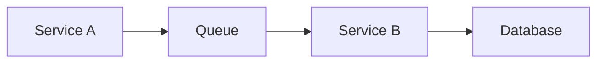

# Distributed Systems

## Overview

- **What is it?** Distributed systems coordinate multiple nodes over unreliable networks.
- **Why is it important?** Scale and fault tolerance require multiple machines and services.
- **Where is it used?** Microservices, Kafka pipelines, cloud storage, global SaaS.

## Learning Objectives

- **Skills gained:** Practical command of Distributed Systems.
- **Concepts covered:**

- Explain CAP tradeoffs at high level.
- Design idempotent workers and retries.
- Use message queues and service discovery.

- **Expected outcome:** You reason about failure modes in distributed Python systems.

## Real World Applications

- Cloud platforms
- Streaming
- Global e-commerce
- Fintech

- **Business applications:** Automate workflows, reduce manual errors, accelerate delivery.
- **Career relevance:** Required knowledge for Python roles from junior developer to senior engineer.

## Core Concepts

### Idempotency

- **Definition:** Safe retries.
- **Visual explanation:** `Idempotency` → process → result
- **Practical example:**

```python
def charge(idempotency_key, amount):
    seen = set()
    if idempotency_key in seen:
        return 'duplicate'
    seen.add(idempotency_key)
    return f'charged {amount}'
print(charge('k1', 10))
```

### Timeouts

- **Definition:** Bound waiting.
- **Visual explanation:** `Timeouts` → process → result
- **Practical example:**

```python
import socket
socket.setdefaulttimeout(5.0)
print(socket.getdefaulttimeout())
```

### Message queue

- **Definition:** Async decoupling.
- **Visual explanation:** `Message queue` → process → result
- **Practical example:**

```python
QUEUE = []
QUEUE.append({'task': 1})
print(QUEUE.pop(0))
```

## Infographic Summary

| Block | Summary |
| --- | --- |
| 📌 Concept | Network partitions and latency are inevitable. |
| ⚡ Purpose | Build reliable multi-node applications. |
| 🔥 Benefits | Scale, isolation, geographic distribution. |
| 🎯 Use Cases | Order processing, event buses, crawl fleets. |
| 🚀 Best Practices | Design for failure; observability; sagas; idempotent handlers. |
| ❌ Common Mistakes | Single point of failure, no retries, distributed monolith coupling. |

## Syntax Guide

### Basic Syntax

```python
# worker consumes message -> process -> ack
```

### Standard Structure

```python
producer -> queue -> consumer -> store
```

### Code Pattern

```python
def retry_delay(attempt: int, base: float = 0.1) -> float:
    return base * (2 ** attempt)


print(retry_delay(2))
```

## Examples

### Beginner Example

```python
jobs = []
jobs.append('email')
print(jobs.pop())
```

### Intermediate Example

```python
def handle_event(event, processed: set):
    event_id = event['id']
    if event_id in processed:
        return 'skipped'
    processed.add(event_id)
    return 'handled'


print(handle_event({'id': '1'}, set()))
```

### Advanced Example

```python
import hashlib


def shard_for(key: str, num_shards: int) -> int:
    digest = hashlib.md5(key.encode(), usedforsecurity=False).hexdigest()
    return int(digest, 16) % num_shards


print(shard_for('user-42', 8))
```

## Workflow Diagram



---
