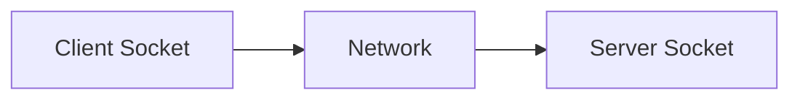

# Network Programming

## Overview

- **What is it?** Network programming sends and receives data over TCP/IP and application protocols.
- **Why is it important?** Distributed apps communicate via sockets, HTTP, and messaging.
- **Where is it used?** Clients, servers, proxies, IoT gateways, custom protocols.

## Learning Objectives

- **Skills gained:** Practical command of Network Programming.
- **Concepts covered:**

- Understand IP, ports, TCP vs UDP.
- Use socket API basics.
- Handle timeouts and buffering.

- **Expected outcome:** You implement basic network clients and servers in Python.

## Real World Applications

- Telecom
- Gaming netcode
- IoT
- Custom protocols

- **Business applications:** Automate workflows, reduce manual errors, accelerate delivery.
- **Career relevance:** Required knowledge for Python roles from junior developer to senior engineer.

## Core Concepts

### TCP

- **Definition:** Reliable stream.
- **Visual explanation:** `TCP` → process → result
- **Practical example:**

```python
import socket
print(socket.SOCK_STREAM)
```

### UDP

- **Definition:** Datagram protocol.
- **Visual explanation:** `UDP` → process → result
- **Practical example:**

```python
import socket
print(socket.SOCK_DGRAM)
```

### socket

- **Definition:** Endpoint abstraction.
- **Visual explanation:** `socket` → process → result
- **Practical example:**

```python
import socket
s = socket.socket()
print(type(s).__name__)
```

## Infographic Summary

| Block | Summary |
| --- | --- |
| 📌 Concept | Sockets are the foundation beneath HTTP and many protocols. |
| ⚡ Purpose | Move bytes between hosts reliably or quickly. |
| 🔥 Benefits | Full control, custom protocols, low-level tooling. |
| 🎯 Use Cases | Echo server, metrics agent, device firmware comms. |
| 🚀 Best Practices | Set timeouts; handle partial reads; close sockets in finally. |
| ❌ Common Mistakes | Blocking forever, no framing, ignoring endianness in binary protocols. |

## Syntax Guide

### Basic Syntax

```python
import socket
sock = socket.create_connection(('example.com', 80), timeout=5)
```

### Standard Structure

```python
create socket -> connect/bind -> send/recv -> close
```

### Code Pattern

```python
with socket.create_connection(addr) as s: s.sendall(data)
```

## Examples

### Beginner Example

```python
import socket
print(socket.gethostname())
```

### Intermediate Example

```python
import socket

def recv_all(sock, size: int) -> bytes:
    chunks = []
    while len(b''.join(chunks)) < size:
        chunk = sock.recv(size - len(b''.join(chunks)))
        if not chunk:
            break
        chunks.append(chunk)
    return b''.join(chunks)


print(callable(recv_all))
```

### Advanced Example

```python
import selectors
import socket


def echo_server():
    sel = selectors.DefaultSelector()
    sock = socket.socket()
    sock.bind(('127.0.0.1', 0))
    sock.listen()
    sel.register(sock, selectors.EVENT_READ)
    return sock, sel


s, sel = echo_server()
print(s.getsockname()[1] > 0)
s.close()
sel.close()
```

## Workflow Diagram



---
