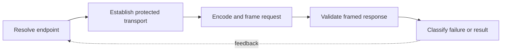

> **Level 3: Advanced** · Topic 13 of 40

[← Distributed Systems](./12-distributed-systems.md) · [↑ Level index](../README.md) · [Socket Programming →](./14-socket-programming.md)

# Network Programming

## Overview
- **What is it?** Network programming designs application protocols over transports, including framing, addressing, name resolution, encoding, security, and failure handling.
- **Why is it important?** Production clients must treat payloads as untrusted bytes and make connection, read, retry, and protocol limits explicit.
- **Where is it used?** It powers API clients, service discovery, telemetry agents, proxies, and custom binary protocols.

## Learning Objectives
- Distinguish application protocols from TCP, UDP, DNS, and TLS transport concerns.
- Encode, frame, validate, and parse messages incrementally.
- Apply deadlines, size limits, and error classification at network boundaries.

## Real World Applications
- HTTP integrations, DNS-aware clients, telemetry collectors, and service agents.
- Length-prefixed or delimiter-based protocols for internal devices and services.
- Securely parsing remote data while preserving protocol compatibility.

## Core Concepts

### Layered Protocols
- **Definition:** Applications define message semantics above transports; TCP supplies an ordered byte stream, while UDP supplies independent datagrams without delivery guarantees.
- **Visual explanation:** `application message → TLS → TCP/UDP → IP → network`
- **Practical example:**

```python
from urllib.parse import urlsplit

endpoint = urlsplit("https://api.example.com:8443/v1/items")
print(endpoint.scheme, endpoint.hostname, endpoint.port, endpoint.path)
```

### Framing and Encoding
- **Definition:** A stream has no message boundaries, so protocols need length prefixes, delimiters with escaping, or a self-delimiting format plus explicit encoding.
- **Visual explanation:** `Python object → serialized bytes → frame boundary → byte stream`
- **Practical example:**

```python
import json
import struct

payload = json.dumps({"event": "ready"}).encode("utf-8")
frame = struct.pack("!I", len(payload)) + payload
declared_size = struct.unpack("!I", frame[:4])[0]
assert frame[4:4 + declared_size] == payload
```

### Defensive Protocol Parsing
- **Definition:** Parsers must cap lengths, reject malformed encodings, and separate retryable transport failures from permanent protocol errors.
- **Visual explanation:** `bytes → length/encoding validation → schema validation → domain message`
- **Practical example:**

```python
import json

def decode_message(payload: bytes, limit: int = 65_536) -> dict[str, object]:
    if len(payload) > limit:
        raise ValueError("message too large")
    value = json.loads(payload.decode("utf-8", errors="strict"))
    if not isinstance(value, dict):
        raise TypeError("object message required")
    return value
```

## Infographic Summary

| Infographic Block | Topic-specific takeaway |
| --- | --- |
| 📌 Concept | Network programming designs application protocols over transports, including framing, addressing, name resolution, encoding, security, and failure handling. |
| ⚡ Purpose | Production clients must treat payloads as untrusted bytes and make connection, read, retry, and protocol limits explicit. |
| 🔥 Benefits | Builds the ability to distinguish application protocols from TCP, UDP, DNS, and TLS transport concerns; it also helps practitioners encode, frame, validate, and parse messages incrementally. |
| 🎯 Use Cases | HTTP integrations, DNS-aware clients, telemetry collectors, and service agents. Length-prefixed or delimiter-based protocols for internal devices and services. |
| 🚀 Best Practices | Cap frame sizes before allocating or decoding. |
| ❌ Common Mistakes | Ignoring the guardrail “Version protocols for additive evolution and compatibility”. |

## Syntax Guide

### Basic Syntax

```python
import ipaddress

network = ipaddress.ip_network("10.0.0.0/24")
allowed = ipaddress.ip_address("10.0.0.42") in network
```

### Standard Structure

```python
import json

body = json.dumps({"version": 1, "kind": "ping"}).encode("utf-8")
message = json.loads(body)
```

### Code Pattern

```python
import struct

HEADER = struct.Struct("!BI")
header = HEADER.pack(1, 512)
version, length = HEADER.unpack(header)
```

## Examples

### Beginner Example

```python
from urllib.parse import urlencode

query = urlencode({"q": "python network", "page": 2})
url = f"https://example.com/search?{query}"
print(url)
```

### Intermediate Example

```python
import ssl
from urllib.request import urlopen

context = ssl.create_default_context()
with urlopen("https://example.com", timeout=5, context=context) as response:
    content_type = response.headers.get_content_type()
    body = response.read(4096)
print(content_type, len(body))
```

### Advanced Example

```python
import struct

def extract_frames(buffer: bytearray, maximum: int = 1_048_576) -> list[bytes]:
    frames = []
    while len(buffer) >= 4:
        size = struct.unpack("!I", buffer[:4])[0]
        if size > maximum:
            raise ValueError("frame exceeds limit")
        if len(buffer) < 4 + size:
            break
        frames.append(bytes(buffer[4:4 + size]))
        del buffer[:4 + size]
    return frames
```

## Workflow Diagram



---

[← Distributed Systems](./12-distributed-systems.md) · [↑ Level index](../README.md) · [Socket Programming →](./14-socket-programming.md)
