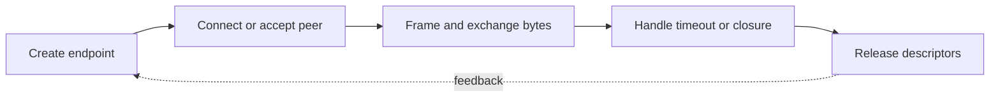

> **Level 3: Advanced** · Topic 14 of 40

[← Network Programming](./13-network-programming.md) · [↑ Level index](../README.md) · [Cybersecurity Automation →](./15-cybersecurity-automation.md)

# Socket Programming

## Overview
- **What is it?** Python's `socket` module exposes operating-system network endpoints for TCP streams, UDP datagrams, and local interprocess communication.
- **Why is it important?** Correct socket code handles partial sends and receives, connection lifetime, timeouts, framing, address families, and clean shutdown.
- **Where is it used?** Sockets are used for custom services, proxies, protocol clients, test harnesses, and low-level network diagnostics.

## Learning Objectives
- Build TCP client and server lifecycles with context-managed sockets.
- Implement bounded framing over a stream and handle partial reads.
- Use selectors or async abstractions for scalable connection readiness.

## Real World Applications
- Custom protocol servers, reverse proxies, local agents, and device gateways.
- Testing service behavior below an HTTP framework.
- Multiplexing many mostly idle connections through readiness notification.

## Core Concepts

### TCP Connection Lifecycle
- **Definition:** A server binds and listens, accepts a new connected socket per peer, exchanges stream bytes, then closes both accepted and listening descriptors.
- **Visual explanation:** `socket → bind → listen → accept → recv/sendall → close`
- **Practical example:**

```python
import socket

with socket.socket(socket.AF_INET, socket.SOCK_STREAM) as server:
    server.setsockopt(socket.SOL_SOCKET, socket.SO_REUSEADDR, 1)
    server.bind(("127.0.0.1", 0))
    server.listen()
    print(server.getsockname())
```

### Stream Reads and Framing
- **Definition:** `recv(n)` may return fewer than n bytes and an empty result means orderly peer closure, so fixed-size fields require a receive loop.
- **Visual explanation:** `byte stream → receive exact header → parse length → receive exact body`
- **Practical example:**

```python
import socket

def recv_exact(connection: socket.socket, size: int) -> bytes:
    chunks = bytearray()
    while len(chunks) < size:
        chunk = connection.recv(size - len(chunks))
        if not chunk:
            raise ConnectionError("peer closed early")
        chunks.extend(chunk)
    return bytes(chunks)
```

### Readiness Multiplexing
- **Definition:** Selectors ask the operating system which nonblocking sockets are ready, avoiding one waiting thread per connection.
- **Visual explanation:** `registered sockets → OS readiness → event callback → update interest`
- **Practical example:**

```python
import selectors
import socket

selector = selectors.DefaultSelector()
listener = socket.socket()
listener.setblocking(False)
selector.register(listener, selectors.EVENT_READ, data="listener")
selector.unregister(listener)
listener.close()
```

## Infographic Summary

| Infographic Block | Topic-specific takeaway |
| --- | --- |
| 📌 Concept | Python's `socket` module exposes operating-system network endpoints for TCP streams, UDP datagrams, and local interprocess communication. |
| ⚡ Purpose | Correct socket code handles partial sends and receives, connection lifetime, timeouts, framing, address families, and clean shutdown. |
| 🔥 Benefits | Builds the ability to build TCP client and server lifecycles with context-managed sockets; it also helps practitioners implement bounded framing over a stream and handle partial reads. |
| 🎯 Use Cases | Custom protocol servers, reverse proxies, local agents, and device gateways. Testing service behavior below an HTTP framework. |
| 🚀 Best Practices | Selectors scale readiness handling for many connections. |
| ❌ Common Mistakes | Ignoring the guardrail “Never allocate a peer-declared frame without enforcing a maximum”. |

## Syntax Guide

### Basic Syntax

```python
import socket

with socket.create_connection(("example.com", 80), timeout=5) as client:
    client.sendall(b"HEAD / HTTP/1.0\r\nHost: example.com\r\n\r\n")
    prefix = client.recv(128)
```

### Standard Structure

```python
import socket

addresses = socket.getaddrinfo(
    "example.com",
    443,
    type=socket.SOCK_STREAM,
)
```

### Code Pattern

```python
import socket
import struct

def send_frame(connection: socket.socket, payload: bytes) -> None:
    connection.sendall(struct.pack("!I", len(payload)) + payload)
```

## Examples

### Beginner Example

```python
import socket

left, right = socket.socketpair()
try:
    left.sendall(b"ping")
    assert right.recv(4) == b"ping"
finally:
    left.close()
    right.close()
```

### Intermediate Example

```python
import socket
import struct

left, right = socket.socketpair()
try:
    send_frame(left, b"hello")
    size = struct.unpack("!I", recv_exact(right, 4))[0]
    assert recv_exact(right, size) == b"hello"
finally:
    left.close()
    right.close()
```

### Advanced Example

```python
import selectors
import socket

selector = selectors.DefaultSelector()
left, right = socket.socketpair()
try:
    right.setblocking(False)
    selector.register(right, selectors.EVENT_READ)
    left.sendall(b"event")
    for key, mask in selector.select(timeout=1):
        if mask & selectors.EVENT_READ:
            print(key.fileobj.recv(1024))
finally:
    selector.close()
    left.close()
    right.close()
```

## Workflow Diagram



---

[← Network Programming](./13-network-programming.md) · [↑ Level index](../README.md) · [Cybersecurity Automation →](./15-cybersecurity-automation.md)
