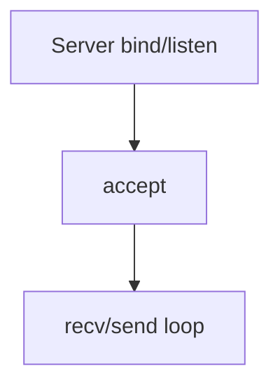

# Socket Programming

## Overview

- **What is it?** Socket programming implements clients and servers using BSD sockets API.
- **Why is it important?** Low-level control is needed for custom services and performance-sensitive I/O.
- **Where is it used?** Chat servers, game servers, proxies, embedded agents.

## Learning Objectives

- **Skills gained:** Practical command of Socket Programming.
- **Concepts covered:**

- Build TCP echo client/server.
- Handle bind/listen/accept.
- Use non-blocking or asyncio streams.

- **Expected outcome:** You write minimal socket-based networked programs.

## Real World Applications

- Multiplayer games
- VPN tooling
- Industrial IoT
- Media streaming

- **Business applications:** Automate workflows, reduce manual errors, accelerate delivery.
- **Career relevance:** Required knowledge for Python roles from junior developer to senior engineer.

## Core Concepts

### bind/listen

- **Definition:** Server waits for connections.
- **Visual explanation:** `bind/listen` → process → result
- **Practical example:**

```python
import socket
s = socket.socket()
s.bind(('127.0.0.1', 0))
print(s.getsockname()[1] > 0)
s.close()
```

### connect

- **Definition:** Client initiates TCP.
- **Visual explanation:** `connect` → process → result
- **Practical example:**

```python
import socket
s = socket.socket()
try:
    s.connect(('127.0.0.1', 9))
except OSError:
    pass
finally:
    s.close()
```

### send/recv

- **Definition:** Transfer bytes.
- **Visual explanation:** `send/recv` → process → result
- **Practical example:**

```python
import socket
a, b = socket.socketpair()
a.send(b'ping')
print(b.recv(4))
```

## Infographic Summary

| Block | Summary |
| --- | --- |
| 📌 Concept | Stream sockets deliver ordered byte pipes. |
| ⚡ Purpose | Implement custom network endpoints. |
| 🔥 Benefits | Minimal dependencies, full protocol control. |
| 🎯 Use Cases | Echo, heartbeat, binary framing, LAN tools. |
| 🚀 Best Practices | Use asyncio streams for many connections; always timeout. |
| ❌ Common Mistakes | No message framing, one recv equals one message assumption. |

## Syntax Guide

### Basic Syntax

```python
sock.sendall(b'data')
data = sock.recv(1024)
```

### Standard Structure

```python
socket -> bind/connect -> send/recv loop -> shutdown
```

### Code Pattern

```python
class Server:
    def accept(self):
        return 'connection'


class Client:
    def connect(self):
        return 'connected'


print(Server().accept(), Client().connect())
```

## Examples

### Beginner Example

```python
import socket

client, server = socket.socketpair()
client.send(b'hello')
print(server.recv(5))
```

### Intermediate Example

```python
import socket


def run_echo_once():
    server = socket.socket()
    server.bind(('127.0.0.1', 0))
    server.listen(1)
    port = server.getsockname()[1]
    client = socket.socket()
    client.connect(('127.0.0.1', port))
    conn, _ = server.accept()
    conn.sendall(b'pong')
    print(client.recv(4))
    conn.close()
    client.close()
    server.close()


run_echo_once()
```

### Advanced Example

```python
import asyncio


async def handle(reader: asyncio.StreamReader, writer: asyncio.StreamWriter):
    data = await reader.read(100)
    writer.write(data.upper())
    await writer.drain()
    writer.close()


async def main():
    server = await asyncio.start_server(handle, '127.0.0.1', 0)
    addr = server.sockets[0].getsockname()
    reader, writer = await asyncio.open_connection(*addr)
    writer.write(b'hi')
    await writer.drain()
    print((await reader.read(10)).decode())
    writer.close()
    server.close()


asyncio.run(main())
```

## Workflow Diagram



---
