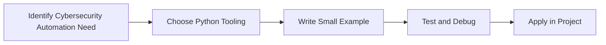

> **Level 3: Advanced** · Topic 15 of 40

[← Socket Programming](./14-socket-programming.md) · [↑ Level index](../README.md) · [Web Scraping →](./16-web-scraping.md)

# Cybersecurity Automation

## Overview
- **What is it?** Cybersecurity Automation is a Python knowledge area focused on systems automation.
- **Why is it important?** Help developers apply systems automation techniques safely, clearly, and consistently.
- **Where is it used?** Network services, security operations, scraping pipelines, and orchestration.

## Learning Objectives
- Gain the practical skill to explain, write, debug, and review cybersecurity automation code.
- Cover the vocabulary, syntax, workflow, edge cases, and professional habits behind cybersecurity automation.
- Expected outcome: you can use cybersecurity automation in a small project and recognize when it belongs in production code.

## Real World Applications
- **Industry use cases:** Network services, security operations, scraping pipelines, and orchestration.
- **Business applications:** Reduce manual work, improve reliability, support reporting, automate decisions, and ship maintainable features.
- **Career relevance:** Supports Python developer, backend engineer, data engineer, AI engineer, DevOps engineer, QA automation, and cybersecurity automation roles.

## Core Concepts

### Mental Model
- **Definition:** The main idea that gives cybersecurity automation its structure and purpose inside a Python program.
- **Visual explanation:** `problem -> Cybersecurity Automation model -> clear code`
- **Practical example:**

```python
apply_cybersecurity_automation_label = "Cybersecurity Automation"
print(apply_cybersecurity_automation_label)
```

### Execution Flow
- **Definition:** The ordered steps Python follows when cybersecurity automation code is created, executed, or integrated.
- **Visual explanation:** `input -> Python operation -> result -> feedback`
- **Practical example:**

```python
import re
print(bool(re.search(r"python", "learn python")))
```

### Quality Rule
- **Definition:** The reliability habit that keeps cybersecurity automation understandable, testable, secure, and maintainable.
- **Visual explanation:** `working code -> validation -> production confidence`
- **Practical example:**

```python
import re

emails = re.findall(r"[\w.-]+@[\w.-]+", "Contact a@x.com and b@y.com")
print(emails)
```

## Infographic Summary

| Infographic Block | Key Message |
| --- | --- |
| 📌 Concept | Cybersecurity Automation belongs to the systems automation part of Python mastery. |
| ⚡ Purpose | Help developers apply systems automation techniques safely, clearly, and consistently. |
| 🔥 Benefits | Stronger maintainability, better reliability, and more professional systems automation decisions. |
| 🎯 Use Cases | Network services, security operations, scraping pipelines, and orchestration. |
| 🚀 Best Practices | Prefer readable names, small examples, explicit errors, tests, documentation, and version-aware choices. |
| ❌ Common Mistakes | Copying code without understanding it, ignoring edge cases, skipping validation, and mixing unrelated responsibilities. |

## Syntax Guide

### Basic Syntax

```python
import re
match = re.search(r"\d+", "Order 42")
```

### Standard Structure

```python
def apply_cybersecurity_automation(value):
    """Apply the Cybersecurity Automation concept to one value."""
    return value

result = apply_cybersecurity_automation("practice")
print(result)
```

### Code Pattern

```python
# 1. Identify the Cybersecurity Automation problem
# 2. Apply the correct Python structure
# 3. Validate the result with tests or output
```

## Examples

### Beginner Example

```python
import re
print(bool(re.search(r"python", "learn python")))
```

### Intermediate Example

```python
import re

emails = re.findall(r"[\w.-]+@[\w.-]+", "Contact a@x.com and b@y.com")
print(emails)
```

### Advanced Example

```python
import re

pattern = re.compile(r"(?P<status>\d{3}) (?P<path>/\S+)")
match = pattern.search("200 /api/users")
print(match.groupdict() if match else {})
```

## Workflow Diagram




---

---

[← Socket Programming](./14-socket-programming.md) · [↑ Level index](../README.md) · [Web Scraping →](./16-web-scraping.md)
