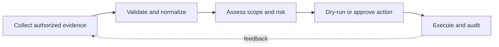

> **Level 3: Advanced** · Topic 15 of 40

[← Socket Programming](./14-socket-programming.md) · [↑ Level index](../README.md) · [Web Scraping →](./16-web-scraping.md)

# Cybersecurity Automation

## Overview
- **What is it?** Cybersecurity automation uses Python to collect evidence, validate configurations, verify integrity, enrich alerts, and orchestrate approved defensive actions.
- **Why is it important?** Automation must preserve audit trails, minimize privileges, validate untrusted inputs, and fail safely because a mistaken action can widen an incident.
- **Where is it used?** It supports security operations, vulnerability management, compliance checks, incident response, and secrets hygiene.

## Learning Objectives
- Use cryptographic primitives through safe standard-library interfaces.
- Parse indicators and invoke system tools without shell injection.
- Design dry-run, approval, least-privilege, and tamper-evident audit controls.

## Real World Applications
- Verifying downloaded artifacts and signed webhook payloads.
- Normalizing IP indicators and enriching authorized incident records.
- Scanning configuration baselines and producing reproducible evidence.

## Core Concepts

### Integrity and Authentication
- **Definition:** A cryptographic hash detects changes, while an HMAC also authenticates data with a shared secret and should be compared in constant time.
- **Visual explanation:** `message + secret → HMAC → constant-time verification`
- **Practical example:**

```python
import hashlib
import hmac

secret = b"training-key"
body = b'{"event":"login"}'
signature = hmac.new(secret, body, hashlib.sha256).hexdigest()
assert hmac.compare_digest(signature, signature)
```

### Safe Input and Process Boundaries
- **Definition:** Treat indicators and command arguments as data: parse them with strict libraries and pass argument lists without invoking a shell.
- **Visual explanation:** `untrusted text → parser/allowlist → argument vector → bounded subprocess`
- **Practical example:**

```python
import ipaddress
import subprocess

address = ipaddress.ip_address("192.0.2.10")
result = subprocess.run(
    ["printf", "%s", str(address)],
    check=True,
    capture_output=True,
    text=True,
    timeout=2,
)
```

### Controlled Remediation
- **Definition:** Defensive actions should support dry runs, scoped credentials, idempotency, human approval for destructive steps, and structured audit events.
- **Visual explanation:** `alert → validate scope → plan/dry-run → approve → act → audit`
- **Practical example:**

```python
from dataclasses import dataclass

@dataclass(frozen=True)
class Action:
    target: str
    reason: str

def quarantine(action: Action, *, execute: bool = False) -> str:
    mode = "executed" if execute else "planned"
    return f"{mode}:{action.target}:{action.reason}"
```

## Infographic Summary

| Infographic Block | Topic-specific takeaway |
| --- | --- |
| 📌 Concept | Cybersecurity automation uses Python to collect evidence, validate configurations, verify integrity, enrich alerts, and orchestrate approved defensive actions. |
| ⚡ Purpose | Automation must preserve audit trails, minimize privileges, validate untrusted inputs, and fail safely because a mistaken action can widen an incident. |
| 🔥 Benefits | Builds the ability to use cryptographic primitives through safe standard-library interfaces; it also helps practitioners parse indicators and invoke system tools without shell injection. |
| 🎯 Use Cases | Verifying downloaded artifacts and signed webhook payloads. Normalizing IP indicators and enriching authorized incident records. |
| 🚀 Best Practices | Dry-run and approval gates protect high-impact remediation. |
| ❌ Common Mistakes | Ignoring the guardrail “Never log tokens, private keys, passwords, or full sensitive payloads”. |

## Syntax Guide

### Basic Syntax

```python
import hashlib
from pathlib import Path

with Path("artifact.bin").open("rb") as stream:
    checksum = hashlib.file_digest(stream, "sha256").hexdigest()
```

### Standard Structure

```python
import ipaddress

def is_public(value: str) -> bool:
    address = ipaddress.ip_address(value)
    return address.is_global
```

### Code Pattern

```python
import json
import logging

logging.basicConfig(level=logging.INFO)
logging.info(json.dumps({"action": "scan", "status": "complete"}))
```

## Examples

### Beginner Example

```python
import secrets

incident_id = secrets.token_urlsafe(16)
print(incident_id)
```

### Intermediate Example

```python
import hashlib
import secrets
from pathlib import Path

def verify(path: Path, expected: str) -> bool:
    with path.open("rb") as stream:
        actual = hashlib.file_digest(stream, "sha256").hexdigest()
    return secrets.compare_digest(actual, expected)
```

### Advanced Example

```python
import ipaddress
from dataclasses import asdict, dataclass

@dataclass(frozen=True)
class Finding:
    indicator: str
    category: str
    approved: bool = False

def normalize_indicator(value: str) -> str:
    return str(ipaddress.ip_address(value))

finding = Finding(normalize_indicator("2001:db8::1"), "documentation-range")
print(asdict(finding))
```

## Workflow Diagram



---

[← Socket Programming](./14-socket-programming.md) · [↑ Level index](../README.md) · [Web Scraping →](./16-web-scraping.md)
