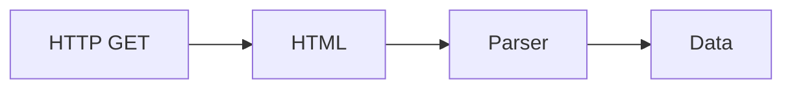

# Web Scraping

## Overview

- **What is it?** Web scraping extracts structured data from HTML and HTTP responses.
- **Why is it important?** Public data powers research, monitoring, and competitive intelligence when permitted.
- **Where is it used?** Price monitoring, news aggregation, lead gen (compliant), archival.

## Learning Objectives

- **Skills gained:** Practical command of Web Scraping.
- **Concepts covered:**

- Fetch pages responsibly with timeouts.
- Parse HTML with BeautifulSoup or lxml.
- Respect robots.txt and rate limits.

- **Expected outcome:** You extract structured fields from web pages ethically and robustly.

## Real World Applications

- Market intelligence
- SEO
- Research
- Compliance monitoring

- **Business applications:** Automate workflows, reduce manual errors, accelerate delivery.
- **Career relevance:** Required knowledge for Python roles from junior developer to senior engineer.

## Core Concepts

### HTTP fetch

- **Definition:** Retrieve page content.
- **Visual explanation:** `HTTP fetch` → process → result
- **Practical example:**

```python
HTML = '<html><title>Hi</title></html>'
print('Hi' in HTML)
```

### HTML parse

- **Definition:** Navigate DOM tree.
- **Visual explanation:** `HTML parse` → process → result
- **Practical example:**

```python
from html.parser import HTMLParser
class P(HTMLParser):
    def handle_starttag(self, tag, attrs):
        self.tag = tag
p = P()
p.feed('<div></div>')
print(p.tag)
```

### CSS/selectors

- **Definition:** Target elements.
- **Visual explanation:** `CSS/selectors` → process → result
- **Practical example:**

```python
from html.parser import HTMLParser
print('title' in '<title>x</title>')
```

## Infographic Summary

| Block | Summary |
| --- | --- |
| 📌 Concept | Scraping = fetch + parse + normalize + store. |
| ⚡ Purpose | Turn web pages into datasets. |
| 🔥 Benefits | Automation of manual copy/paste research. |
| 🎯 Use Cases | Product prices, job listings, metadata harvest. |
| 🚀 Best Practices | Rate limit; identify bot; check Terms of Service; cache. |
| ❌ Common Mistakes | Ignoring robots, brittle regex-only parsing, no backoff. |

## Syntax Guide

### Basic Syntax

```python
html = fetch(url)
soup.select('h1.title')
```

### Standard Structure

```python
fetch -> parse -> extract -> validate -> save
```

### Code Pattern

```python
for page in pages:
    for item in parse(page):
        store(item)
```

## Examples

### Beginner Example

```python
title = 'Sample'
print(title.lower())
```

### Intermediate Example

```python
from html.parser import HTMLParser


class TitleParser(HTMLParser):
    def __init__(self):
        super().__init__()
        self.in_title = False
        self.title = ''

    def handle_starttag(self, tag, attrs):
        if tag == 'title':
            self.in_title = True

    def handle_data(self, data):
        if self.in_title:
            self.title += data

    def handle_endtag(self, tag):
        if tag == 'title':
            self.in_title = False


parser = TitleParser()
parser.feed('<html><title>Hello</title></html>')
print(parser.title)
```

### Advanced Example

```python
import time


class RateLimiter:
    def __init__(self, min_interval: float):
        self.min_interval = min_interval
        self.last = 0.0

    def wait(self):
        now = time.monotonic()
        elapsed = now - self.last
        if elapsed < self.min_interval:
            time.sleep(self.min_interval - elapsed)
        self.last = time.monotonic()


limiter = RateLimiter(0.01)
limiter.wait()
print('fetched')
```

## Workflow Diagram



---
