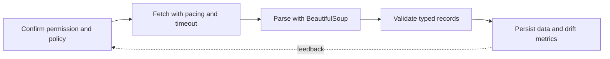

> **Level 3: Advanced** · Topic 16 of 40

[← Cybersecurity Automation](./15-cybersecurity-automation.md) · [↑ Level index](../README.md) · [Automation Frameworks →](./17-automation-frameworks.md)

# Web Scraping

## Overview
- **What is it?** Web scraping extracts structured data from permitted web pages while respecting site terms, robots guidance, rate limits, and data-protection obligations.
- **Why is it important?** Reliable scrapers separate fetching from parsing, use stable semantic selectors, validate outputs, and cache or retry conservatively.
- **Where is it used?** It is used for public-data research, price monitoring, content migration, quality assurance, and archival workflows.

## Learning Objectives
- Fetch pages with explicit identity, timeout, status handling, and pacing.
- Parse HTML with BeautifulSoup selectors and normalize extracted fields.
- Detect layout drift and avoid bypassing access controls or anti-abuse systems.

## Real World Applications
- Collecting permitted public catalogs, notices, and structured reports.
- Validating links and metadata across owned websites.
- Migrating legacy content into a documented internal schema.

## Core Concepts

### Responsible Retrieval
- **Definition:** A scraper should identify itself, respect published policies, limit request rate, use deadlines, and stop on denial rather than evade controls.
- **Visual explanation:** `permission/policy → paced request → status check → cached response`
- **Practical example:**

```python
import requests

headers = {"User-Agent": "CurriculumResearchBot/1.0 (contact@example.com)"}
response = requests.get("https://example.com", headers=headers, timeout=(3.05, 10))
response.raise_for_status()
```

### BeautifulSoup Parsing
- **Definition:** BeautifulSoup builds a navigable tree from imperfect HTML; CSS selectors locate elements while attribute access and `get_text` extract normalized values.
- **Visual explanation:** `HTML bytes → parser tree → CSS selection → normalized record`
- **Practical example:**

```python
from bs4 import BeautifulSoup

html = '<article data-id="7"><h2> Python </h2></article>'
soup = BeautifulSoup(html, "html.parser")
article = soup.select_one("article[data-id]")
assert article is not None
record = {"id": article["data-id"], "title": article.h2.get_text(strip=True)}
```

### Schema and Drift Detection
- **Definition:** Parsing should produce a typed internal schema and fail visibly when required selectors disappear instead of silently emitting corrupt rows.
- **Visual explanation:** `selected fields → required-field validation → record or drift alert`
- **Practical example:**

```python
from dataclasses import dataclass

@dataclass(frozen=True)
class Article:
    identifier: str
    title: str

def require_text(element, selector: str) -> str:
    match = element.select_one(selector)
    if match is None:
        raise ValueError(f"missing selector: {selector}")
    return match.get_text(" ", strip=True)
```

## Infographic Summary

| Infographic Block | Topic-specific takeaway |
| --- | --- |
| 📌 Concept | Web scraping extracts structured data from permitted web pages while respecting site terms, robots guidance, rate limits, and data-protection obligations. |
| ⚡ Purpose | Reliable scrapers separate fetching from parsing, use stable semantic selectors, validate outputs, and cache or retry conservatively. |
| 🔥 Benefits | Builds the ability to fetch pages with explicit identity, timeout, status handling, and pacing; it also helps practitioners parse HTML with BeautifulSoup selectors and normalize extracted fields. |
| 🎯 Use Cases | Collecting permitted public catalogs, notices, and structured reports. Validating links and metadata across owned websites. |
| 🚀 Best Practices | Cache pages during parser development to avoid repeated traffic. |
| ❌ Common Mistakes | Ignoring the guardrail “Do not scrape private data or circumvent authentication and controls”. |

## Syntax Guide

### Basic Syntax

```python
from bs4 import BeautifulSoup

soup = BeautifulSoup("<p class='note'>Ready</p>", "html.parser")
text = soup.select_one("p.note").get_text(strip=True)
```

### Standard Structure

```python
import requests

with requests.Session() as session:
    session.headers["User-Agent"] = "ResearchBot/1.0"
    response = session.get("https://example.com", timeout=10)
    response.raise_for_status()
```

### Code Pattern

```python
from urllib.parse import urljoin

def links(soup, base_url: str) -> list[str]:
    return [
        urljoin(base_url, anchor["href"])
        for anchor in soup.select("a[href]")
    ]
```

## Examples

### Beginner Example

```python
from bs4 import BeautifulSoup

soup = BeautifulSoup("<ul><li>A</li><li>B</li></ul>", "html.parser")
print([item.get_text(strip=True) for item in soup.select("li")])
```

### Intermediate Example

```python
from bs4 import BeautifulSoup

html = '<div class="product" data-sku="P1"><span class="price">$12.50</span></div>'
soup = BeautifulSoup(html, "html.parser")
products = [
    {"sku": node["data-sku"], "price": node.select_one(".price").get_text(strip=True)}
    for node in soup.select(".product[data-sku]")
]
print(products)
```

### Advanced Example

```python
from bs4 import BeautifulSoup
from decimal import Decimal

def parse_products(html: str) -> list[dict[str, object]]:
    soup = BeautifulSoup(html, "html.parser")
    records = []
    for node in soup.select("article.product[data-sku]"):
        price_text = require_text(node, ".price").removeprefix("$")
        records.append({
            "sku": str(node["data-sku"]),
            "name": require_text(node, "h2"),
            "price": Decimal(price_text),
        })
    if not records:
        raise ValueError("no products found; layout may have changed")
    return records
```

## Workflow Diagram



---

[← Cybersecurity Automation](./15-cybersecurity-automation.md) · [↑ Level index](../README.md) · [Automation Frameworks →](./17-automation-frameworks.md)
