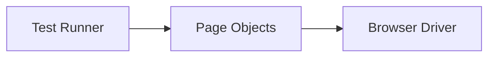

# Automation Frameworks

## Overview

- **What is it?** Automation frameworks structure reusable test and RPA-style automation (Selenium, Playwright, Robot).
- **Why is it important?** Ad-hoc scripts become unmaintainable without page objects and reporting.
- **Where is it used?** QA automation, browser testing, IT RPA, regression suites.

## Learning Objectives

- **Skills gained:** Practical command of Automation Frameworks.
- **Concepts covered:**

- Organize tests with page object model.
- Use fixtures and waits properly.
- Integrate automation into CI.

- **Expected outcome:** You build maintainable automation suites with frameworks.

## Real World Applications

- QA teams
- SaaS releases
- E-commerce
- Banking UAT

- **Business applications:** Automate workflows, reduce manual errors, accelerate delivery.
- **Career relevance:** Required knowledge for Python roles from junior developer to senior engineer.

## Core Concepts

### Page Object

- **Definition:** Encapsulate UI locators.
- **Visual explanation:** `Page Object` → process → result
- **Practical example:**

```python
class LoginPage:
    def username(self):
        return '#user'
print(LoginPage().username())
```

### Waits

- **Definition:** Handle async UI.
- **Visual explanation:** `Waits` → process → result
- **Practical example:**

```python
import time
time.sleep(0)
print('ready')
```

### Test runner

- **Definition:** Execute suite.
- **Visual explanation:** `Test runner` → process → result
- **Practical example:**

```python
TESTS = [lambda: True]
print(all(t() for t in TESTS))
```

## Infographic Summary

| Block | Summary |
| --- | --- |
| 📌 Concept | Frameworks separate test logic from UI details. |
| ⚡ Purpose | Reliable repeatable automation at scale. |
| 🔥 Benefits | Maintainability, parallel runs, reporting plugins. |
| 🎯 Use Cases | Smoke tests, checkout flows, admin consoles. |
| 🚀 Best Practices | Stable selectors; explicit waits; screenshot on failure. |
| ❌ Common Mistakes | sleep-only sync, duplicated selectors, flaky shared state. |

## Syntax Guide

### Basic Syntax

```python
page.click('#submit')
assert page.text('#msg') == 'OK'
```

### Standard Structure

```python
pages -> tests -> runner -> reports
```

### Code Pattern

```python
class LoginPage:
    def open(self):
        return self

    def login(self, user, password):
        return user


print(LoginPage().open().login('ada', 'secret'))
```

## Examples

### Beginner Example

```python
def test_true():
    assert True
test_true()
```

### Intermediate Example

```python
class HomePage:
    def __init__(self, driver):
        self.driver = driver

    def title(self):
        return self.driver.get('title')


class FakeDriver:
    def get(self, key):
        return {'title': 'Home'}[key]


print(HomePage(FakeDriver()).title())
```

### Advanced Example

```python
class TestCase:
    def __init__(self, name, fn):
        self.name = name
        self.fn = fn

    def run(self):
        try:
            self.fn()
            return self.name, True
        except AssertionError:
            return self.name, False


suite = [TestCase('login', lambda: True)]
print([tc.run() for tc in suite])
```

## Workflow Diagram



---
