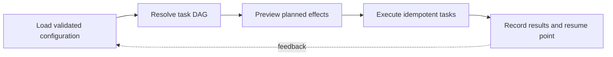

> **Level 3: Advanced** · Topic 17 of 40

[← Web Scraping](./16-web-scraping.md) · [↑ Level index](../README.md) · [ETL Development →](./18-etl-development.md)

# Automation Frameworks

## Overview
- **What is it?** An automation framework turns one-off scripts into repeatable commands with configuration, task discovery, dependency ordering, logging, retries, and testable adapters.
- **Why is it important?** The framework should make actions observable and idempotent while keeping shell, filesystem, and network effects behind explicit interfaces.
- **Where is it used?** It supports release tooling, environment checks, scheduled maintenance, migrations, and operator runbooks.

## Learning Objectives
- Design discoverable tasks with validated inputs and structured results.
- Use `argparse`, subprocess argument vectors, and dependency graphs safely.
- Add dry-run, idempotency, retry policy, and machine-readable logging.

## Real World Applications
- CLI runbooks for backups, release checks, and environment bootstrapping.
- Reusable task libraries invoked locally, on schedules, or in CI.
- Operational workflows where partial completion must be resumable.

## Core Concepts

### Task Contracts
- **Definition:** A task contract names inputs, outputs, side effects, and failure behavior so orchestration does not depend on print statements.
- **Visual explanation:** `validated context → task → structured result/error`
- **Practical example:**

```python
from dataclasses import dataclass
from typing import Protocol

@dataclass(frozen=True)
class Result:
    changed: bool
    message: str

class Task(Protocol):
    def run(self, dry_run: bool = False) -> Result: ...
```

### Dependency Ordering
- **Definition:** A directed acyclic graph expresses prerequisites; topological execution prevents a task from running before its required state exists.
- **Visual explanation:** `task graph → validate acyclic → topological order → execute`
- **Practical example:**

```python
from graphlib import TopologicalSorter

dependencies = {
    "deploy": {"test", "build"},
    "test": {"build"},
    "build": set(),
}
order = tuple(TopologicalSorter(dependencies).static_order())
```

### Safe Effect Adapters
- **Definition:** Effects use bounded, explicit APIs and return evidence; subprocesses receive argument lists, timeouts, captured output, and checked exit status.
- **Visual explanation:** `task plan → effect adapter → external system → recorded result`
- **Practical example:**

```python
import subprocess

def git_revision() -> str:
    completed = subprocess.run(
        ["git", "rev-parse", "HEAD"],
        check=True,
        capture_output=True,
        text=True,
        timeout=5,
    )
    return completed.stdout.strip()
```

## Infographic Summary

| Infographic Block | Topic-specific takeaway |
| --- | --- |
| 📌 Concept | An automation framework turns one-off scripts into repeatable commands with configuration, task discovery, dependency ordering, logging, retries, and testable adapters. |
| ⚡ Purpose | The framework should make actions observable and idempotent while keeping shell, filesystem, and network effects behind explicit interfaces. |
| 🔥 Benefits | Builds the ability to design discoverable tasks with validated inputs and structured results; it also helps practitioners use `argparse`, subprocess argument vectors, and dependency graphs safely. |
| 🎯 Use Cases | CLI runbooks for backups, release checks, and environment bootstrapping. Reusable task libraries invoked locally, on schedules, or in CI. |
| 🚀 Best Practices | Structured logs: task, duration, attempt, outcome, correlation ID. |
| ❌ Common Mistakes | Ignoring the guardrail “Avoid hidden module-import side effects and unbounded retries”. |

## Syntax Guide

### Basic Syntax

```python
import argparse

parser = argparse.ArgumentParser()
parser.add_argument("--dry-run", action="store_true")
arguments = parser.parse_args([])
```

### Standard Structure

```python
from collections.abc import Callable

tasks: dict[str, Callable[[], object]] = {}

def task(name: str):
    def register(function: Callable[[], object]) -> Callable[[], object]:
        tasks[name] = function
        return function
    return register
```

### Code Pattern

```python
from dataclasses import dataclass

@dataclass(frozen=True)
class TaskContext:
    dry_run: bool
    correlation_id: str
```

## Examples

### Beginner Example

```python
from pathlib import Path

def ensure_directory(path: Path, dry_run: bool = False) -> Result:
    if path.is_dir():
        return Result(False, "already exists")
    if not dry_run:
        path.mkdir(parents=True)
    return Result(True, f"create {path}")
```

### Intermediate Example

```python
import logging
import time

def execute(name: str, action) -> Result:
    started = time.monotonic()
    try:
        result = action()
        return result
    finally:
        logging.info("task=%s duration=%.3f", name, time.monotonic() - started)
```

### Advanced Example

```python
from graphlib import TopologicalSorter

def run_plan(graph: dict[str, set[str]], registry: dict[str, Task]) -> list[Result]:
    results = []
    for name in TopologicalSorter(graph).static_order():
        try:
            results.append(registry[name].run())
        except KeyError as error:
            raise ValueError(f"unknown task: {name}") from error
    return results
```

## Workflow Diagram



---

[← Web Scraping](./16-web-scraping.md) · [↑ Level index](../README.md) · [ETL Development →](./18-etl-development.md)
