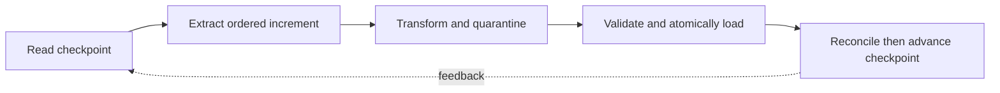

> **Level 3: Advanced** · Topic 18 of 40

[← Automation Frameworks](./17-automation-frameworks.md) · [↑ Level index](../README.md) · [Data Engineering →](./19-data-engineering.md)

# ETL Development

## Overview
- **What is it?** ETL pipelines extract data from sources, transform it into a governed schema, and load it into a destination with recoverable checkpoints.
- **Why is it important?** Reliable ETL separates pure transformations from I/O, tracks lineage and watermarks, validates quality, and commits outputs atomically.
- **Where is it used?** It powers warehouses, reporting, migrations, integrations, and feature-generation pipelines.

## Learning Objectives
- Design extract, transform, and load boundaries with typed records.
- Implement incremental watermarks, idempotent loads, and quarantine paths.
- Validate schema, uniqueness, completeness, and reconciliation metrics.

## Real World Applications
- Incrementally moving transactional data into an analytics warehouse.
- Normalizing partner files while retaining rejected rows and reasons.
- Backfilling historical partitions without duplicating destination records.

## Core Concepts

### Extraction and Watermarks
- **Definition:** Incremental extraction reads records after a durable high-water mark and advances it only after the corresponding load commits.
- **Visual explanation:** `saved watermark → ordered source page → committed load → new watermark`
- **Practical example:**

```python
from datetime import datetime

def after_watermark(rows: list[dict], watermark: datetime) -> list[dict]:
    return sorted(
        (row for row in rows if row["updated_at"] > watermark),
        key=lambda row: (row["updated_at"], row["id"]),
    )
```

### Pure Transformations
- **Definition:** A transformation maps validated source records to destination records without hidden I/O, making replay and unit testing deterministic.
- **Visual explanation:** `source record → normalize/derive → validated destination record`
- **Practical example:**

```python
from decimal import Decimal

def transform(row: dict[str, str]) -> dict[str, object]:
    quantity = int(row["quantity"])
    unit_price = Decimal(row["unit_price"])
    return {
        "order_id": row["id"].strip(),
        "total": quantity * unit_price,
    }
```

### Idempotent Atomic Loads
- **Definition:** Loads use stable business keys and a transaction or atomic partition replacement so retrying a batch does not duplicate partial results.
- **Visual explanation:** `staged batch → validate counts → upsert/replace in transaction → checkpoint`
- **Practical example:**

```python
import sqlite3

def upsert(connection: sqlite3.Connection, rows: list[tuple[str, str]]) -> None:
    with connection:
        connection.executemany(
            "INSERT INTO target(id, value) VALUES(?, ?) "
            "ON CONFLICT(id) DO UPDATE SET value=excluded.value",
            rows,
        )
```

## Infographic Summary

| Infographic Block | Topic-specific takeaway |
| --- | --- |
| 📌 Concept | ETL pipelines extract data from sources, transform it into a governed schema, and load it into a destination with recoverable checkpoints. |
| ⚡ Purpose | Reliable ETL separates pure transformations from I/O, tracks lineage and watermarks, validates quality, and commits outputs atomically. |
| 🔥 Benefits | Builds the ability to design extract, transform, and load boundaries with typed records; it also helps practitioners implement incremental watermarks, idempotent loads, and quarantine paths. |
| 🎯 Use Cases | Incrementally moving transactional data into an analytics warehouse. Normalizing partner files while retaining rejected rows and reasons. |
| 🚀 Best Practices | Quarantine invalid rows with reason and lineage metadata. |
| ❌ Common Mistakes | Ignoring the guardrail “Advance checkpoints only after durable destination success”. |

## Syntax Guide

### Basic Syntax

```python
def extract(rows, since):
    for row in rows:
        if row["updated_at"] > since:
            yield row
```

### Standard Structure

```python
def pipeline(rows, since):
    for row in extract(rows, since):
        try:
            yield transform(row)
        except (KeyError, ValueError) as error:
            print("rejected", row.get("id"), str(error))
```

### Code Pattern

```python
from dataclasses import dataclass

@dataclass(frozen=True)
class BatchMetrics:
    extracted: int
    loaded: int
    rejected: int
```

## Examples

### Beginner Example

```python
rows = [
    {"id": "A", "quantity": "2", "unit_price": "4.50"},
    {"id": "B", "quantity": "1", "unit_price": "8.00"},
]
print([transform(row) for row in rows])
```

### Intermediate Example

```python
import csv
from pathlib import Path

def extract_csv(path: Path):
    with path.open(newline="", encoding="utf-8") as stream:
        yield from csv.DictReader(stream)
```

### Advanced Example

```python
import sqlite3

connection = sqlite3.connect(":memory:")
connection.execute("CREATE TABLE target(id TEXT PRIMARY KEY, value TEXT NOT NULL)")
batch = [("A", "first"), ("B", "second")]
upsert(connection, batch)
upsert(connection, [("A", "updated")])
rows = connection.execute("SELECT id, value FROM target ORDER BY id").fetchall()
assert rows == [("A", "updated"), ("B", "second")]
```

## Workflow Diagram



---

[← Automation Frameworks](./17-automation-frameworks.md) · [↑ Level index](../README.md) · [Data Engineering →](./19-data-engineering.md)
