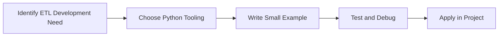

> **Level 3: Advanced** · Topic 18 of 40

[← Automation Frameworks](./17-automation-frameworks.md) · [↑ Level index](../README.md) · [Data Engineering →](./19-data-engineering.md)

# ETL Development

## Overview
- **What is it?** ETL Development is a Python knowledge area focused on data engineering and analytics.
- **Why is it important?** Help developers apply data engineering and analytics techniques safely, clearly, and consistently.
- **Where is it used?** Pipelines, dashboards, feature engineering, and large-scale data platforms.

## Learning Objectives
- Gain the practical skill to explain, write, debug, and review etl development code.
- Cover the vocabulary, syntax, workflow, edge cases, and professional habits behind etl development.
- Expected outcome: you can use etl development in a small project and recognize when it belongs in production code.

## Real World Applications
- **Industry use cases:** Pipelines, dashboards, feature engineering, and large-scale data platforms.
- **Business applications:** Reduce manual work, improve reliability, support reporting, automate decisions, and ship maintainable features.
- **Career relevance:** Supports Python developer, backend engineer, data engineer, AI engineer, DevOps engineer, QA automation, and cybersecurity automation roles.

## Core Concepts

### Dataset Representation
- **Definition:** The main idea that gives etl development its structure and purpose inside a Python program.
- **Visual explanation:** `problem -> ETL Development model -> clear code`
- **Practical example:**

```python
apply_etl_development_label = "ETL Development"
print(apply_etl_development_label)
```

### Transformation Pipeline
- **Definition:** The ordered steps Python follows when etl development code is created, executed, or integrated.
- **Visual explanation:** `input -> Python operation -> result -> feedback`
- **Practical example:**

```python
import csv
from io import StringIO

file = StringIO("name,score\nAda,95\n")
print(list(csv.DictReader(file)))
```

### Validation Signal
- **Definition:** The reliability habit that keeps etl development understandable, testable, secure, and maintainable.
- **Visual explanation:** `working code -> validation -> production confidence`
- **Practical example:**

```python
import csv
from io import StringIO

output = StringIO()
writer = csv.DictWriter(output, fieldnames=["name", "score"])
writer.writeheader()
writer.writerow({"name": "Lin", "score": 98})
print(output.getvalue())
```

## Infographic Summary

| Infographic Block | Key Message |
| --- | --- |
| 📌 Concept | ETL Development belongs to the data engineering and analytics part of Python mastery. |
| ⚡ Purpose | Help developers apply data engineering and analytics techniques safely, clearly, and consistently. |
| 🔥 Benefits | Stronger maintainability, better reliability, and more professional data engineering and analytics decisions. |
| 🎯 Use Cases | Pipelines, dashboards, feature engineering, and large-scale data platforms. |
| 🚀 Best Practices | Prefer readable names, small examples, explicit errors, tests, documentation, and version-aware choices. |
| ❌ Common Mistakes | Copying code without understanding it, ignoring edge cases, skipping validation, and mixing unrelated responsibilities. |

## Syntax Guide

### Basic Syntax

```python
import csv
rows = list(csv.DictReader(open("data.csv", newline="")))
```

### Standard Structure

```python
def apply_etl_development(value):
    """Apply the ETL Development concept to one value."""
    return value

result = apply_etl_development("practice")
print(result)
```

### Code Pattern

```python
# 1. Identify the ETL Development problem
# 2. Apply the correct Python structure
# 3. Validate the result with tests or output
```

## Examples

### Beginner Example

```python
import csv
from io import StringIO

file = StringIO("name,score\nAda,95\n")
print(list(csv.DictReader(file)))
```

### Intermediate Example

```python
import csv
from io import StringIO

output = StringIO()
writer = csv.DictWriter(output, fieldnames=["name", "score"])
writer.writeheader()
writer.writerow({"name": "Lin", "score": 98})
print(output.getvalue())
```

### Advanced Example

```python
import csv
from io import StringIO

data = StringIO("dept,total\nSales,100\nSales,150\n")
totals = {}
for row in csv.DictReader(data):
    totals[row["dept"]] = totals.get(row["dept"], 0) + int(row["total"])
print(totals)
```

## Workflow Diagram




---

---

[← Automation Frameworks](./17-automation-frameworks.md) · [↑ Level index](../README.md) · [Data Engineering →](./19-data-engineering.md)
