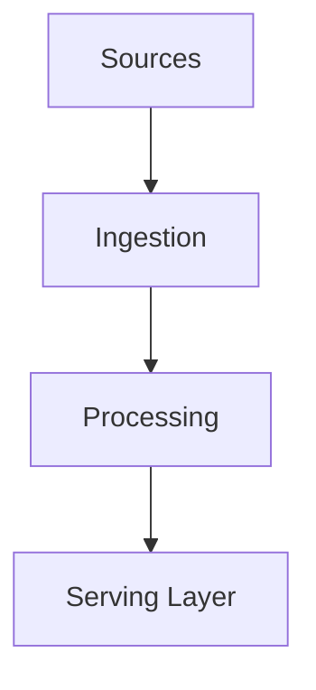

# Data Engineering

## Overview

- **What is it?** Data engineering builds reliable pipelines, storage layers, and serving paths for analytics and ML.
- **Why is it important?** Raw data must become trustworthy tables and features at scale.
- **Where is it used?** Lakehouses, warehouses, streaming platforms, feature stores.

## Learning Objectives

- **Skills gained:** Practical command of Data Engineering.
- **Concepts covered:**

- Design batch and streaming pipelines.
- Apply partitioning and schema evolution.
- Monitor data quality SLAs.

- **Expected outcome:** You architect data platforms with Python components.

## Real World Applications

- Tech unicorns
- Finance
- Healthcare analytics
- Retail

- **Business applications:** Automate workflows, reduce manual errors, accelerate delivery.
- **Career relevance:** Required knowledge for Python roles from junior developer to senior engineer.

## Core Concepts

### Pipeline

- **Definition:** Orchestrated stages.
- **Visual explanation:** `Pipeline` → process → result
- **Practical example:**

```python
stages = ['extract', 'transform', 'load']
print('->'.join(stages))
```

### Partitioning

- **Definition:** Split data by key/date.
- **Visual explanation:** `Partitioning` → process → result
- **Practical example:**

```python
parts = {'2026-06-06': [1, 2]}
print(list(parts))
```

### Lineage

- **Definition:** Track data origin.
- **Visual explanation:** `Lineage` → process → result
- **Practical example:**

```python
meta = {'source': 'crm', 'batch': '001'}
print(meta['source'])
```

## Infographic Summary

| Block | Summary |
| --- | --- |
| 📌 Concept | Data engineering connects sources to trustworthy datasets. |
| ⚡ Purpose | Enable analytics and ML with quality and scale. |
| 🔥 Benefits | Single source of truth, reusable pipelines. |
| 🎯 Use Cases | Daily marts, CDC streams, feature pipelines. |
| 🚀 Best Practices | Idempotent jobs; observability; contract tests on schemas. |
| ❌ Common Mistakes | Tight coupling to one tool, no backfills, missing monitoring. |

## Syntax Guide

### Basic Syntax

```python
orchestrator.run(dag_id='daily_sales')
```

### Standard Structure

```python
ingest -> bronze -> silver -> gold
```

### Code Pattern

```python
def merge_upserts(rows, event_date: str):
    return [dict(r, event_date=event_date) for r in rows]


print(merge_upserts([{'id': 1}], '2026-06-06'))
```

## Examples

### Beginner Example

```python
events = [{'user': 'a', 'ts': 1}, {'user': 'b', 'ts': 2}]
print(len(events))
```

### Intermediate Example

```python
from collections import defaultdict

def aggregate_by_user(events):
    totals = defaultdict(int)
    for event in events:
        totals[event['user']] += 1
    return dict(totals)


print(aggregate_by_user([{'user': 'a'}, {'user': 'a'}, {'user': 'b'}]))
```

### Advanced Example

```python
def validate_schema(row: dict, required: set[str]) -> dict:
    missing = required - row.keys()
    if missing:
        raise ValueError(f'missing {missing}')
    return row


print(validate_schema({'id': 1, 'name': 'Ada'}, {'id', 'name'}))
```

## Workflow Diagram



---
