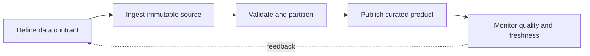

> **Level 3: Advanced** · Topic 19 of 40

[← ETL Development](./18-etl-development.md) · [↑ Level index](../README.md) · [Pandas →](./20-pandas.md)

# Data Engineering

## Overview
- **What is it?** Data engineering builds reliable systems that model, partition, transport, store, and serve data under explicit quality and freshness contracts.
- **Why is it important?** Good design treats schemas, lineage, replay, observability, and late-arriving data as first-class operational concerns.
- **Where is it used?** It supports analytics platforms, event streams, lakehouses, feature stores, and regulatory reporting.

## Learning Objectives
- Choose schemas, partitions, and file layouts from query and update patterns.
- Design batch and streaming jobs for replay, deduplication, and late data.
- Define data quality, lineage, freshness, and ownership signals.

## Real World Applications
- Partitioned analytical datasets consumed by dashboards and models.
- Event ingestion with deduplication and event-time windows.
- Curated data products with discoverable owners and service-level objectives.

## Core Concepts

### Schema as a Contract
- **Definition:** A schema defines names, types, nullability, keys, and evolution rules shared by producers and consumers.
- **Visual explanation:** `producer record → schema validation/version → compatible consumers`
- **Practical example:**

```python
from dataclasses import dataclass
from datetime import datetime

@dataclass(frozen=True)
class Event:
    event_id: str
    occurred_at: datetime
    customer_id: str
```

### Partitioning and Layout
- **Definition:** Partition keys prune reads but also control file counts and skew; choose low-to-moderate cardinality fields aligned with common filters.
- **Visual explanation:** `records → partition key → bounded files → query pruning`
- **Practical example:**

```python
from collections import defaultdict

def partition_by_date(events):
    partitions = defaultdict(list)
    for event in events:
        partitions[event.occurred_at.date().isoformat()].append(event)
    return partitions
```

### Replay and Event Time
- **Definition:** Replayable pipelines retain immutable inputs, deduplicate by stable IDs, and separate event time from processing time to handle delayed records.
- **Visual explanation:** `immutable log → dedupe → event-time window → materialized result`
- **Practical example:**

```python
def deduplicate(events: list[Event]) -> list[Event]:
    latest: dict[str, Event] = {}
    for event in events:
        latest[event.event_id] = event
    return sorted(latest.values(), key=lambda event: event.occurred_at)
```

## Infographic Summary

| Infographic Block | Topic-specific takeaway |
| --- | --- |
| 📌 Concept | Data engineering builds reliable systems that model, partition, transport, store, and serve data under explicit quality and freshness contracts. |
| ⚡ Purpose | Good design treats schemas, lineage, replay, observability, and late-arriving data as first-class operational concerns. |
| 🔥 Benefits | Builds the ability to choose schemas, partitions, and file layouts from query and update patterns; it also helps practitioners design batch and streaming jobs for replay, deduplication, and late data. |
| 🎯 Use Cases | Partitioned analytical datasets consumed by dashboards and models. Event ingestion with deduplication and event-time windows. |
| 🚀 Best Practices | Quality contracts cover freshness, completeness, uniqueness, and validity. |
| ❌ Common Mistakes | Ignoring the guardrail “Every dataset needs lineage, an owner, and documented retention”. |

## Syntax Guide

### Basic Syntax

```python
from datetime import UTC, datetime

observed_at = datetime.now(UTC)
partition = observed_at.strftime("date=%Y-%m-%d")
```

### Standard Structure

```python
def quality_report(rows: list[dict]) -> dict[str, int]:
    identifiers = [row.get("id") for row in rows]
    return {
        "rows": len(rows),
        "missing_id": identifiers.count(None),
        "duplicate_id": len(identifiers) - len(set(identifiers)),
    }
```

### Code Pattern

```python
from hashlib import sha256
import json

def record_key(record: dict[str, object]) -> str:
    canonical = json.dumps(record, sort_keys=True, default=str)
    return sha256(canonical.encode()).hexdigest()
```

## Examples

### Beginner Example

```python
def quality_report(rows: list[dict]) -> dict[str, int]:
    identifiers = [row.get("id") for row in rows]
    return {
        "rows": len(rows),
        "missing_id": identifiers.count(None),
        "duplicate_id": len(identifiers) - len(set(identifiers)),
    }

rows = [{"id": "1"}, {"id": "2"}, {"id": "2"}, {}]
print(quality_report(rows))
```

### Intermediate Example

```python
from collections import defaultdict
from dataclasses import dataclass
from datetime import UTC, datetime

@dataclass(frozen=True)
class Event:
    event_id: str
    occurred_at: datetime
    customer_id: str

def partition_by_date(events):
    partitions = defaultdict(list)
    for event in events:
        partitions[event.occurred_at.date().isoformat()].append(event)
    return partitions

events = [
    Event("e2", datetime(2026, 1, 2, tzinfo=UTC), "c1"),
    Event("e1", datetime(2026, 1, 1, tzinfo=UTC), "c1"),
]
print(partition_by_date(events).keys())
```

### Advanced Example

```python
from dataclasses import dataclass
from datetime import datetime, timedelta

@dataclass
class Watermark:
    maximum_event_time: datetime
    allowed_lateness: timedelta

    def accepts(self, event_time: datetime) -> bool:
        return event_time >= self.maximum_event_time - self.allowed_lateness

    def observe(self, event_time: datetime) -> None:
        self.maximum_event_time = max(self.maximum_event_time, event_time)
```

## Workflow Diagram



---

[← ETL Development](./18-etl-development.md) · [↑ Level index](../README.md) · [Pandas →](./20-pandas.md)
