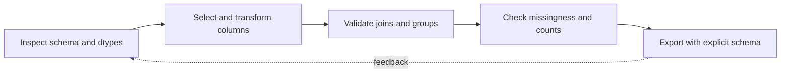

> **Level 3: Advanced** · Topic 20 of 40

[← Data Engineering](./19-data-engineering.md) · [↑ Level index](../README.md) · [NumPy →](./21-numpy.md)

# Pandas

## Overview
- **What is it?** pandas provides labeled tabular data structures and vectorized operations for cleaning, joining, reshaping, aggregating, and analyzing in-memory datasets.
- **Why is it important?** Advanced use requires explicit dtypes, index semantics, missing-value rules, join cardinality, and avoidance of chained assignment.
- **Where is it used?** It is used for analytics, feature preparation, reconciliation, time-series work, and medium-scale ETL.

## Learning Objectives
- Select columns and rows with explicit `.loc` and dtype-aware operations.
- Validate merge cardinality and aggregation assumptions.
- Build method-chained transformations with predictable missing-data behavior.

## Real World Applications
- Reconciling orders against customer and payment tables.
- Computing grouped metrics and time-window summaries.
- Preparing validated datasets before database or model ingestion.

## Core Concepts

### Labels, Dtypes, and Missingness
- **Definition:** A DataFrame aligns operations by labels and stores each column with a dtype whose missing-value semantics affect comparison and arithmetic.
- **Visual explanation:** `column labels + dtype + index alignment → vectorized result`
- **Practical example:**

```python
import pandas as pd

frame = pd.DataFrame({"customer": ["A", "B"], "units": [2, None]})
frame["units"] = frame["units"].astype("Int64")
frame["known"] = frame["units"].notna()
```

### Vectorized Transformation
- **Definition:** Vectorized column expressions delegate loops to optimized array operations and preserve declarative intent better than row-wise Python iteration.
- **Visual explanation:** `columns → boolean/arithmetic expression → aligned output column`
- **Practical example:**

```python
import pandas as pd

orders = pd.DataFrame({"quantity": [2, 3], "price": [4.5, 2.0]})
orders = orders.assign(total=lambda table: table["quantity"] * table["price"])
```

### Relational Integrity
- **Definition:** `merge(validate=...)` asserts expected key cardinality, while indicators expose unmatched rows that would otherwise silently distort metrics.
- **Visual explanation:** `left keys + right keys → validated join → matched/unmatched audit`
- **Practical example:**

```python
import pandas as pd

orders = pd.DataFrame({"customer_id": [1, 2], "total": [10, 20]})
customers = pd.DataFrame({"customer_id": [1, 2], "name": ["Ada", "Lin"]})
result = orders.merge(customers, on="customer_id", validate="many_to_one")
```

## Infographic Summary

| Infographic Block | Topic-specific takeaway |
| --- | --- |
| 📌 Concept | pandas provides labeled tabular data structures and vectorized operations for cleaning, joining, reshaping, aggregating, and analyzing in-memory datasets. |
| ⚡ Purpose | Advanced use requires explicit dtypes, index semantics, missing-value rules, join cardinality, and avoidance of chained assignment. |
| 🔥 Benefits | Builds the ability to select columns and rows with explicit `.loc` and dtype-aware operations; it also helps practitioners validate merge cardinality and aggregation assumptions. |
| 🎯 Use Cases | Reconciling orders against customer and payment tables. Computing grouped metrics and time-window summaries. |
| 🚀 Best Practices | `merge(validate=...)` turns join assumptions into checks. |
| ❌ Common Mistakes | Ignoring the guardrail “Avoid chained assignment; assign through `.loc` or return a new frame”. |

## Syntax Guide

### Basic Syntax

```python
import pandas as pd

frame = pd.DataFrame({"name": ["Ada", "Lin"], "score": [91, 84]})
passing = frame.loc[frame["score"].ge(90), ["name", "score"]]
```

### Standard Structure

```python
summary = (
    frame.assign(band=lambda table: table["score"].floordiv(10))
    .groupby("band", as_index=False)
    .agg(students=("name", "count"), mean_score=("score", "mean"))
)
```

### Code Pattern

```python
def clean_orders(frame: "pd.DataFrame") -> "pd.DataFrame":
    required = {"order_id", "quantity", "price"}
    if missing := required.difference(frame.columns):
        raise ValueError(f"missing columns: {sorted(missing)}")
    return frame.assign(
        total=lambda table: table["quantity"].astype("Int64") * table["price"]
    )
```

## Examples

### Beginner Example

```python
import pandas as pd

frame = pd.DataFrame({"team": ["A", "A", "B"], "score": [8, 9, 7]})
print(frame.groupby("team")["score"].mean())
```

### Intermediate Example

```python
import pandas as pd

sales = pd.DataFrame({
    "date": pd.to_datetime(["2026-01-01", "2026-01-08"]),
    "amount": [100.0, 125.0],
})
weekly = sales.set_index("date").resample("7D")["amount"].sum()
print(weekly)
```

### Advanced Example

```python
import pandas as pd

facts = pd.DataFrame({"customer_id": [1, 3], "amount": [10, 20]})
dimensions = pd.DataFrame({"customer_id": [1, 2], "segment": ["A", "B"]})
audit = facts.merge(
    dimensions,
    on="customer_id",
    how="left",
    validate="many_to_one",
    indicator=True,
)
unmatched = audit.loc[audit["_merge"].eq("left_only"), "customer_id"]
assert unmatched.tolist() == [3]
```

## Workflow Diagram



---

[← Data Engineering](./19-data-engineering.md) · [↑ Level index](../README.md) · [NumPy →](./21-numpy.md)
