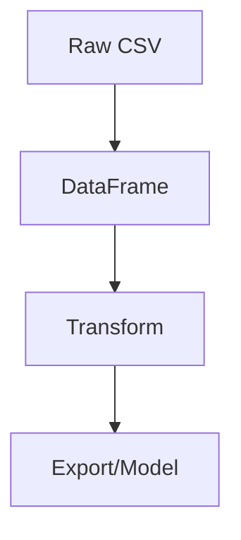

# Pandas

## Overview

- **What is it?** Pandas is a library for tabular data manipulation via DataFrame and Series objects.
- **Why is it important?** It is the standard tool for data cleaning, exploration, and feature engineering.
- **Where is it used?** Analytics, finance, marketing, ML feature pipelines, reporting.

## Learning Objectives

- **Skills gained:** Practical command of Pandas.
- **Concepts covered:**

- Load and inspect datasets.
- Filter, group, merge, and pivot.
- Handle missing data.

- **Expected outcome:** You transform raw data into analysis-ready tables.

## Real World Applications

- Data science
- BI
- Quant research
- Ops analytics

- **Business applications:** Automate workflows, reduce manual errors, accelerate delivery.
- **Career relevance:** Required knowledge for Python roles from junior developer to senior engineer.

## Core Concepts

### DataFrame

- **Definition:** 2D labeled table.
- **Visual explanation:** `DataFrame` → process → result
- **Practical example:**

```python
import pandas as pd
df = pd.DataFrame({'a': [1, 2]})
print(df.shape)
```

### Series

- **Definition:** 1D labeled array.
- **Visual explanation:** `Series` → process → result
- **Practical example:**

```python
import pandas as pd
s = pd.Series([1, 2, 3])
print(s.mean())
```

### GroupBy

- **Definition:** Split-apply-combine aggregations.
- **Visual explanation:** `GroupBy` → process → result
- **Practical example:**

```python
import pandas as pd
df = pd.DataFrame({'g': ['x', 'x'], 'v': [1, 2]})
print(df.groupby('g')['v'].sum().to_dict())
```

## Infographic Summary

| Block | Summary |
| --- | --- |
| 📌 Concept | DataFrame = rows + columns + indexes. |
| ⚡ Purpose | Efficient structured data operations. |
| 🔥 Benefits | Expressive API, integrates with NumPy/plotting/ML. |
| 🎯 Use Cases | ETL, dashboards, ad hoc analysis, feature stores. |
| 🚀 Best Practices | Avoid chained indexing; vectorize; profile memory. |
| ❌ Common Mistakes | iterrows on large data, ignoring dtypes, unnecessary copies. |

## Syntax Guide

### Basic Syntax

```python
import pandas as pd
df = pd.DataFrame({'a': [1, 2], 'b': [3, 4]})
```

### Standard Structure

```python
load -> clean -> transform -> aggregate -> export
```

### Code Pattern

```python
import pandas as pd
df = pd.DataFrame({'g': ['a'], 'v': [1]})
print(df.groupby('g')['v'].sum())
```

## Examples

### Beginner Example

```python
import pandas as pd
df = pd.DataFrame({'price': [10, 20]})
print(df['price'].sum())
```

### Intermediate Example

```python
import pandas as pd

df = pd.DataFrame({'region': ['US', 'US', 'EU'], 'revenue': [100, 150, 80]})
summary = df.groupby('region')['revenue'].sum().sort_values(ascending=False)
print(summary.to_dict())
```

### Advanced Example

```python
import pandas as pd

def active_sku_counts(chunks):
    parts = []
    for chunk in chunks:
        parts.append(chunk[chunk['status'] == 'active'].groupby('sku').size())
    return pd.concat(parts).groupby(level=0).sum()


chunks = [pd.DataFrame({'sku': ['A', 'A'], 'status': ['active', 'inactive']})]
print(active_sku_counts(chunks).to_dict())
```

## Workflow Diagram



---
