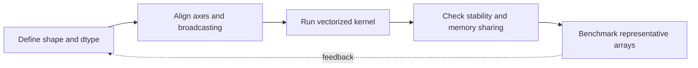

> **Level 3: Advanced** · Topic 21 of 40

[← Pandas](./20-pandas.md) · [↑ Level index](../README.md) · [PySpark →](./22-pyspark.md)

# NumPy

## Overview
- **What is it?** NumPy arrays store homogeneous values in strided memory and execute vectorized numerical kernels without Python-level loops.
- **Why is it important?** Shape, dtype, broadcasting, views, memory order, and numerical stability determine both correctness and performance.
- **Where is it used?** NumPy underpins scientific computing, image processing, simulation, and most Python machine-learning libraries.

## Learning Objectives
- Reason about shape, axes, dtype, strides, views, and copies.
- Use broadcasting and vectorized reductions correctly.
- Apply stable numerical comparisons and avoid accidental temporary arrays.

## Real World Applications
- Vector and matrix computation, simulation, signals, and image tensors.
- Compact feature preparation for scientific and machine-learning workloads.
- Interchange of contiguous numerical buffers with compiled libraries.

## Core Concepts

### Shape, Dtype, and Strides
- **Definition:** An ndarray combines a data buffer with shape, dtype, and byte strides that map indices to memory locations.
- **Visual explanation:** `index tuple × strides + base pointer → typed element`
- **Practical example:**

```python
import numpy as np

matrix = np.arange(12, dtype=np.float64).reshape(3, 4)
print(matrix.shape, matrix.dtype, matrix.strides)
```

### Broadcasting
- **Definition:** Broadcasting compares dimensions from the right and virtually expands size-one axes without copying data.
- **Visual explanation:** `(rows, columns) + (columns,) → aligned virtual expansion`
- **Practical example:**

```python
import numpy as np

samples = np.array([[1.0, 2.0], [3.0, 4.0]])
means = samples.mean(axis=0)
centered = samples - means
```

### Views and Numerical Stability
- **Definition:** Basic slicing usually returns a view that shares memory; stable algorithms avoid overflow, cancellation, and exact floating-point equality.
- **Visual explanation:** `slice → shared buffer; stable transform → bounded numeric error`
- **Practical example:**

```python
import numpy as np

values = np.arange(6.0)
view = values[::2]
view += 10
assert np.shares_memory(values, view)
assert np.allclose(values[::2], [10, 12, 14])
```

## Infographic Summary

| Infographic Block | Topic-specific takeaway |
| --- | --- |
| 📌 Concept | NumPy arrays store homogeneous values in strided memory and execute vectorized numerical kernels without Python-level loops. |
| ⚡ Purpose | Shape, dtype, broadcasting, views, memory order, and numerical stability determine both correctness and performance. |
| 🔥 Benefits | Builds the ability to reason about shape, axes, dtype, strides, views, and copies; it also helps practitioners use broadcasting and vectorized reductions correctly. |
| 🎯 Use Cases | Vector and matrix computation, simulation, signals, and image tensors. Compact feature preparation for scientific and machine-learning workloads. |
| 🚀 Best Practices | Use `allclose`, not exact equality, for computed floats. |
| ❌ Common Mistakes | Ignoring the guardrail “Profile allocations when chained expressions create large temporaries”. |

## Syntax Guide

### Basic Syntax

```python
import numpy as np

values = np.array([1, 2, 3], dtype=np.float64)
doubled = values * 2
```

### Standard Structure

```python
matrix = np.arange(12).reshape(3, 4)
column_totals = matrix.sum(axis=0)
row_means = matrix.mean(axis=1)
```

### Code Pattern

```python
def standardize(values: "np.ndarray") -> "np.ndarray":
    means = values.mean(axis=0, keepdims=True)
    deviations = values.std(axis=0, keepdims=True)
    return np.divide(
        values - means,
        deviations,
        out=np.zeros_like(values, dtype=float),
        where=deviations != 0,
    )
```

## Examples

### Beginner Example

```python
import numpy as np

values = np.array([3, 7, 2, 9])
selected = values[values >= 7]
print(selected)
```

### Intermediate Example

```python
import numpy as np

points = np.array([[0.0, 0.0], [3.0, 4.0], [6.0, 8.0]])
distances = np.linalg.norm(points - points[0], axis=1)
assert np.allclose(distances, [0.0, 5.0, 10.0])
```

### Advanced Example

```python
import numpy as np

rng = np.random.default_rng(42)
samples = rng.normal(size=(10_000, 3))
covariance = np.cov(samples, rowvar=False)
eigenvalues, eigenvectors = np.linalg.eigh(covariance)
principal_axis = eigenvectors[:, np.argmax(eigenvalues)]
assert principal_axis.shape == (3,)
```

## Workflow Diagram



---

[← Pandas](./20-pandas.md) · [↑ Level index](../README.md) · [PySpark →](./22-pyspark.md)
