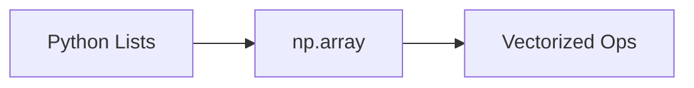

# NumPy

## Overview

- **What is it?** NumPy provides fast n-dimensional arrays and vectorized numerical operations.
- **Why is it important?** Vectorization underpins scientific Python and ML performance.
- **Where is it used?** ML preprocessing, simulations, image arrays, linear algebra.

## Learning Objectives

- **Skills gained:** Practical command of NumPy.
- **Concepts covered:**

- Create and slice ndarrays.
- Apply ufuncs and broadcasting.
- Use linear algebra routines.

- **Expected outcome:** You perform numeric computation efficiently with NumPy.

## Real World Applications

- ML research
- Quant
- Engineering sims
- Medical imaging

- **Business applications:** Automate workflows, reduce manual errors, accelerate delivery.
- **Career relevance:** Required knowledge for Python roles from junior developer to senior engineer.

## Core Concepts

### ndarray

- **Definition:** Homogeneous n-D array.
- **Visual explanation:** `ndarray` → process → result
- **Practical example:**

```python
import numpy as np
a = np.array([1, 2, 3])
print(a.dtype)
```

### vectorization

- **Definition:** Ops without Python loops.
- **Visual explanation:** `vectorization` → process → result
- **Practical example:**

```python
import numpy as np
print(np.array([1, 2]) + 10)
```

### broadcasting

- **Definition:** Align shapes for ops.
- **Visual explanation:** `broadcasting` → process → result
- **Practical example:**

```python
import numpy as np
print(np.array([[1], [2]]) + np.array([10, 20]))
```

## Infographic Summary

| Block | Summary |
| --- | --- |
| 📌 Concept | NumPy pushes loops into optimized C. |
| ⚡ Purpose | Fast numerical kernels in Python. |
| 🔥 Benefits | Speed, interop with ML stack, rich math API. |
| 🎯 Use Cases | Feature matrices, FFT, random sampling, grids. |
| 🚀 Best Practices | Avoid Python loops on large arrays; choose dtype consciously. |
| ❌ Common Mistakes | Excessive memory from float64 defaults, mixing lists and arrays. |

## Syntax Guide

### Basic Syntax

```python
import numpy as np
a = np.arange(6).reshape(2, 3)
```

### Standard Structure

```python
create array -> vectorized ops -> aggregate
```

### Code Pattern

```python
result = np.where(mask, a, b)
```

## Examples

### Beginner Example

```python
import numpy as np
print(np.mean([1, 2, 3, 4]))
```

### Intermediate Example

```python
import numpy as np
a = np.random.default_rng(0).normal(size=1000)
print(round(a.mean(), 3))
```

### Advanced Example

```python
import numpy as np

A = np.array([[1.0, 2.0], [3.0, 4.0]])
b = np.array([1.0, 2.0])
print(np.linalg.solve(A, b))
```

## Workflow Diagram



---
