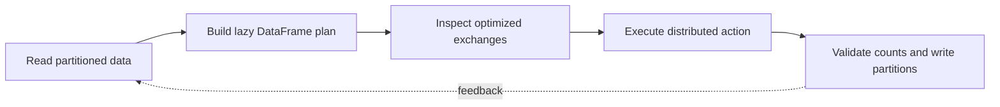

> **Level 3: Advanced** · Topic 22 of 40

[← NumPy](./21-numpy.md) · [↑ Level index](../README.md) · [Machine Learning →](./23-machine-learning.md)

# PySpark

## Overview
- **What is it?** PySpark exposes Apache Spark's distributed DataFrame and SQL engine from Python for partitioned, fault-tolerant data processing.
- **Why is it important?** Spark builds lazy logical plans, optimizes them, and executes stages across workers; shuffles, skew, serialization, and partition size dominate performance.
- **Where is it used?** It is used for lakehouse ETL, large aggregations, feature pipelines, and distributed batch or streaming analytics.

## Learning Objectives
- Construct SparkSession and DataFrame transformations with explicit schemas.
- Read execution plans and identify narrow operations, shuffles, and skew.
- Use built-in SQL functions before Python UDFs and validate distributed outputs.

## Real World Applications
- Joining and aggregating datasets larger than one machine's memory.
- Processing partitioned Parquet tables in data lakes.
- Building restartable batch and Structured Streaming pipelines.

## Core Concepts

### Lazy DataFrame Plans
- **Definition:** Transformations build an immutable logical plan; an action triggers optimization, stage construction, and distributed execution.
- **Visual explanation:** `DataFrame transformations → optimized plan → stages/tasks → action result`
- **Practical example:**

```python
from pyspark.sql import SparkSession, functions as F

spark = SparkSession.builder.appName("lesson").getOrCreate()
events = spark.createDataFrame([("A", 2), ("B", 3)], ["key", "value"])
plan = events.where(F.col("value") > 1).groupBy("key").sum("value")
plan.explain()
```

### Partitions and Shuffles
- **Definition:** Partitions are units of parallel work; joins and aggregations often redistribute records by key, creating expensive network and disk shuffles.
- **Visual explanation:** `input partitions → exchange by key → reduce partitions`
- **Practical example:**

```python
from pyspark.sql import functions as F

totals = (
    events.repartition("key")
    .groupBy("key")
    .agg(F.sum("value").alias("total"))
)
```

### Schema and Built-in Expressions
- **Definition:** Explicit schemas avoid inference surprises, and Spark SQL expressions stay in the optimized JVM plan unlike ordinary Python-row UDF execution.
- **Visual explanation:** `typed columns → Catalyst expressions → optimized physical operators`
- **Practical example:**

```python
from pyspark.sql import Row, functions as F, types as T

schema = T.StructType([
    T.StructField("id", T.StringType(), False),
    T.StructField("amount", T.DoubleType(), False),
])
frame = spark.createDataFrame([Row(id="A", amount=4.5)], schema)
normalized = frame.withColumn("amount_cents", F.round(F.col("amount") * 100))
```

## Infographic Summary

| Infographic Block | Topic-specific takeaway |
| --- | --- |
| 📌 Concept | PySpark exposes Apache Spark's distributed DataFrame and SQL engine from Python for partitioned, fault-tolerant data processing. |
| ⚡ Purpose | Spark builds lazy logical plans, optimizes them, and executes stages across workers; shuffles, skew, serialization, and partition size dominate performance. |
| 🔥 Benefits | Builds the ability to construct SparkSession and DataFrame transformations with explicit schemas; it also helps practitioners read execution plans and identify narrow operations, shuffles, and skew. |
| 🎯 Use Cases | Joining and aggregating datasets larger than one machine's memory. Processing partitioned Parquet tables in data lakes. |
| 🚀 Best Practices | Use Parquet projection and predicate pushdown. |
| ❌ Common Mistakes | Ignoring the guardrail “Inspect plans and skew before adding clusters or caching everything”. |

## Syntax Guide

### Basic Syntax

```python
from pyspark.sql import SparkSession

spark = SparkSession.builder.appName("analytics").getOrCreate()
frame = spark.read.parquet("s3://bucket/events/")
```

### Standard Structure

```python
from pyspark.sql import functions as F

daily = (
    frame.where(F.col("status") == "complete")
    .groupBy(F.to_date("created_at").alias("date"))
    .agg(F.count("*").alias("orders"))
)
```

### Code Pattern

```python
def validate_unique(frame, key: str) -> None:
    from pyspark.sql import functions as F

    duplicate = frame.groupBy(key).count().where(F.col("count") > 1).limit(1)
    if duplicate.count():
        raise ValueError(f"duplicate key: {key}")
```

## Examples

### Beginner Example

```python
from pyspark.sql import SparkSession

spark = SparkSession.builder.master("local[*]").appName("example").getOrCreate()
numbers = spark.range(5)
numbers.show()
```

### Intermediate Example

```python
from pyspark.sql import functions as F

orders = spark.createDataFrame(
    [("A", 10.0), ("A", 15.0), ("B", 7.0)],
    ["customer", "amount"],
)
summary = orders.groupBy("customer").agg(F.sum("amount").alias("total"))
summary.orderBy(F.desc("total")).show()
```

### Advanced Example

```python
from pyspark.sql import functions as F

customers = spark.createDataFrame([("A", "gold"), ("B", "silver")], ["customer", "tier"])
enriched = (
    orders.join(F.broadcast(customers), "customer", "left")
    .withColumn("event_date", F.current_date())
    .select("event_date", "customer", "tier", "amount")
)
(
    enriched.write.mode("overwrite")
    .partitionBy("event_date")
    .parquet("/tmp/enriched-orders")
)
```

## Workflow Diagram



---

[← NumPy](./21-numpy.md) · [↑ Level index](../README.md) · [Machine Learning →](./23-machine-learning.md)
