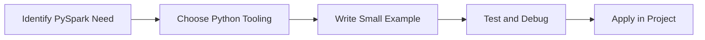

> **Level 3: Advanced** · Topic 22 of 40

[← NumPy](./21-numpy.md) · [↑ Level index](../README.md) · [Machine Learning →](./23-machine-learning.md)

# PySpark

## Overview
- **What is it?** PySpark is a Python knowledge area focused on data engineering and analytics.
- **Why is it important?** Help developers apply data engineering and analytics techniques safely, clearly, and consistently.
- **Where is it used?** Pipelines, dashboards, feature engineering, and large-scale data platforms.

## Learning Objectives
- Gain the practical skill to explain, write, debug, and review pyspark code.
- Cover the vocabulary, syntax, workflow, edge cases, and professional habits behind pyspark.
- Expected outcome: you can use pyspark in a small project and recognize when it belongs in production code.

## Real World Applications
- **Industry use cases:** Pipelines, dashboards, feature engineering, and large-scale data platforms.
- **Business applications:** Reduce manual work, improve reliability, support reporting, automate decisions, and ship maintainable features.
- **Career relevance:** Supports Python developer, backend engineer, data engineer, AI engineer, DevOps engineer, QA automation, and cybersecurity automation roles.

## Core Concepts

### Dataset Representation
- **Definition:** The main idea that gives pyspark its structure and purpose inside a Python program.
- **Visual explanation:** `problem -> PySpark model -> clear code`
- **Practical example:**

```python
apply_pyspark_label = "PySpark"
print(apply_pyspark_label)
```

### Transformation Pipeline
- **Definition:** The ordered steps Python follows when pyspark code is created, executed, or integrated.
- **Visual explanation:** `input -> Python operation -> result -> feedback`
- **Practical example:**

```python
import pandas as pd

df = pd.DataFrame({"name": ["Ada", "Lin"], "score": [95, 98]})
print(df)
```

### Validation Signal
- **Definition:** The reliability habit that keeps pyspark understandable, testable, secure, and maintainable.
- **Visual explanation:** `working code -> validation -> production confidence`
- **Practical example:**

```python
import pandas as pd

df = pd.DataFrame({"team": ["A", "A", "B"], "sales": [10, 15, 7]})
print(df.groupby("team")["sales"].sum())
```

## Infographic Summary

| Infographic Block | Key Message |
| --- | --- |
| 📌 Concept | PySpark belongs to the data engineering and analytics part of Python mastery. |
| ⚡ Purpose | Help developers apply data engineering and analytics techniques safely, clearly, and consistently. |
| 🔥 Benefits | Stronger maintainability, better reliability, and more professional data engineering and analytics decisions. |
| 🎯 Use Cases | Pipelines, dashboards, feature engineering, and large-scale data platforms. |
| 🚀 Best Practices | Prefer readable names, small examples, explicit errors, tests, documentation, and version-aware choices. |
| ❌ Common Mistakes | Copying code without understanding it, ignoring edge cases, skipping validation, and mixing unrelated responsibilities. |

## Syntax Guide

### Basic Syntax

```python
import pandas as pd
df = pd.DataFrame({"value": [1, 2, 3]})
```

### Standard Structure

```python
def apply_pyspark(value):
    """Apply the PySpark concept to one value."""
    return value

result = apply_pyspark("practice")
print(result)
```

### Code Pattern

```python
# 1. Identify the PySpark problem
# 2. Apply the correct Python structure
# 3. Validate the result with tests or output
```

## Examples

### Beginner Example

```python
import pandas as pd

df = pd.DataFrame({"name": ["Ada", "Lin"], "score": [95, 98]})
print(df)
```

### Intermediate Example

```python
import pandas as pd

df = pd.DataFrame({"team": ["A", "A", "B"], "sales": [10, 15, 7]})
print(df.groupby("team")["sales"].sum())
```

### Advanced Example

```python
import pandas as pd

orders = pd.DataFrame({"user_id": [1, 2], "total": [50, 75]})
users = pd.DataFrame({"user_id": [1, 2], "name": ["Ada", "Lin"]})
print(orders.merge(users, on="user_id"))
```

## Workflow Diagram




---

---

[← NumPy](./21-numpy.md) · [↑ Level index](../README.md) · [Machine Learning →](./23-machine-learning.md)
