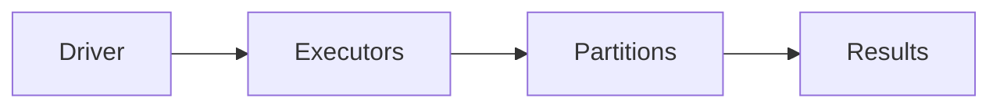

# PySpark

## Overview

- **What is it?** PySpark distributes data processing across clusters using Spark's resilient datasets and DataFrames.
- **Why is it important?** Single-machine pandas fails on terabyte-scale datasets.
- **Where is it used?** Lakehouse ETL, log analytics, ML feature generation at scale.

## Learning Objectives

- **Skills gained:** Practical command of PySpark.
- **Concepts covered:**

- Understand RDD vs DataFrame API.
- Apply transforms lazily and actions.
- Tune partitions and shuffles.

- **Expected outcome:** You author distributed batch jobs with PySpark patterns.

## Real World Applications

- Big data platforms
- Ad tech
- Telecom
- Finance risk

- **Business applications:** Automate workflows, reduce manual errors, accelerate delivery.
- **Career relevance:** Required knowledge for Python roles from junior developer to senior engineer.

## Core Concepts

### SparkSession

- **Definition:** Entry point to Spark.
- **Visual explanation:** `SparkSession` → process → result
- **Practical example:**

```python
print('SparkSession'[:5])
```

### DataFrame

- **Definition:** Distributed table API.
- **Visual explanation:** `DataFrame` → process → result
- **Practical example:**

```python
rows = [{'id': 1}, {'id': 2}]
print(len(rows))
```

### lazy eval

- **Definition:** Transformations build plan.
- **Visual explanation:** `lazy eval` → process → result
- **Practical example:**

```python
plan = ['read', 'filter', 'groupBy']
print(plan[-1])
```

## Infographic Summary

| Block | Summary |
| --- | --- |
| 📌 Concept | Spark executes DAGs in parallel across executors. |
| ⚡ Purpose | Scale Python data processing horizontally. |
| 🔥 Benefits | Fault tolerance, SQL interface, ecosystem integration. |
| 🎯 Use Cases | Nightly aggregates, log parsing, large joins. |
| 🚀 Best Practices | Avoid collect on big data; cache hot datasets; control skew. |
| ❌ Common Mistakes | Too many shuffles, tiny files, UDFs everywhere instead of built-ins. |

## Syntax Guide

### Basic Syntax

```python
df = spark.read.parquet('s3://bucket/path')
```

### Standard Structure

```python
read -> transform -> cache/persist -> action
```

### Code Pattern

```python
steps = ['read', 'filter', 'groupBy', 'write']
print('->'.join(steps))
```

## Examples

### Beginner Example

```python
records = [{'country': 'US', 'v': 1}, {'country': 'EU', 'v': 2}]
print(sum(r['v'] for r in records))
```

### Intermediate Example

```python
from collections import defaultdict

def group_sum(rows, key):
    totals = defaultdict(int)
    for row in rows:
        totals[row[key]] += row['value']
    return dict(totals)


data = [{'region': 'US', 'value': 10}, {'region': 'US', 'value': 5}]
print(group_sum(data, 'region'))
```

### Advanced Example

```python
def explain_plan(steps):
    return ' -> '.join(steps)


print(explain_plan(['scan', 'filter', 'project', 'aggregate']))
```

## Workflow Diagram



---
